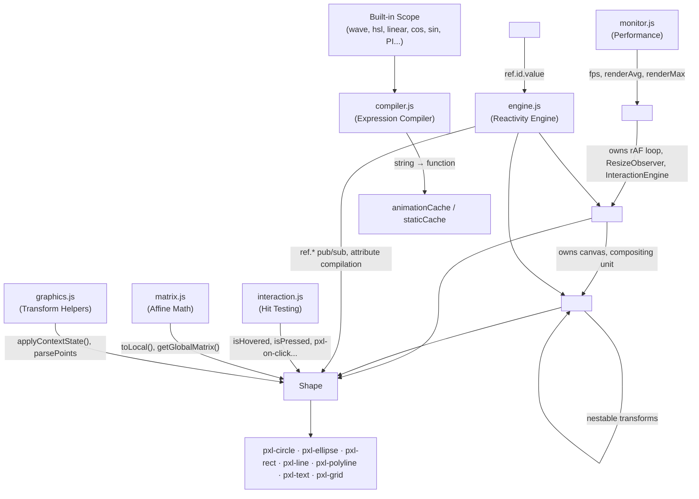

# Kilopixel Framework — Complete Technical Reference

> **Version**: 0.1.0 | **Status**: Pre-release (API may change, no backwards compatibility) | **Total Source**: ~70KB minified | **Zero Dependencies** | **Zero Build Step for Users**

Kilopixel is a **declarative, reactive animation engine for HTML5 Canvas** built on Web Components. Users describe canvas scenes with custom HTML elements (`<pxl-stage>`, `<pxl-layer>`, `<pxl-circle>`, …); the engine compiles their attribute expressions and redraws a layer in every frame in which something in it changed or is animated.

```html
<!-- Minimal working example -->
<script src="pxl.min.js"></script>
<pxl-stage id="main" ratio="16 / 9">
  <pxl-layer>
    <pxl-circle x="500" y="300" r="50" fill="red" rotate="t * 90"></pxl-circle>
  </pxl-layer>
</pxl-stage>
```

---

## Table of Contents

1. [Architecture Overview](#architecture-overview)
2. [Source Files](#source-files)
3. [Element Hierarchy & Inheritance](#element-hierarchy--inheritance)
4. [The Expression Compiler](#the-expression-compiler)
5. [The Reactivity Engine](#the-reactivity-engine)
6. [Coordinate System & Transform Pipeline](#coordinate-system--transform-pipeline)
7. [The Responsive Unit System](#the-responsive-unit-system)
8. [Color & Gradient System](#color--gradient-system)
9. [Arrowhead System](#arrowhead-system)
10. [Time Drivers](#time-drivers)
11. [Interaction System](#interaction-system)
12. [Matrix Engine & Coordinate Mapping](#matrix-engine--coordinate-mapping)
13. [Element Reference — Stage](#element-reference--stage)
14. [Element Reference — Layer](#element-reference--layer)
15. [Element Reference — Group](#element-reference--group)
16. [Element Reference — Shape (Base Class)](#element-reference--shape-base-class)
17. [Element Reference — Circle](#element-reference--circle)
18. [Element Reference — Ellipse](#element-reference--ellipse)
19. [Element Reference — Rect](#element-reference--rect)
20. [Element Reference — Line](#element-reference--line)
21. [Element Reference — Polyline](#element-reference--polyline)
22. [Element Reference — Text](#element-reference--text)
23. [Element Reference — Grid](#element-reference--grid)
24. [Element Reference — Variable](#element-reference--variable)
25. [Per-Frame Render Pipeline](#per-frame-render-pipeline)
26. [Performance Monitor](#performance-monitor)
27. [Build System](#build-system)
28. [AI Code Generation Guide](#ai-code-generation-guide)

---

## Architecture Overview



### Per-Frame Data Flow

```
Stage.requestRender() → requestAnimationFrame → Stage.render(t)
  ├─ pxl._frame++
  ├─ interaction.process()  → pointer broadcast, hit testing, hover states, DOM events and handlers (drawn in this frame)
  ├─ Sort layers and stage-level variables by DOM position (if dirty)
  ├─ For each stage-level <pxl-var>: update(t); if one is animated → stage.requestRender()
  ├─ Update phase, for each layer (if isDirty || isAnimated): layer.update(t)
  │   ├─ _wasDirty = isDirty, isDirty = false
  │   ├─ evaluateAnimations(t)  → update attributeValues, broadcast ref.*
  │   ├─ For each child (group/shape/variable): child.update(t)
  │   │   └─ evaluateAnimations(t)  → if animated: parentLayer.invalidate() (heartbeat: isDirty again, next rAF)
  │   └─ _keepAlive = isDirty
  ├─ Draw phase, for each layer where needsRender(): layer.render(u, t)
  │   ├─ ctx.clearRect(), isDirty = _keepAlive
  │   ├─ ctx.save() + applyTransformState(translate→rotate→scale→skew→offset)
  │   ├─ For each child: child.render(ctx, u, t)
  │   │   ├─ ctx.save() + applyContextState()
  │   │   ├─ shape.draw(ctx, u, t) → _buildPath + applyStyle
  │   │   └─ ctx.restore()
  │   ├─ ctx.restore()
  │   └─ Heartbeat: if the layer's own attributes are animated → stage.requestRender()
  └─ Performance metrics accumulation (published by pxl.perf's own 1-second timer, not here)
```

---

## Source Files

The framework compiles from these files (in build order):

| # | File | Purpose |
|---|------|---------|
| 1 | `js/engine.js` | Global `pxl` namespace, reactivity pub-sub, attribute compilation bridge |
| 2 | `js/matrix.js` | 2D affine matrices (Float64Array, written in place), `toLocal()` |
| 3 | `js/compiler.js` | Multi-tier expression parser, built-in scope, time drivers |
| 4 | `js/interaction.js` | InteractionEngine class, dummy context hit testing, DOM events on shapes and groups, `pxl-on-*` handlers, cursor |
| 5 | `js/graphics.js` | Transform pipeline helper, anchor tables, points parser, radius resolver, arrowhead constants & record factory, line dash helper |
| 6 | `js/monitor.js` | Performance telemetry (fps, renderAvg, renderMax) |
| 7 | `js/elements/stage.js` | Root container, canvas host, rAF loop, resize, pointer routing |
| 8 | `js/elements/node.js` | `PxlNode` base class (extends HTMLElement), matrix tracking |
| 9 | `js/elements/layer.js` | Compositing layer, own canvas, dirty-flag rendering |
| 10 | `js/elements/group.js` | Nestable transform container, draws into parent canvas |
| 11 | `js/elements/shape.js` | Base Shape class, style application, gradient creation, arrows |
| 12 | `js/elements/shapes/circle.js` | `<pxl-circle>` — arcs, pies, donuts, arrowheads |
| 13 | `js/elements/shapes/ellipse.js` | `<pxl-ellipse>` — elliptical arcs with independent radii |
| 14 | `js/elements/shapes/rect.js` | `<pxl-rect>` — per-corner radii, 9-position anchor |
| 15 | `js/elements/shapes/line.js` | `<pxl-line>` — simple line with arrowheads |
| 16 | `js/elements/shapes/polyline.js` | `<pxl-polyline>` — per-coordinate animation, Catmull-Rom smoothing, arrowheads |
| 17 | `js/elements/shapes/text.js` | `<pxl-text>` — 3-tier caching, word-wrap, reveal effect |
| 18 | `js/elements/shapes/grid.js` | `<pxl-grid>` — infinite viewport-clipped grid |
| 19 | `js/elements/variable.js` | `<pxl-var>` — reactive variable element |

---

## Element Hierarchy & Inheritance

```
HTMLElement
├── Stage (pxl-stage)           — the root, not a PxlNode
└── PxlNode (abstract base)
    ├── Layer (pxl-layer)       — extends PxlNode, owns <canvas>
    ├── Group (pxl-group)       — extends PxlNode, transform container
    ├── Variable (pxl-var)      — extends PxlNode, reactive variable
    └── Shape (abstract)        — extends PxlNode, drawing + styling
        ├── Circle (pxl-circle)
        ├── Ellipse (pxl-ellipse)
        ├── Rect (pxl-rect)
        ├── Line (pxl-line)
        ├── Polyline (pxl-polyline)
        ├── Text (pxl-text)
        └── Grid (pxl-grid)
```

### Namespace (Only `pxl` Is Global)

All classes live on the `pxl` namespace as class expressions, like every other engine object (`pxl.Matrix`, `pxl.InteractionEngine`):

```javascript
pxl.Line = class Line extends pxl.Shape {
  static defaults = { ...pxl.Shape.defaults, x1: 0, y1: 0, x2: 0, y2: 0 /* … */ };
  // …
};
customElements.define('pxl-line', pxl.Line);
```

- **Only `pxl` is global.** Engine code never declares top-level `class`, `const`, `let`, `var` or `function`: public parts go on `pxl.*`, internals on `pxl._*`. A top-level declaration would become a global name for every script on the page (user scripts with the same name fail with a SyntaxError; a global `Text` would hide the DOM's `Text`). `build.js` refuses to build if it finds one.
- **`class pxl.Line …` is not valid JavaScript** (a declaration needs a plain name); the class expression `pxl.Line = class Line …` keeps the readable name (`pxl.Line.name === 'Line'`) without a global.
- **Debugging:** type `pxl` in the console to browse all classes, engine functions and state (`pxl.nodes`, `pxl.perf`, …).
- **Custom shapes** extend `pxl.Shape` (`class Star extends pxl.Shape`), exactly like the built-in shapes.
- **Classic script, not an ES module:** Kilopixel's interface is HTML plus standard DOM, so there is nothing to `import`; a classic `<script>` in `<head>` upgrades elements during parsing and works without a build step and from `file://`. Design: `design/2026-10-17_bundle_scope_plan.md`.

### PxlNode (Base Class for Layer/Group/Shape/Variable)

**Source**: `js/elements/node.js`

Every PxlNode has:
- `static defaults` — read-only attribute defaults of the class, inherited by spreading (`static defaults = { ...pxl.Shape.defaults, r: 0, … }`). The `PxlNode` constructor copies them into `attributeExpressions` and `attributeValues`; `pxl.resolveEmptyAttribute` reads them for bare / removed attributes (see [Empty & Removed Attributes](#empty--removed-attributes))
- `attributeExpressions` — compiled functions or static values for each attribute
- `attributeValues` — current evaluated values (read by render loop)
- `animatedAttributeKeys[]` — attributes that depend on `t` (evaluated every frame)
- `reactiveAttributeKeys[]` — attributes that depend on `ref.*` variables (evaluated on change)
- `toLocalAttributeKeys[]` — reactive attributes using `toLocal()`, also re-evaluated when an ancestor's transform changes (see [Coordinate Mapping](#coordinate-mapping-tolocal))
- `isAnimated` — true if any attribute uses time-dependent expressions
- `_localMatrix` / `_globalMatrix` — Float64Array affine matrices, recomputed lazily
- `parentLayer` — reference to closest `<pxl-layer>` ancestor
- `parentContainer` — reference to closest `<pxl-group>` or `<pxl-layer>` parent

**Key Methods**:
- `attributeChangedCallback(name, old, new)` — passes the value to `setValue()`; `pxl-on-*` handlers go to `setHandler()`. `id` is observed too, but not compiled: once the element is registered (`isRegistered`, set at the end of `connectedCallback()`), an `id` that is set, changed or removed moves its entry in `pxl.nodes` (`pxl.renameNode()`: the old entry is deleted if it points to this element, `refKey` follows, both names are broadcast, so readers of the old name read `undefined`). Frameworks such as Angular and Alpine set `id` after insertion. During an upgrade the attributes arrive before `connectedCallback()`, which registers the id itself. A shape whose new id is read for `isHovered` / `isPressed` registers for hit testing (`Shape.attributeChangedCallback()`)
- `setValue(name, value)` — the one path for attributes and properties ([Properties](#properties-javascript-and-frameworks)): a string or `null` through `pxl.compileAttribute()`, any other value stored as it is (`pxl.storeValue()`), the same parsed value again skipped, a function warned; then `valueChanged(name)`: animation state, local matrix dirty for transform keys, broadcast, invalidate the layer (`Variable` also asks the stage for a frame)
- `connectedCallback()` — first sets properties that were set before the upgrade (`_pendingProperties`), then finds parentLayer/parentContainer, registers child (once per connect, no `includes()` check), restores subscriptions, registers in `pxl.nodes` if has `id`, sets `isRegistered`
- `disconnectedCallback()` — clears `isRegistered`, removes from `pxl.nodes`, clears its own subscriptions, unregisters from parent
- `variableChangedCallback(varName)` — re-evaluates reactive attributes for a changed variable, unsubscribes if no longer needed
- `evaluateAnimations(t)` — iterates `animatedAttributeKeys`, calls expression functions with time, broadcasts ref changes if values changed, marks local matrix dirty on transform changes
- `getLocalMatrix()` / `getGlobalMatrix()` — lazy versioned matrix computation with parent chain walking

**The `attributeValues` Object**:
Has four hidden (non-enumerable) properties:
- `set(key, value)` — Kilopixel's setter for handlers (`pxl.setFromRef()`): a string goes to `setAttribute()` and is compiled like the attribute; any other value goes through the property (a number without compiling, an array stays an array). A name the element doesn't have warns once per element type and name. Used by imperative event handlers: `ref.myVar.set('value', 100)`
- `$node` — back-reference to the DOM element itself
- `tx` / `ty` — getters for the element's **drawn origin** in its parent space (the space of its own `x` / `y`): the local matrix translation, i.e. `x` / `y` plus the `dx` / `dy` offset turned by the element's own `rotate`, `zoom` / `scalex` / `scaley` and skew. Equal to `x + dx` / `y + dy` only without those. Same value as `toLocal(ref.el, 'tx' | 'ty')` for a reader in the same space

---

## The Expression Compiler

**Source**: `js/compiler.js`

### Compilation Pipeline

`pxl.parseAttributeValue()` checks the cheap cases first, so most attribute values never reach the compiler. In order:

1. **Hex colors** (`#ff0000`, `#fff`) → returned as they are
2. **Template literals** (`` `...` ``) → always compiled
3. **Words** (letters and spaces only, `/^[a-zA-Z\s]+$/`) → returned as a string (`"red"`, `"none"`, `"Hello World"`), except:
   - `"t"` → compiled as a time expression
   - `"true"` / `"false"` → boolean
   - names of `Math` constants (`"PI"`) → their number
   - static CSS colors → returned as a string, never compiled: `rgb(...)` / `rgba(...)` with numbers only; `hsl(...)` / `hsla(...)` with `%` on saturation and lightness (`hsl(200, 50%, 40%)`, also the space syntax; `pxl.CSS_HSL_REGEX`); the CSS color functions Kilopixel doesn't define, `hwb()`, `lab()`, `lch()`, `oklab()`, `oklch()`, `color()`, without nested parentheses (`pxl.CSS_COLOR_FUNCTION_REGEX`). Kilopixel's own `hsl(200, 50, 40)` (no `%`) is compiled. Compiling a color costs about 90 µs and takes a cache slot, which a color changed in every frame would pay each time (`design/2026-10-30_framework_compatibility_plan.md` §24)
4. **One quoted string** (`'Hello World'`) → the text between the quotes. Escapes aren't read: `'It\'s'` stays raw (write `It's` without quotes, or backticks); a written `\n` reaches the text shape, which breaks the line there (decided 2026-11-17, `design/2026-11-02_string_literals_in_expressions_plan.md` §7)
5. **Numbers** (`"100"`, `"-50"`, `"0.25"`) → `Number`
6. **Anything that looks like code** (a regex finds `t`, `ref.`, `toLocal(`, parentheses, brackets, operators next to numbers, or `+` next to a quote) → compiled
7. Anything else → returned as a string

### Expression Compilation (`compileExpression`)

1. **Cache lookup**: `staticCache` and `animationCache` (Maps keyed by the source string). Each keeps at most `pxl.COMPILE_CACHE_LIMIT` (2,000) entries; `pxl.cacheExpression()` drops the oldest when a new one comes (Maps keep insertion order). A framework that rebuilds an expression string on every render would otherwise grow them without end; elements keep their compiled functions, and a dropped string only compiles again
2. **Code and quoted text**: `pxl.splitStringLiterals()` splits the string once into code and string literals (`'…'`, `"…"`, the text of `` `…` ``; the code inside `${…}` counts as code). Steps 3–7 read and rewrite only the code, so words in quoted text stay text: `'Press return: ' + ref.score.value` keeps its automatic `return`, `` `ref.angle.value = ${ref.angle.value}` `` shows `ref.angle.value` as written, a lone `t` in text doesn't make the expression animated, and `ref.<id>` in text adds no dependency
3. **CSS percentages**: `50%` isn't valid JavaScript, so `hsl(120, 50%, 40%)` becomes `hsl(120, '50%', '40%')`. In code only: a quoted CSS color (`'hsla(280, 80%, 30%, 0.06)'` in a gradient's colors) stays as written
4. **Time dependency**: a regex finds `t` (not after a `.`) or a call of a time driver; `toLocal(` sets `usesToLocal`
5. **`pxl.rewriteExpression()`** (shared with `pxl-on-*` handlers, also code only): `ref.player.x` → `ref.player?.x` (no TypeError before the element connects), `toLocal(` → `pxl.toLocal(this, `
6. **Dependencies**: a regex collects every `ref.<id>`
7. **Return**: without the word `return` in the code, the code is wrapped in `return …;`

Then two branches:

**Animated or reactive** (uses time or `ref.*`):
```javascript
const fn = new Function('scope', 'ref', `
  const { PI, sin, cos, ... } = scope;
  let t;
  const _d = new Date();
  const loop = (d) => (t % d) / d;
  // ... the other time drivers
  return function(_t) {
    t = _t;
    return <user expression>;
  };
`)(pxl.scope, pxl.nodes);
```

The outer function runs once per distinct string and unpacks the scope; the returned function runs at every evaluation and receives only `_t`. Elements with the same string share the function.

Properties set on the function:
- `fn.isTimeDependent`: uses `t` or a time driver
- `fn.variableDependencies`: the `ref.<id>` keys (only when there are any)
- `fn.usesToLocal`: calls `toLocal()` (reader-side reactivity, see [Coordinate Mapping](#coordinate-mapping-tolocal))

**Static** (neither): evaluated once with `new Function`; the result is cached in `staticCache`.

**Errors**: a string that doesn't compile logs a warning and is used as a plain string (also cached).

**Content Security Policy**: every expression and `pxl-on-*` handler is compiled with `new Function`, so a page whose CSP doesn't allow `'unsafe-eval'` can't run Kilopixel.

### `Math` Without the Prefix

All `Math` constants and methods (`PI`, `cos`, `sin`, `abs`, `min`, `max`, `pow`, `round`, …) are in every expression's scope. Write `cos(t)`, not `Math.cos(t)`: both work (`Math` is a global), but docs and examples use the short form.

### Return Statements

An expression without the word `return` is wrapped in `return …;`, so two forms work:
- **Expressions**: `t > 10 ? 'red' : 'blue'`
- **Code blocks**: `if (t < 10) { return 'red'; } else { return 'blue'; }`

---

## The Reactivity Engine

**Source**: `js/engine.js`

### Core Architecture

- **`pxl.nodes`** — a flat `{}` registry mapping element `id` → `attributeValues` object. When any element with an `id` connects to the DOM, it registers: `pxl.nodes[myId] = this.attributeValues`
- **`pxl._subscriptions`** — a `{ fullKey: [element, element, ...] }` pub-sub map
- **`pxl._subscribedKeys`** — the other side: a `WeakMap` element → `Set` of its keys. `subscribeToVariable()` checks the set instead of scanning the subscriber list, and `clearAllVariableSubscriptions()` (on disconnect) removes the element only from its own keys. Scanning every key for every removed element was quadratic: 2,000 shapes with 2,000 readers took 622–732 ms to remove, now 4 ms (2026-11-16, `design/2026-10-30_framework_compatibility_plan.md` §20)
- **`pxl.broadcast(fullKey)`** — iterates subscribers backwards (safe for in-place removal), calling `element.variableChangedCallback(fullKey)`

### Attribute Classification (Three Tiers)

When `pxl.compileAttribute(element, name, value)` is called:

| Result Type | Storage | Evaluation |
|-------------|---------|------------|
| **Static** (number, string, boolean) | `attributeValues[name] = value` | Never re-evaluated |
| **Time-Dependent Function** (`fn.isTimeDependent = true`) | Added to `animatedAttributeKeys[]` | Every frame via `evaluateAnimations(t)` |
| **Reactive Function** (has `variableDependencies` but no time) | Added to `reactiveAttributeKeys[]` | Only when referenced variable broadcasts |

### Empty & Removed Attributes

A bare attribute (`<pxl-polyline closed>`, `el.hidden = true`, `toggleAttribute`) arrives as `''`, a removed one (`removeAttribute`, `el.hidden = false`, frameworks dropping `null` / `undefined` bindings) as `null`. `pxl.compileAttribute` resolves both **before** parsing via `pxl.resolveEmptyAttribute`:

| Incoming | Boolean attribute (`pxl.BOOLEAN_ATTRIBUTES`) | `<pxl-var>` `value` | Any other attribute |
|---|---|---|---|
| `''` (bare) | `true` (HTML presence rule) | `''` | class default |
| `null` (removed) | class default (`false`) | `0` | class default |

- Boolean attributes: `hidden`, `closed`, `smooth`, `pie`, `anticlockwise`, `labels`. Only bare, `"true"` and `"false"` are booleans: `closed="1"` is **not** `true`.
- The resolved value is static, so removing an animated or reactive attribute also stops its animation / subscription.
- Defaults that are `null` on purpose keep meaning "not set" (rect `r1`–`r4` fall back to `r`, circle `end` / `sweep` mean a full circle).
- Stage (not a `PxlNode`): bare `alwaysrender` = `true`; bare / removed `ratio` = `16 / 9`.
- Event handlers: see [Event Handling](#event-handling).
- Not handled: whitespace-only values (`" "` parses to `0`) and invalid values (`miterlimit="abc"`).
- Design: `design/2026-10-17_attribute_defaults_and_state_isolation_plan.md`.

### Properties (JavaScript and Frameworks)

For users: `docs/frameworks.html` (setup per framework and the TypeScript downloads, values, events, cursor, components, Tailwind, server rendering, known limits, a live event log).

Every observed attribute is also a JavaScript property (`design/2026-10-30_framework_compatibility_plan.md` §6, §24): `el.r = 50`, `el.x = '500 + sin(t) * 100'`, `el.r = undefined`. React 19, Vue, Preact and Svelte set a property when the element has one (`name in element`); Angular `[x]`, Lit `.x` and Solid `prop:x` always do.

- **Accessors** (`pxl.defineAccessors()`, `engine.js`): a getter / setter per observed attribute on the class prototype, defined the first time an instance of the class is created (`pxl._accessorClasses`), so custom shapes get them too. Not for hyphenated names (the `pxl-on-*` handlers stay attribute-only), and not for names the prototype already has: `id` and `hidden` stay native (`hidden` reflects to the attribute), as would an attribute named like another `HTMLElement` property or a class's own getter.
- **Getter:** the evaluated value, the same as `ref.<id>.<name>` (`el.x` of an animated `x` is its value in the last update).
- **Setter → `PxlNode.setValue(name, value)`**, the one path for attributes and properties (`attributeChangedCallback()` calls it too), then `valueChanged(name)` (animation state, matrix, broadcast, invalidate):

| Value | Stored |
|---|---|
| number, boolean, array, object (a gradient descriptor) | as it is (`pxl.storeValue()`): no parsing, no compiling, no cache entry. Arrays are kept by reference and never changed by the engine: assign a new array to change one |
| string | compiled like the attribute string (`el.x = 'sin(t) * 100'` animates; CSS colors stay text, see the parser above). Except `text`, below |
| `undefined` / `null` | the default, as a removed attribute (Rule A); `''` works like a bare attribute |
| a function | not supported (yet): warned once per element (`pxl.warnFunctionValue()`), the value stays |
| the same parsed value again | nothing happens: no broadcast, no redraw (frameworks and hydration set unchanged values again) |

- **No reflection:** a property doesn't write the attribute (as in Lit). Property and attribute: the last change wins; setting the attribute to the text it already has is no change, so a property set in between stays.
- **`text` is literal:** a string set as `el.text` is shown as it is, never compiled (`Text`'s own accessor). Frameworks bind data to it, and compiling data would run it as code (`alert(1)`) or fail on it (`Q1 - 2024`). Expressions stay available through the attribute. Every other string property is code like an attribute value: never pass untrusted strings to them (colors from data: `#hex`, `rgb()` and the CSS color functions stay text).
- **Values set before the upgrade** (a script loaded late, code splitting): such properties are own properties of the element that hide the accessors. The constructor reads `Object.keys(this)` before it adds any field and takes them out (`pxl.takeOwnProperties()`); `connectedCallback()` sets them again, after the attributes, so the framework's value wins over server HTML. An element upgraded without being connected (`customElements.upgrade()`) gets them when it is inserted.
- **Special properties:** `<pxl-polyline>` `points` ([Points Syntax](#points-syntax)); `<pxl-var>` `value` also asks for a frame; `<pxl-stage>` `ratio` and `alwaysrender` write the attribute (`reflectAttribute()`; `false`, `null`, `undefined` remove it).
- **`ref.<id>.set(name, value)`** (handlers): a string goes to `setAttribute()`, any other value through the property; an unknown name warns once per element type and name.
- **Cost** (`design/prototypes/2026-10-30_framework_compatibility/w3_property_costs.html`, headless with `gc()`): a number property about 0.5 µs per set with one reader, `setAttribute()` about 4–5 µs; a new `hsl(…, 50%, 50%)` string 0.7–1.3 µs (compiled before: about 90 µs); `text` 0.2–0.4 µs. Nothing per frame: the engine never calls the accessors while drawing.

### Variable Change Propagation

```
pxl.broadcast('ref.myVar')
  → for each subscriber element (backwards):
      → element.variableChangedCallback('ref.myVar')
        → pxl.evaluateAttributesForVariable(element, 'ref.myVar')
          → re-evaluate all reactive attributes that depend on 'ref.myVar'
          → returns bitmask: bit 1 = var still needed, bit 2 = values changed
        → if bit 1 is 0: unsubscribe (self-cleaning)
        → if bit 2 is 1: broadcast own ref key + invalidate layer
```

Propagation is recursive and depth first. Known limits, accepted for now (`design/2026-11-12_reactive_propagation_plan.md`):
- **Cycles:** a cycle that settles (`a = b`, `b = a`) keeps its values, and an attribute that reads another attribute of its own element (`shadowcolor="ref.orb.stroke"`) follows after one extra round. A cycle whose values keep changing (`a = b + 1`, `b = a + 1`) re-enters an element from inside that element's own broadcast. `variableChangedCallback()` counts that nesting (`_broadcastNesting`) and stops at `pxl.MAX_CYCLE_ROUNDS` (100) with a warning through `reportError()`. Chains, diamonds and elements with many inputs are entered one call after the other, so the count never grows for them. A cycle of n elements nests n × 100 calls, which stays below the stack limit up to about 200 elements.
- **Diamonds:** a reader reached on two paths is evaluated once per path, and its first evaluation can see one new and one old input. Only final values are drawn, so this costs a little time but is not visible.
- **Readers with `t`** don't subscribe: a self-reference with `t` reads its previous frame's value (the "follow" effect).

### The `ref.*` Namespace

All reactive references use a flat `ref.` prefix:
- `ref.myCircle.x` — reads `pxl.nodes['myCircle'].x` (the circle's current x value)
- `ref.main.mouseX` — reads the stage's mouse X coordinate
- `ref.speed.value` — reads a `<pxl-var id="speed">` element's value
- `ref.btn.isHovered` — reads a shape's hover state

The compiler rewrites `ref.player.x` to `ref.player?.x`, so a ref to an element that isn't connected yet reads `undefined` instead of throwing.

**IDs in camelCase:** an element read through `ref.*` needs an id that is a JavaScript name (`id="ex4Layer"`, `id="orbitSpeed"`). A hyphen is a minus sign in an expression: `ref.ex4-layer.x` reads as `ref.ex4 - layer.x` and throws.

---

## Coordinate System & Transform Pipeline

### Center and Offset

Every element (layer, group, shape) has the same coordinate model:

- **`x`, `y`**: the element's **center**, the point that rotation, scaling and skewing turn around. An offset moves the drawing, but `x` / `y` stays the transform origin.
- **`dx`, `dy`**: a **local offset**, applied *after* rotation, scaling and skewing. It moves where the shape is drawn without moving its center, so a rotating element with an offset orbits its center.

### Transform Order

Shapes go through `pxl.applyContextState()`, which calls `pxl.applyTransformState()` (steps 1–5, also used by layers, groups and hit testing) and then sets the compositing (steps 6–9):

```
1. ctx.translate(x * u, y * u)                     ← move to the center (transform origin)
2. ctx.rotate(rotate * π/180)                       ← rotate around it
3. ctx.scale(zoom * scalex, zoom * scaley)          ← scale around it
4. ctx.transform(1, tan(skewy), tan(skewx), 1, 0, 0) ← skew (angles in degrees)
5. ctx.translate(dx * u, dy * u)                    ← offset, after rotate / scale / skew
6. ctx.globalAlpha *= alpha                         ← opacity, multiplied
7. ctx.globalCompositeOperation = mask or blend     ← mask wins when both are set
8. ctx.filter                                       ← CSS filter, px values scaled by u
9. ctx.shadowColor / shadowBlur / shadowOffsetX / Y  ← only when shadowcolor is set
```

Each step is skipped when its values are the defaults.

**Zoom and Scale**: `scalex` / `scaley` are the two arguments of the canvas `ctx.scale(x, y)` (two attributes, because splitting one `scale="x, y"` expression at commas isn't safe). `zoom` is a uniform factor on top: it **multiplies** both axes (`zoom * scalex`, `zoom * scaley`), so `zoom="2" scalex="1.5"` draws at 3 / 2, and an animated `zoom` (a pulse, hover feedback) can be combined with a stretched shape. `zoom="-1"` turns the element by 180° (both axes negative). Design: `design/2026-10-29_tolocal_decomposition_plan.md` §5.

### Example: an Orbit

With the offset applied after the rotation, an orbit needs one element, no nested group and no trigonometry:

```html
<!-- Planet orbiting (500, 300) at 60° per second, orbit radius 200 -->
<pxl-circle x="500" y="300" dx="200" rotate="t * 60" r="20" fill="red"></pxl-circle>
```

### Shape Drawing Origin

After the transform steps, the context's origin is the shape's drawn position, so `draw()` works around `(0, 0)`: a circle draws `ctx.arc(0, 0, r * u, …)`.

---

### Compositing: Layers Use CSS, Shapes Use the Canvas

`alpha`, `blend` and `filter` mean the same on layers and shapes, but are applied in two different places:

- **Layers (`<pxl-layer>`):** set as CSS on the layer's `<canvas>` (`opacity`, `mix-blend-mode`, `filter`). The browser composites the finished canvas with the layers below and the page. Shapes in the layer don't inherit these values; they are drawn normally into the canvas.
- **Shapes:** set on the canvas context (`ctx.globalAlpha`, `ctx.globalCompositeOperation`, `ctx.filter`, shadows) while the shape draws, so they affect how its pixels combine with the shapes drawn before it in the same layer.
- **Groups (`<pxl-group>`)** only transform: they have no `alpha`, `blend`, `filter` or shadow. Use a layer, or set the values on the shapes.
- **Shadows** (`shadowcolor`, `shadowblur`, `shadowx`, `shadowy`) exist only on shapes. For one shadow of a whole layer's silhouette, use `filter="dropShadow(…)"` on the layer.

### `blend` and `mask`

On a shape, both set `ctx.globalCompositeOperation`; they are two attributes because they do different jobs and only one of them works on layers:
- **`blend`** (layers and shapes): color mixing (`screen`, `multiply`, `overlay`, `lighter`, …). On a layer it becomes CSS `mix-blend-mode`; the canvas name `lighter` (additive) is translated to CSS `plus-lighter`.
- **`mask`** (shapes only): alpha compositing and clipping (`destination-in`, `destination-out`, `source-atop`, …). CSS `mix-blend-mode` has no such modes, so layers don't have `mask`.

If a shape sets both, `mask` wins.

---

## The Responsive Unit System

- **Logical width**: always **1000**
- **Unit `u`**: `clientWidth / 1000`, the scale factor
- **Logical height**: `1000 / ratio` (`ref.<stageId>.height`)
- Lengths and positions (`x`, `y`, `dx`, `dy`, `r`, `w`, `h`, `strokewidth`, …) are multiplied by `u` when drawing
- **Pixel density**: each layer's canvas has `devicePixelRatio` pixels per CSS pixel; the stage's ResizeObserver updates it

So:
- `x="500"` is always the horizontal center
- `x="0"` is the left edge, `x="1000"` the right edge
- The same markup works at any stage size

Write fixed positions as numbers: `x="500"`, not `x="ref.main.width / 2"`. A number is parsed once and never evaluated again; the expression subscribes to the stage and is evaluated when it broadcasts.

---

## Color & Gradient System

### Color Functions

These are JavaScript functions in the expression scope, not CSS. They return strings:

```javascript
rgb(r, g, b)       → "rgb(r,g,b)"
rgba(r, g, b, a)   → "rgba(r,g,b,a)"
hsl(h, s, l)       → "hsl(h,s%,l%)"      // numbers get a '%'
hsla(h, s, l, a)   → "hsla(h,s%,l%,a)"
```

A call with variables (`hsl(t * 36, 80, 50)`) is compiled like any expression. A static CSS color (`rgb(…)` / `rgba(…)` with numbers only, `hsl(…)` / `hsla(…)` with `%`, `oklch(…)` and the other CSS color functions) is passed to the canvas as a CSS string without compiling.

### Gradient Descriptors

`linear()`, `radial()` and `conic()` return plain **descriptor objects**, not `CanvasGradient` instances. `shape.createGradient()` builds the gradient at draw time, when the shape's bounding box is known.

#### Color Stops

All three gradient functions take their color stops as the second argument, in one of two forms:
```javascript
['red', 'yellow', 'blue']             // colors only: evenly spaced from 0 to 1
[0, 'red', 0.8, 'blue', 1, 'yellow']  // offset, color, offset, color, …
```

Offsets are clamped to 0–1 when the gradient is created (`addColorStop` throws outside that range): an animated stop that overshoots stays at the end, and `NaN` (e.g. a `ref` that isn't connected yet) becomes `0`.

#### `linear(direction, colors)`

**Angle** (number):
```html
fill="linear(45, ['red', 'blue'])"
```
Degrees in canvas orientation: `0` runs left to right, `90` top to bottom (unlike CSS, where `0deg` points up). The gradient line goes through the box center with half-length `|w/2·cos| + |h/2·sin|`, so it reaches the farthest corners at any angle and aspect ratio, like in CSS.

**Vector** (array):
```html
fill="linear([0, 0, 1, 1], ['red', 'blue'])"
```
`[x1, y1, x2, y2]`, relative to the shape's bounding box: `[0, 0]` is the top-left corner, `[1, 1]` the bottom-right.

#### `radial(config, colors)`

The config has **1**, **3** or **6** values, the arguments of `ctx.createRadialGradient(x0, y0, r0, x1, y1, r1)` with defaults for the missing ones. Centers are relative to the bounding box (`0`–`1`):

| Values | Syntax | Meaning |
|:---:|---|---|
| **1** | `radial([r1], colors)` (or `radial(r1, colors)`) | Centered on the box `(0.5, 0.5)`, from radius `0` to `r1` |
| **3** | `radial([x0, y0, r1], colors)` | Centered on `(x0, y0)`, from radius `0` to `r1` |
| **6** | `radial([x0, y0, r0, x1, y1, r1], colors)` | Start circle `(x0, y0, r0)` and end circle `(x1, y1, r1)`, for off-center highlights, cones and gradients with a hollow core |

##### Radii (`r0`, `r1`)
A radius is a number or a keyword:
1. **Number**: a logical length (`200`), drawn as `|r × u|`.
2. **Side** (`'top'`, `'bottom'`, `'left'`, `'right'`): the perpendicular distance from the center to that edge of the box, e.g. `'top'` = `y · h · u`, `'right'` = `(1 − x) · w · u`. The circle touches that edge.
3. **Point on the box** (corners `'top-left'`, `'top-right'`, `'bottom-right'`, `'bottom-left'`; edge midpoints `'top-center'`, `'right-center'`, `'bottom-center'`, `'left-center'`, also written `'center-top'` etc.): the straight distance from the center to that point, `√(((x − ax) · w · u)² + ((y − ay) · h · u)²)`. The circle passes through it.
4. **CSS keywords**: `'closest-side'`, `'farthest-side'`, `'closest-corner'`, `'farthest-corner'`, as in CSS. The two `closest-` keywords return at least `0.001`, so a center on an edge still draws.

#### `conic(angle, colors)`

**Angle** (number):
```html
fill="conic(0, ['red', 'yellow', 'lime', 'cyan', 'blue', 'magenta', 'red'])"
```
Start angle in degrees, around the box center.

**Config** (array):
```html
fill="conic([90, 0.3, 0.7], ['red', 'blue'])"
```
`[angle, cx, cy]`: start angle in degrees and the center, relative to the box.

#### Gradient Area (Stroke vs. Fill)

Gradient positions and keyword radii are relative to the shape's bounding box (`getBoundingBox()`, the path geometry without the stroke). For the **stroke** gradient, `createGradient` makes each side at least `strokewidth`, centered on the box: a line or flat polyline has a box side of `0`, and a gradient across it would have zero length and paint nothing (the canvas paints nothing for equal end points); a thin rect would squeeze the gradient into its path while the stroke is wider. Where a side is at least `strokewidth`, the area is the box itself. Fill gradients always use the box. Design: `design/2026-10-11_stroke_gradient_zero_dimension_hardening_plan.md`.

#### Gradient Caching

Each shape caches two gradients, `_gradCache[0]` for the fill and `_gradCache[1]` for the stroke. A slot keeps the descriptor object, `u`, the four bounding box values (`left`, `top`, `right`, `bottom`) and `strokewidth` (`sw`, which sizes the stroke gradient's area); while all of them are the same, the cached `CanvasGradient` is reused. So a gradient follows an animated size or stroke width, and a static shape builds its gradient once. An animated gradient expression returns a new descriptor in every frame, so it builds a new `CanvasGradient` in every frame (≈ 0.8 µs).

---

## Filters

The `filter` attribute (layers: CSS `filter` on the canvas; shapes: `ctx.filter`) takes CSS filter strings, written with helper functions from `pxl.scope`. The helpers add the units, so values are plain numbers like everywhere else in Kilopixel.

### Usage

**One filter**:
```html
<pxl-layer filter="blur(5)"></pxl-layer>
```

**Several filters** (an array, joined with spaces):
```html
<pxl-circle filter="[blur(10), contrast(150), saturate(200)]"></pxl-circle>
```

**Animated**: any expression works, with or without an array: `filter="blur(wave(2) * 10)"`.

### Filter Helpers

| Function | Output | Unit |
| :--- | :--- | :--- |
| `blur(radius)` | `blur(…px)` | logical length, scaled by `u` |
| `dropShadow(x, y, blur, color)` | `drop-shadow(…px …px …px color)` | logical lengths, scaled by `u`; `color` defaults to `#000` |
| `brightness(val)` | `brightness(…%)` | percent |
| `contrast(val)` | `contrast(…%)` | percent |
| `hueRotate(deg)` | `hue-rotate(…deg)` | degrees |
| `invert(val)` | `invert(…%)` | percent |
| `saturate(val)` | `saturate(…%)` | percent |
| `grayscale(val)` | `grayscale(…%)` | percent |
| `sepia(val)` | `sepia(…%)` | percent |
| `opacity(val)` | `opacity(…%)` | percent |

**Scaling** happens on the final string (`pxl.scaleResponsiveFilter`, called by `resolveFilter()`, cached per filter string and `u`): every number followed by `px` is multiplied by `u`, including exponent notation (`1.2e-15px`, which JavaScript prints for values near 0). So `px` values written by hand in backticks (`` filter="`blur(${t * 10}px)`" ``) scale with the stage too; `px` means logical units there, not screen pixels. `%` and `deg` are not scaled.

**Backticks** are only needed for CSS filters without a helper (e.g. `url(#svgFilter)`). There every unit is up to you, and a missing `px` makes the whole string invalid: the browser ignores it without an error.

---

## Arrowhead System

**Source**: `js/elements/shape.js` (shared math), `js/graphics.js` (constants), per-shape mapping in `line.js`, `polyline.js`, `circle.js`, `ellipse.js`  
**Design**: `design/2026-10-14_unified_arrowhead_geometry_plan.md` (full derivations)

Supported on `<pxl-line>`, `<pxl-polyline>`, `<pxl-circle>` and `<pxl-ellipse>` via `arrowstart`, `arrowend` (number or `'auto'`) and `arrowstyle` (`'filled'` | `'line'`).

### Size
- The arrowhead is an **equilateral triangle** (60° tip). `size` is its side length, which equals the **base width** (wing corner to wing corner).
- `'auto'` = `strokewidth × 3.6`. Values `≤ 0` mean no arrowhead.
- Length from tip to base = `size × cos30° ≈ 0.866 × size`.
- **No minimum size**: heads narrower than the stroke are allowed (user's choice).

### Alignment Principle
> The linecap defines where the line ends, and the arrow tip ends at the same spot.

- The tip lands on the cap boundary: the end point for `butt`, `strokewidth / 2` beyond it for `square` and `round`. This is the same for both styles.
- `'line'` chevrons: the stroked corner reaches beyond its path vertex by `strokewidth` (miter), `strokewidth / 2` (round) or `strokewidth / 4` (bevel), and the vertex is pulled back by that amount. Chevrons use the shape's `linejoin`.
- **Miter tips are always sharp**: a 60° miter needs a canvas miter limit of `2` (`1 / sin 30°`). If the shape's `miterlimit` is lower than `4` (e.g. to blunt sharp polyline corners), `drawArrows` raises it to `4` (headroom for float rounding) for the chevron stroke only, so the path corners stay bevelled while the arrow tip stays pointed.

### Shaft Pullback (Inset)
The stroke under the head is shortened ("inset") so it never shows beside or in front of the head:
- **`'filled'`**: the shaft ends at depth `D = min(max(Dmin, 0.6 × length), length + capExt)` behind the tip, where `Dmin` is the exact minimum for the cap (`0.866·sw` butt, `1.366·sw` square, `1·sw` round). This formula is continuous, so animated sizes never jump. Very small heads sit flush on the shaft end like a pointed cap.
- **`'line'`**: the shaft's visible end is exactly at the chevron vertex (inset = the join extension).
- **One trim definition**: the shaft end and the head base lie `inset` / the head length away from the tip **in a straight line**, on every shape. Lines: exact along the line. Circles: `2·asin(d / 2R)`. Ellipses and smooth polylines: 12 bisection steps (ellipse: on the angle; polyline: on the first/last Bézier segment, split with de Casteljau, `_flatCache` is never mutated). The head points along the **chord over its own length**, so its base sits on the curve.

### Rules & Limits
- Arrowheads only apply to **open** strokes. They are ignored with `pie`, `closed`, `ir` / `irx` / `iry`, and on closed polylines. A full 360° sweep with arrows stays an open arc.
- Heads inherit the stroke style (colors and gradients). **No `stroke` (or `strokewidth="0"`) means no arrowheads.**
- `'line'` chevrons are always drawn solid, even on dashed strokes.
- If a path is shorter than both insets combined, only the heads are drawn.
- 2-point polylines are drawn straight even with `smooth` (a curve through 2 points with free ends is a line).
- Polylines: arrows skip zero-length end segments (first/last points closer than 0.01 px) and sit on the first/last point with a distinct neighbour. If all points are the same, no heads are drawn.

### Performance
- Zero allocations per frame: each arrow shape pre-allocates two records (`_arrowStart`, `_arrowEnd`) via `pxl.createArrowRecord()`, with all fields initialized as doubles (one stable hidden class).
- Vector API: directions are unit vectors; wings are a rotation by the constants `pxl.ARROW_COS30` / `pxl.ARROW_SIN30`. There is no `atan2`, and no trig inside the head drawing.
- Both heads are drawn in one path: one `fill()` or `stroke()` per shape.
- Fast path: shapes without arrowheads skip all arrow math.

---

## Time Drivers

All 8 time drivers are defined in `pxl.drivers` and injected into every compiled expression's scope. The variable `t` is in **seconds** (not milliseconds). Each driver takes a `d` parameter (duration/period in seconds) and returns a value in the `[0, 1]` range.

| Driver | Formula | Behavior |
|--------|---------|----------|
| `loop(d)` | `(t % d) / d` | Linear sawtooth, 0→1 repeating |
| `yoyo(d)` | `1 - abs((t % (d*2)) / d - 1)` | Linear ping-pong, 0→1→0 |
| `wave(d)` | `0.5 - cos((t/d) * PI * 2) * 0.5` | Smooth sinusoidal, 0→1→0 |
| `bounce(d)` | `abs(sin((t/d) * PI))` | Absolute sine, bouncing ball |
| `strobe(d)` | `t % d < d*0.5 ? 1 : 0` | Binary on/off toggle |
| `glide(d)` | `l*l*(3-2*l)` where `l = (t%d)/d` | Smooth ease-in-out (Hermite) |
| `pulse(d)` | `pow(sin((t/d) * PI), 6)` | Sharp spike pulse |
| `glitch(d)` | `abs(sin(floor(t/d) * 437.58)) % 1` | Pseudo-random stepped values |
| `time(unit)` | e.g. `time('s')` | Real-world time ('ms', 's', 'm', 'h', 'day', 'date', 'month', 'year') with decimal precision |

**Usage**: All `(d)` drivers return 0-1. Multiply to scale, add to offset:
```html
r="30 + wave(2) * 70"           <!-- radius oscillates between 30 and 100 over 2 seconds -->
fill="hsl(loop(5) * 360, 80, 50)"  <!-- hue cycles through rainbow every 5 seconds -->
```

**Real-world time clocks**:
The `time(unit)` driver reads the user's local clock. The values have decimals (`time('s')` may return `45.242`), so a clock hand sweeps smoothly instead of jumping once per second.

| Unit | Returns | Range | Use case |
|------|---------|-------|----------|
| `'ms'` | Milliseconds | `0 - 999` | Strobe effects, micro-animations |
| `'s'` | Seconds of the minute | `0.0 - 59.999` | Second hand: `rotate="(time('s') / 60) * 360"` |
| `'m'` | Minutes of the hour | `0.0 - 59.999` | Minute hand: `rotate="(time('m') / 60) * 360"` |
| `'h'` | Hours of the day | `0.0 - 23.999` | 12h Hour hand: `rotate="((time('h') % 12) / 12) * 360"` |
| `'day'` | Day of the week | `0 - 6` | Sunday=0, Monday=1 |
| `'date'` | Day of the month | `1 - 31` | Calendars |
| `'month'`| Month of the year | `1 - 12` | 1=Jan, 12=Dec |
| `'year'` | Full year | e.g. `2026` | Copyright text |

*Tip: For a digital ticking clock instead of a smooth sweep, use `floor(time('s'))`.*

---

## Interaction System

**Source**: `js/interaction.js`

### States, Handlers and DOM Events

Shapes and groups offer interaction in three ways: states that expressions read, handlers that run code, and DOM events for JavaScript and frameworks (`design/2026-10-30_framework_compatibility_plan.md` §4, §22, §23).

#### 1. States (for expressions)

Two booleans on every shape and group, set by the engine:
- `isHovered`: the pointer is over the shape; on a group, over any shape inside it (like CSS `:hover` on a parent)
- `isPressed`: a press started on the shape (or a shape inside the group) and isn't released yet, wherever the pointer is now

```html
<pxl-rect id="btn" w="100" h="40"
  fill="ref.btn.isPressed ? '#333' : (ref.btn.isHovered ? '#666' : '#999')"
  zoom="ref.btn.isPressed ? 0.95 : (ref.btn.isHovered ? 1.05 : 1)"></pxl-rect>
```

#### 2. Handlers (for code)

JavaScript statements in an attribute of a shape or group. Each is a listener for a DOM event (`pxl.HANDLER_EVENTS`):

| Attribute | DOM event | Runs when |
|---|---|---|
| `pxl-on-click` | `click` | a click on the shape; on a group, on any shape inside it |
| `pxl-on-enter` | `pointerenter` | the pointer enters the shape, or the group as a whole |
| `pxl-on-leave` | `pointerleave` | the pointer leaves the shape, or the group as a whole |
| `pxl-on-down` | `pointerdown` | a press starts on the shape |
| `pxl-on-up` | `pointerup` | a press ends over the shape |
| `pxl-on-move` | `pointermove` | the pointer moves over the shape (at most once per frame) |

```html
<pxl-group pxl-on-click="ref.counter.set('value', ref.counter.value + 1)">
  <pxl-rect w="120" h="40" fill="#333"></pxl-rect>
  <pxl-text text="Add" fill="#fff" align="center" baseline="middle"></pxl-text>
</pxl-group>
```

Because handlers are listeners, they run in the DOM's order: the shape's handler, then its group's, then the groups further out, together with framework listeners on the same elements (on one element in the order they were added). A framework listener's `stopPropagation()` also stops the handlers further out. Handlers get no event object. Details in [Event Handling](#event-handling). The names start with `pxl-` and don't start with `on`: `onclick` is the browser's own handler attribute (run as page JavaScript, without `ref`), and frameworks treat `on…` names as their own listeners (§4.3, D1). A plain `onclick` on a shape is not a Kilopixel handler; the browser runs it on Kilopixel's `click`.

#### 3. DOM Events (for JavaScript and frameworks)

The engine dispatches real DOM events on shapes, so `addEventListener()`, React `onClick` / `onPointerEnter` (delegated to the root), Vue `@click`, Angular `(click)`, Svelte, Solid, Lit, Alpine and htmx work on shapes and groups as on HTML elements:

| Events | When | Notes |
|---|---|---|
| `pointerdown`, `mousedown`, `pointerup`, `mouseup`, `click`, `dblclick`, `contextmenu` | when the browser's event arrives (D4) | over a shape, the browser's event is stopped at the stage (capture phase) and the same event is dispatched on the shape: every listener sees one event, with the shape as `target`. Over empty space the browser's event passes unchanged (target: the layer) |
| `pointerover`, `pointerout` (bubble), `pointerenter`, `pointerleave` (don't bubble), then `mouseover`, `mouseout`, `mouseenter`, `mouseleave` | when the hovered shape changes | enter / leave also on every group entered or left, from the outermost group in; `relatedTarget`: the shape left or entered, or the shape's layer for empty space. Over empty space the layer is the element under the pointer: moving onto a shape, the layer first gets `pointerout` / `mouseout` (`relatedTarget`: the shape); moving off it, `pointerover` / `mouseover` after the leave events. The browser sends neither (the pointer stays on one canvas), and React needs them: it builds `onPointerEnter` / `onPointerLeave` only from the out events and ignores an over event whose `relatedTarget` is an element it rendered |
| `pointermove`, `mousemove` | once per frame while the pointer moves over a shape | `movementX` / `movementY`: the browser's moves since the last one, summed. The stage's listeners also get the browser's own moves |

- **Event objects:** a new `PointerEvent` / `MouseEvent` per dispatch (event fields are read-only, and frameworks may keep the object), `composed: true`, built from one reused init object with the browser event's fields (`clientX`, `screenX`, buttons, modifier keys, `pointerId`, `pointerType`, `isPrimary`, `pressure`, `width`, `tilt*`, …). `offsetX` / `offsetY` equal `clientX` / `clientY` (shapes are `display: none`): use `clientX`, or `ref.<stage>.mouseX` for stage units (D3: no extra fields).
- **`preventDefault()`** on Kilopixel's event is passed on to the browser's (`pointerdown` without mouse events afterwards, `contextmenu` without the browser's menu).
- **Click target (E7):** the nearest shape or group that holds both the press and the release. Pressed on one shape and released on another (outside a common group), Kilopixel sends no click and the browser's click passes to the stage. A click without a press on the stage (a synthetic click) goes to the shape under it.
- **Order:** states are updated and broadcast first, then the events are dispatched. In `process()` the events are collected during the hit test and dispatched after it from a preallocated queue; a listener that causes more events (another dispatch, a frame) adds them to the queue, and the running loop dispatches them.
- **Own events:** the stage ignores the event it is dispatching (`_dispatching`). The browser's events over a canvas arrive retargeted to their layer; events whose target is another element inside the stage (a shape that holds pointer capture, `shape.click()`, HTML content in a layer) pass unchanged.
- **Pointer capture:** `setPointerCapture()` on a shape works (checked with a real drag, plan §23.8). The browser then sends its moves, the release and the click to the shape itself: the stage takes `mouseX` / `mouseY` from `clientX` and its own box, sends no `pointermove` of its own while a shape holds capture (`gotpointercapture` / `lostpointercapture`), and ends the press on the release.
- **Multi-touch:** `mouseX`, hover and `isPressed` follow the primary pointer. Other touch points (`isPrimary: false` with a `pointerType`) get their own presses, releases and clicks, hit-tested at their position.
- **Release outside the stage:** while a press is held, a capture listener on `window` ends it when the release happens outside the stage (checked with `composedPath()`, so a stage in a shadow root works). `pointercancel` (touch scrolling) ends it too, without a click (E8).
- **Leaving the stage:** the browser's `pointerout` of the layer (capture phase, `relatedTarget` outside the stage) clears the hover and dispatches the leave events right away, before the page sees the layer's own `pointerout`.
- **Known limits:** capture listeners above the stage (React `onClickCapture`) see the browser's click before Kilopixel's (E9). CSS `:hover` never matches a shape, `getBoundingClientRect()` of a shape is empty, shapes can't take keyboard focus, and test tools that click an element (Playwright `page.click('pxl-circle')`) need coordinates instead (§23.6).

### Cursor

The cursor is only CSS (E1). In every hit test the engine reads the hovered shape's computed `cursor` (inherited from its groups, layer and stage) and writes it on the layer canvases (`Layer.setCursor()`, inside their shadow roots, so no framework style binding overwrites it), only when it changes; over empty space, or for `auto`, it removes it. The stage never gets an inline `cursor`.

- The hand for handlers is a rule of the default styles, like the browser's rule for links: `[pxl-on-click], [pxl-on-down], [pxl-on-up] { cursor: pointer }` in `@layer pxl`. A page overrides it with any rule, and the shapes inside a group with such a handler inherit the hand.
- A framework listener gets the hand from CSS, as an HTML element does: `style="cursor: pointer"`, Tailwind `cursor-pointer`. Reading `isPressed` gives no hand.

### Hit Testing Algorithm

Hit testing uses a **dummy canvas context** (`pxl.dummyCtx`) whose `fill()` and `stroke()` test the pointer instead of painting:

1. A 1×1 off-screen canvas is created at module load
2. Its `fill` method is overridden to call `isPointInPath(hitX, hitY)`
3. Its `stroke` method is overridden to call `isPointInStroke(hitX, hitY)`
4. During hit testing (`InteractionEngine.findShapeAt(x, y)`), the engine:
   - Walks the stage's layers and their children (`childList`, groups recursively) in **reverse drawing order**, so the topmost shape is tested first and no list of shapes is kept or sorted. A layer or group with `hidden` is skipped with everything inside it, and so is a layer that CSS hides (`display: none`, `visibility: hidden`, read from its computed style). A layer's `pointer-events` is not checked: its shapes inherit it, and a shape with `pointer-events: auto` inside a layer with `none` is hit, as in the DOM
   - **Box check** first (`Shape.mayContainPoint()`): the point is mapped into the shape's own space with the inverse of its global matrix (`getInverseGlobalMatrix()`, inverted again only when the matrix changed) and compared with `getHitBox()`, padded by what the stroke can reach (`hitPadding()`: half the width, a miter up to `miterlimit` × half the width, a square cap's corner, arrowheads). `getHitBox()` is `getBoundingBox()`, except for a **smooth polyline**: its curve can leave the box of its points, so its hit box also contains the Bézier handles of every segment (`loadSegment()`; a cubic Bézier stays inside the box of its four control points, also for `smooth` above 1 or below 0 and for closed paths). The box is read in every test, from the current values, so a shape changed with `setAttribute()` is hit at its new size and place. Custom shapes without their own `getBoundingBox()` skip the box check (`needsExactHitTest()`)
   - Then the shape's CSS `pointer-events` (`cssStyle()`, the cached computed style; inherited from its groups and layer, so `pointer-events: none` on a group or layer takes its shapes out, and `auto` on a shape inside it brings that shape back, as in the DOM)
   - Then the exact test: sets the shape's global matrix on the dummy context (translation × `u`) and calls the shape's optional **`hitTest(ctx, u)`** hook if it has one, otherwise its `draw()` method, inside `try / catch / finally`: a shape that throws counts as not hit, reports its error, and the dummy context is always restored. Alpha, blend, mask, filter and shadows don't affect `isPointInPath`
   - The intercepted fill/stroke methods check if the mouse point is inside
   - First hit wins (topmost element)
   - Cost (`design/prototypes/2026-10-30_framework_compatibility/hit_walk_bench.html`, 2026-11-18, browser pane): about 0.4–0.8 µs per shape for a full walk, 1–4 exact tests per hit test. A layer with `pointer-events: none` costs the same as any other layer (measured 2026-11-19: 0.35–0.4 ms for 1,000 shapes, about 2.5 ms for 5,000). In a real frame a small walk runs with cold caches and costs about 10× more per shape: on `examples/test49.html` 0.15–0.2 ms per walk, an exact test about 33 µs (2026-11-20, `design/prototypes/2026-10-30_framework_compatibility/hit_walk_in_frame.js`, plan §23.9).

So the hit area is the shape's own path, the same one it draws: no separate collision geometry. Strokes count with their width (`isPointInStroke`).

**`hitTest(ctx, u)` hook**: for shapes whose hit area can't be expressed as a path. Currently only `<pxl-text>` implements it (glyphs drawn with `fillText` produce no path): it adds its bounding box as a rect and calls the intercepted `ctx.fill()`. See [Element Reference — Text](#element-reference--text).

### InteractionEngine Lifecycle

- **Every shape is hit-tested**, like elements in the DOM: no registration, and no handler or reader needed (§22, §23 step 2). `isHovered` / `isPressed` work for every shape and group.
- **State:** the innermost hovered node and the innermost pressed node (`_hovered`, `_pressed`); their groups up to the layer share the state. A shape or group that leaves the DOM gives up its states (`releaseElement()`, from `disconnectedCallback()`), and the state passes to its nearest group still in the page, which stays hovered or pressed without new enter events. A stage that leaves the DOM clears everything (`reset()`).
- **Out of hit testing:** CSS `pointer-events: none` on a shape, a group or a layer (inline style, class, Tailwind `pointer-events-none`); `hidden` shapes, groups and layers. The default styles give `pxl-grid` `pointer-events: none` (it covers the stage and would catch the pointer between its lines); a page can set `auto`. A decoration drawn on top of a clickable shape catches the pointer too: it gets `pointer-events: none`, or it goes into a group with the clickable shape, with the handler on the group (`examples/test37.html`).
- **Resting pointer:** while no pointer event arrives, `process()` tests again at most every `pxl.RESTING_HIT_INTERVAL` (100 ms): a shape that moves under a resting pointer is hovered within 100 ms, and any pointer move tests in its own frame. Measured with the bench above: a full walk costs about 0.4–0.6 ms for 1,000 shapes, `process()` with the pointer resting 0.03–0.16 ms per frame for 1,000–5,000 animated shapes.
- **Browser events** go to the stage's `handleEvent()`: `pointermove`, `pointerenter`, `pointerleave`, `gotpointercapture`, `lostpointercapture` in the bubble phase (`Stage.POINTER_EVENTS`); `pointerdown`, `pointerup`, `pointercancel`, `pointerout`, `mousedown`, `mouseup`, `click`, `dblclick`, `contextmenu` in the capture phase, when they arrive (`Stage.ARRIVING_EVENTS`). A press, release or click is hit-tested at its own position, so a tap without a move before it is hit too; its hover change (enter events) comes first. The hit result is kept for that position until the pointer moves or a frame runs: one click brings up to five browser events.
- **`process()`** runs at the **start** of each `stage.render()`, before the update phase: it broadcasts the stage's pointer values (`mouseX`, `mouseY`, `isHovered`) if a pointer event arrived, hit-tests against the values of the last update (the picture on screen), updates `isHovered` with its boundary events, queues one `pointermove` / `mousemove` on the hovered shape if the pointer moved, and dispatches the queue. Readers of the states (with or without `t`) and whatever a listener changes are drawn in the same frame (`design/2026-11-17_pointer_frame_order_plan.md`).
- **Idle layers stay idle:** events, cursor changes and states never invalidate a layer. A state change is broadcast only to the readers of that id, so only a layer with a reader redraws; a group without an id broadcasts nothing. A static page asks for one frame per browser move (to run `process()`) and none while the pointer rests.
- Mouse coordinates are converted to logical units: `offsetX / stage.unit` over a canvas; for other targets (a captured shape) `clientX` minus the stage's box.
- **Allocations:** none in the walk, the box check, the boundary walk (`contains()`) and the queue. One event object per dispatched event: while the pointer moves over a shape, two per frame (`pointermove`, `mousemove`, about 6 µs each); a hover change about 8 (pointer and mouse versions), plus 4 per group entered or left.

---

## Matrix Engine & Coordinate Mapping

**Source**: `js/matrix.js`

### Affine Matrices

`pxl.Matrix` is a namespace of static functions that write into existing `Float64Array(6)` matrices `[a, b, c, d, tx, ty]`. Float64 is the precision of JavaScript numbers, so `ref.<id>.tx` and `toLocal()` return attribute values unchanged where no transform is involved (`x="333.3"` gives `333.3`; a `Float32Array` gave `333.29998779296875`, visible in text readouts). Same speed and code as Float32.

- `create()` → identity Float64Array
- `updateLocal(out, x, y, dx, dy, rotate, scalex, scaley, skewx, skewy)` → builds local transform
- `multiply(out, a, b)` → `out = a * b`
- `invert(out, a)` → `out = a⁻¹` (identity when the matrix can't be inverted, e.g. `zoom="0"`)

Three matrices are allocated once and reused by `toLocal()` and the grid:
- `pxl._scratchMatrixA`
- `pxl._scratchMatrixB`
- `pxl._identityMatrix`

### Lazy Versioned Matrix Tracking

Each PxlNode creates both matrices in its constructor and tracks their state to avoid recomputation:
- `_isLocalMatrixDirty` — set when a transform attribute changes (starts `true`)
- `_localMatrixVersion` / `_globalMatrixVersion` — increment when the matrix is recomputed
- `_lastLocalMatrixVersion` / `_lastParentMatrixVersion` — the versions the global matrix was built from; `_lastParentMatrixVersion` is reset on connect, because a new parent may have the same version number as the old one

`getGlobalMatrix()` recursively walks the parent chain, only recomputing when version mismatches are detected.

### Coordinate Mapping (`toLocal`)

The `toLocal(target, property)` function projects a target element's position into the caller's parent coordinate space — exactly the space where the caller's own attributes (`x`, `y`, etc.) are interpreted. This makes the result directly usable as an attribute value.

```html
<!-- Track a shape's actual drawn position from a different coordinate space -->
<pxl-line x1="toLocal(ref.planet, 'tx')" y1="toLocal(ref.planet, 'ty')" x2="0" y2="0"></pxl-line>
```

**Algorithm** (`pxl.toLocal`):
1. Get the caller's parent's global matrix
2. Get the target's global matrix
3. Compute: `Delta = Invert(CallerParentGlobal) × TargetGlobal`
4. Compute the target's offset vector in the delta space: `tdx = delta[0]·dx + delta[2]·dy`, `tdy = delta[1]·dx + delta[3]·dy`
5. Extract the requested property:

| Property | Formula | Description |
|----------|---------|-------------|
| `'x'` | `delta[4] - tdx` | Target's **pivot/center** (without offset) |
| `'y'` | `delta[5] - tdy` | Same for Y axis |
| `'dx'` | `tdx` | Target's **offset vector** rotated into caller's space |
| `'dy'` | `tdy` | Same for Y axis |
| `'tx'` | `delta[4]` | Target's **total position** (center + offset) |
| `'ty'` | `delta[5]` | Same for Y axis |
| `'rotate'` | `atan2(delta[1], delta[0]) × 180/π` | Direction of the target's x axis in degrees |
| `'scalex'` | `√(delta[0]² + delta[1]²)` | Length of the target's x axis (total, includes every `zoom`) |
| `'scaley'` | `det / scalex` | Height perpendicular to the x axis, **signed** (negative = mirrored) |
| `'skewx'` | `atan((delta[0]·delta[2] + delta[1]·delta[3]) / scalex²) × 180/π` | Lean of the target's y axis in degrees |
| `'zoom'` | `√|det|` | Total uniform zoom (see below) |

`det = delta[0]·delta[3] − delta[1]·delta[2]`. The frame properties decompose the delta in Kilopixel's own order (rotate → scale → skew) with `skewy = 0`: `rotate`, `scalex`, `scaley` and `skewx` rebuild any 2×2 matrix (mirrors and skew included). `skewy` is not offered: it isn't unique (`skewy="30"` is the same matrix as `rotate="30" scalex="1.155" scaley="0.866" skewx="23.4"`), so it would always be `0`.

**`'zoom'` (total zoom)**: the factor by which the target's frame changes areas, as a length factor. As long as nothing between the reader and the target (the target included) is stretched (`scalex ≠ scaley`), it is exactly the product of all `zoom` (and uniform `scalex = scaley`) factors, also with rotation, skew or mirroring in between; e.g. `zoom="2"` in a layer with `zoom="1.5"` gives `3`. With stretching in the pipeline it is the average factor (same area): then read `'scalex'` and `'scaley'` instead. Typical use: `r="ref.c.r * toLocal(ref.c, 'zoom')"` or `zoom="toLocal(ref.planet, 'zoom')"`.

**Totals, not attributes**: toLocal returns how the target looks from the reader's space, not which attribute caused it. Even in the same space, a target with `zoom="2"` reports `'scalex'` = 2 (its `ref.el.scalex` is 1), and one with `scalex="2"` reports `'zoom'` = 1.41 (its `ref.el.zoom` is 1). A matrix can't tell `zoom="2"` from `scalex="2" scaley="2"`.

**Clone rule** (exact copy of a frame from another space):

```html
x="toLocal(ref.el, 'x')" y="toLocal(ref.el, 'y')"
rotate="toLocal(ref.el, 'rotate')" skewx="toLocal(ref.el, 'skewx')"
scalex="toLocal(ref.el, 'scalex')" scaley="toLocal(ref.el, 'scaley')"
dx="ref.el.dx" dy="ref.el.dy"
```

The reader doesn't set `skewy` and keeps `zoom` at `1` (or uses it on purpose: `zoom="1.1"` is an outline 10 % larger). The offset comes from the plain ref, because the reader's own rotate / scale / skew turn it exactly like the target's.

**Variant with the total position**: `x="toLocal(ref.el, 'tx')" y="toLocal(ref.el, 'ty')"` and no `dx` / `dy`, with the same four frame values, draws the same shape: an offset is applied after rotate / scale / skew, so moving the pivot to the drawn position gives the same picture. The two variants differ only in the copy's own pivot. With `'tx'` / `'ty'`, the copy's own `zoom` or `rotate` acts around the drawn shape, which is what an outline around a target with an offset needs (`zoom="1.1"` stays centered on it). With `'x'` / `'y'` + `dx` / `dy`, they act around the target's pivot, so a zoomed outline drifts away from the shape, and an added `rotate` makes the copy orbit the same pivot.

**Unknown names**: `pxl.checkToLocalProperties` warns once at compile time when a literal property name isn't in `pxl.toLocalProperties` (e.g. `'skewy'`, the removed `'scale'`, typos). `pxl.toLocal` itself returns `0` for them without logging, because it runs every frame. Names given as variables aren't checked.

**Algebraic Identity**: `toLocal(target, 'x') + toLocal(target, 'dx')` equals `toLocal(target, 'tx')`. The `'tx'`/`'ty'` properties are shortcuts for the sum of center + offset. Use `'tx'`/`'ty'` when tracking where a shape actually appears (e.g., connecting lines). Use `'x'`/`'y'` when tracking the pivot point (e.g., drawing orbit rings around a center).

**Reactivity**: `toLocal` results update when either side moves:
- **Target side**: the reader subscribes to `ref.<target>`. When the target changes, or an ancestor of the target changes its transform, the target is broadcast (`broadcastGlobalMatrixChange()` walks the ancestor's subtree and broadcasts every tracked child).
- **Reader side**: the compiler flags `toLocal` expressions (`fn.usesToLocal`); `pxl.compileAttribute` lists reactive ones in the reader's `toLocalAttributeKeys`. When an ancestor of the reader changes its transform, the same walk calls `pxl.evaluateToLocalAttributes()` on the reader. If that moves the reader, its own subtree is walked by `setLocalMatrixDirty()`. The walk runs before the children are drawn, so there is no one-frame lag.
- Nothing is evaluated while nothing moves. Time-dependent `toLocal` expressions are evaluated every frame anyway and are not listed.
- Design: `design/2026-10-26_tolocal_fix_plan.md`.

**Targets**: shapes, groups and layers (anything with a frame). `ref.<stage>` returns `0` (the stage has no frame), a not yet connected `ref.<id>` returns `0`, and a `pxl-var` returns `NaN` (it observes only `value`, so its matrix is built from `undefined`).

**Draw order**: every frame evaluates all layers first and draws them afterwards (two phases, [Per-Frame Render Pipeline](#per-frame-render-pipeline)). A reader drawn before its target (an earlier layer, or earlier in the same layer) gets the target's value through the broadcast during the update phase, so it is drawn with this frame's value, whatever the DOM order. This holds for toLocal and plain `ref.*` readers, and for readers of the stage's pointer and of `isHovered` / `isPressed` (handled at the start of the frame). Remaining limit: a reader whose expression also uses `t` doesn't subscribe and reads its target when it is evaluated itself; placed before an animated target, it still lags one frame (`design/2026-11-12_two_phase_frame_plan.md` §3.1.1, step 3).

Note: The compiler rewrites `toLocal(` to `pxl.toLocal(this, ` at compile time.

---

## Element Reference — Stage

**Tag**: `<pxl-stage>`  
**Class**: `pxl.Stage extends HTMLElement`  
**Source**: `js/elements/stage.js`

The stage extends `HTMLElement` directly, not `PxlNode`: it is the root and has no frame of its own.

### Observed Attributes

| Attribute | Default | Description |
|-----------|---------|-------------|
| `ratio` | `16 / 9` | Sets CSS `aspect-ratio`. Parsed through the expression compiler, so math like `10 / 3` works. Bare or removed → `16 / 9`. |
| `alwaysrender` | `false` | When `true` (or bare), disables the built-in `IntersectionObserver` and forces continuous rendering even when scrolled out of view. |

### Built-in `attributeValues` (Published via `ref.stageId.*`)

| Property | Type | Description |
|----------|------|-------------|
| `mouseX` | number | Pointer X in logical coordinates (0-1000). Default: 500 |
| `mouseY` | number | Pointer Y in logical coordinates. Default: 500 |
| `isHovered` | boolean | True when pointer is over the stage |
| `width` | number | Always 1000 (fixed logical width) |
| `height` | number | Dynamic, based on aspect ratio (`1000 / parsedRatio`) |
| `fps` | number | Frames rendered per second over the last interval; `0` on an idle page |
| `renderAvg` | string | Average ms per frame (2 decimal places, `'0.00'` before the first publish) |
| `renderMax` | string | Worst frame ms in last second (2 decimal places, `'0.00'` before the first publish) |

Like on every element, `attributeValues` also has the hidden `set(key, value)` and `$node` properties. It is created in the constructor and kept on reconnect (mouse position and stats survive moving the stage in the DOM). `toLocal(ref.<stageId>, …)` returns `0`: the stage has no frame.

### Key Behavior

- **Properties** `ratio` and `alwaysrender` (frameworks): they write the attribute (`reflectAttribute()`; `false`, `null`, `undefined` remove it); the getters return the parsed ratio and `isAlwaysRender()`. Values set before the upgrade are applied in `connectedCallback()`, as on the other elements ([Properties](#properties-javascript-and-frameworks))
- Creates no shadow DOM or internal canvas — layers each create their own
- **Default styles** (`pxl.DEFAULT_STYLES` in `stage.js`): `pxl-stage { display: block; position: relative; width: 100% }`, `pxl-stage:state(fallback) { contain: inline-size; contain-intrinsic-inline-size: 300px; min-width: 0 }` and `display: none` for `pxl-var`, `pxl-group` and the built-in shapes (their content, e.g. `<pxl-text>{label}</pxl-text>` in JSX, would otherwise show as page text through the layer's `<slot>`; content placed directly in a layer stays visible; a custom shape element needs its own rule if it may get children), and `pxl-grid { pointer-events: none }` (out of hit testing, see [Interaction System](#interaction-system)), and `[pxl-on-click], [pxl-on-down], [pxl-on-up] { cursor: pointer }` (the hand for handlers, inherited by a group's shapes; see [Cursor](#cursor)), inside `@layer pxl { … }`. `pxl.addDefaultStyles(root)` adds them as one `<style data-pxl>` at the start of `<head>` when the script loads, and at the start of a shadow root when a stage connects inside one (document styles don't reach into it). The first cascade layer declared ranks lowest, so any page rule wins, also rules in the page's own layers (Tailwind v4); `adoptedStyleSheets` and `:where()` would beat layered page rules. Only `aspect-ratio` (from `ratio`) is written inline (the cursor goes on the layer canvases)
- **300 px fallback width**: a parent that sizes itself to its content (a centered flex or grid item, `inline-block`, an absolute card) asks the stage for its content width; the layers are absolutely positioned and give none, so the stage would be 0 × 0. `markFallbackWidth()` then adds the custom state `fallback` (`attachInternals()` on first use, field `_internals`): `contain-intrinsic-inline-size: 300px` answers 300 (like `<canvas>`), `min-width: 0` keeps the stage shrinkable as a flex or grid item. It is called from `resize()` when the width is 0 and once in the frame after `connectedCallback()` (a ResizeObserver needn't report an element that stays 0 × 0); a stage without a box (`display: none`) is skipped; `disconnectedCallback()` removes the state. Only such stages get it: on every stage, the 300 px would also be the minimum content width that keeps the cards and grid columns around a stage from shrinking. Older browsers without custom states keep the stage 0 × 0. Design: `design/2026-11-04_stage_sizing_plan.md`
- `ResizeObserver` with `device-pixel-content-box` (fallback to `content-box`)
- `unit = clientWidth / 1000`
- **Built-in `IntersectionObserver`**: Automatically pauses requestAnimationFrame loops when the stage is scrolled out of the viewport (or out of an overflow scroll container like a carousel), and resumes rendering immediately upon re-entry. Can be overridden with `alwaysrender="true"`.
- Manages its `_layers` array, sorts by DOM position when dirty
- `render(t)` first handles the pointer (`interaction.process()`, [Interaction System](#interaction-system)), then runs two phases ([Per-Frame Render Pipeline](#per-frame-render-pipeline)): first its stage-level variables and every dirty or animated layer evaluate (`if (layer.isDirty || layer.isAnimated) layer.update(t)`), then every layer that needs it draws (`if (layer.needsRender()) layer.render(u, t)`). `pxl._frame` counts the frames
- Manages its stage-level `<pxl-var>` elements in `_variables` (`registerVariable()` / `unregisterVariable()`)
- Delegates all pointer events to its `InteractionEngine`
- Registers with `pxl.perf` for telemetry
- `id` is observed like on every element (`pxl.renameNode()`, field `_isRegistered`); `disconnectedCallback()` removes its `pxl.nodes` entry
- Supports multiple independent stages per page

---

## Element Reference — Layer

**Tag**: `<pxl-layer>`  
**Class**: `pxl.Layer extends pxl.PxlNode`  
**Source**: `js/elements/layer.js`

### Observed Attributes (14)

`x`, `y`, `dx`, `dy`, `rotate`, `zoom`, `scalex`, `scaley`, `skewx`, `skewy`, `alpha`, `blend`, `filter`, `hidden`

### Default Values

```javascript
{ x: 0, y: 0, dx: 0, dy: 0, rotate: 0, zoom: 1, scalex: 1, scaley: 1,
  skewx: 0, skewy: 0, alpha: 1, blend: 'source-over', filter: 'none',
  hidden: false }
```

### Key Behavior

- Each layer creates its own `<canvas>` element in an open shadow root (constructor), with a `<style>` (`pxl.Layer.STYLES`: `:host { display: block; position: absolute; inset: 0 }` and the canvas filling the layer) and a `<slot>` for the light-DOM children. Replacing the layer's children (`innerHTML`, htmx, frameworks) can't remove the canvas, and the light DOM holds only what the page wrote. Pointer events from the canvas are retargeted to `<pxl-layer>` outside the shadow root; `offsetX` / `offsetY` stay exact. Engine and tests reach the canvas as `layer._canvas`
- `isDirty` flag (or the layer's own animated attributes, `isAnimated`) controls whether the layer is updated in a frame
- `update(t)` (update phase): keeps earlier requests in `_wasDirty`, clears `isDirty`, evaluates its own animations and (unless hidden) its children's; animated children set `isDirty` again (the heartbeat, kept in `_keepAlive`). `_updateFrame` records the frame
- `needsRender()`: draw in this frame when it was dirty before its update, is dirty now (also through a later layer's broadcast), or is animated itself
- `render(u, t)` (draw phase): updates the CSS compositing, clears and redraws the canvas, then sets `isDirty = _keepAlive`, so only the heartbeat carries into the next frame ([Dirty-Flag Optimization](#dirty-flag-optimization))
- `_isCanvasEmpty` tracks whether the canvas was just cleared (optimization for hidden layers)
- `invalidate()` sets `isDirty = true` and calls `stage.requestRender()`
- Hidden optimization: if `hidden` (its current value in `attributeValues`, so a reactive `hidden` that turns false asks for a frame again) AND `_isCanvasEmpty`, `invalidate()` returns early without scheduling rAF
- Layer compositing uses **CSS DOM properties** (`canvas.style.opacity`, `canvas.style.mixBlendMode`, `canvas.style.filter`) — not Canvas context state. The `'source-over'` blend mode maps to CSS `'normal'`.
- Layer transforms use `pxl.applyTransformState()` (spatial only), NOT `pxl.applyContextState()` (which adds compositing). This enforces the dual architecture.
- **CSS-Only Fast Path**: When all of a layer's animated attributes are compositing properties (`alpha`, `blend`, `filter`; not transforms, not `hidden`) and the layer isn't dirty (nothing inside it is animated or changed), the layer skips canvas clearing and child re-rendering entirely — it only updates CSS DOM properties and requests the next frame. This works because a layer, which is its own `parentLayer` (`closest('pxl-layer')` includes the element), doesn't invalidate itself in `evaluateAnimations()`; a layer's own `setAttribute()` still invalidates it (fixed 2026-11-12, `design/2026-11-12_two_phase_frame_plan.md` §7.1).
- **Heartbeat**: animated layers call `this.stage?.requestRender()` at the end of `render()` (deliberately without setting `isDirty`, enabling the CSS-Only Fast Path)
- Children (groups and shapes) sorted by DOM position when `_isOrderDirty`
- `resize(w, h, dpr)` — called by stage, resizes canvas to physical pixels, scales context by DPR

---

## Element Reference — Group

**Tag**: `<pxl-group>`  
**Class**: `pxl.Group extends pxl.PxlNode`  
**Source**: `js/elements/group.js`

**Transforms only:** `<pxl-group>` groups elements and transforms them together. It has no compositing attributes (`alpha`, `blend`, `filter`, `shadow*`): for those, use a `<pxl-layer>` or set them on the shapes.

### Observed Attributes (17)

Same geometric transforms as Layer: `x`, `y`, `dx`, `dy`, `rotate`, `zoom`, `scalex`, `scaley`, `skewx`, `skewy`, `hidden`; the handlers `pxl-on-click`, `pxl-on-enter`, `pxl-on-leave`, `pxl-on-down`, `pxl-on-up`, `pxl-on-move` (and `id`). Defaults also hold the states `isHovered: false`, `isPressed: false`.

### Key Behavior

- **Interaction** (plan §23, E10): a group gets the DOM events of the shapes inside it by bubbling, and `pointerenter` / `pointerleave` of its own when the pointer enters or leaves it as a whole. Its handlers are listeners like a shape's: `pxl-on-click`, `-down`, `-up`, `-move` run for any shape inside it (after the shape's own handler, before outer groups'), `pxl-on-enter` / `-leave` only at the group's edge. `ref.<group>.isHovered` / `isPressed` are true while a shape inside it is hovered or pressed. A button made of a rect and a label is one group with the handler on the group; the label needs no `pointer-events: none`. Layers get no handlers or states (`ref.<stage>.isHovered` covers the stage)
- Has no canvas of its own: draws into its layer's context
- Groups can nest infinitely, each adding transforms to the stack
- `update(t)` (update phase): sorts children by DOM position (if `_isOrderDirty`), evaluates its animations, and, unless hidden, calls `update(t)` on its children. A failing evaluation stores `_failedFrame` and skips the children.
- `render(ctx, u, t)` (draw phase): stops if it failed in this frame or is hidden, applies transforms, calls `render()` on its children
- Only saves/restores context if there are actual transform changes (optimization)

---

## Element Reference — Shape (Base Class)

**Tag**: N/A (abstract)  
**Class**: `pxl.Shape extends pxl.PxlNode`  
**Source**: `js/elements/shape.js`

### Observed Attributes (33)

**Transform**: `x`, `y`, `dx`, `dy`, `rotate`, `zoom`, `scalex`, `scaley`, `skewx`, `skewy`  
**Style**: `fill`, `stroke`, `strokewidth`, `linecap`, `linejoin`, `miterlimit`, `linedash`, `dashoffset`  
**Render**: `alpha`, `blend`, `mask`, `filter`, `shadowcolor`, `shadowblur`, `shadowx`, `shadowy`, `hidden`  
**Events**: `pxl-on-click`, `pxl-on-enter`, `pxl-on-leave`, `pxl-on-down`, `pxl-on-up`, `pxl-on-move` (also on groups)

### Style Attributes Breakdown

- **`fill` & `stroke`**: Accept standard CSS colors (`#hex`, `rgb()`, `rgba()`, `hsl()`, etc.) or dynamic gradient descriptors generated by `linear()`, `radial()`, or `conic()`.
- **`strokewidth`**: Thickness of the stroke. Multiplied by the responsive unit `u` at draw time. Defaults to `1`.
- **`linecap`**: Defines the end of lines. Options: `'butt'` (default), `'round'`, `'square'`.
- **`linejoin`**: Defines how two connecting segments are joined. Options: `'miter'` (default), `'round'`, `'bevel'`.
- **`miterlimit`**: Maximum miter length. Defaults to `10`.
- **`dashoffset`**: Shifts the start of the dash pattern. Multiplied by the responsive unit `u`. Defaults to `0`.
- **`linedash`**: the dash pattern; every value is scaled by `u` when drawing. Forms:
  - **Array** for several values: `linedash="[20, 10]"`. Brackets are required: `"20, 10"` without them is not a pattern (it stays a string). The array form also takes expressions without a change of syntax: `linedash="[wave(2) * 20, 10]"`.
  - **One number**: `linedash="20"` (dash and gap of equal length).
  - **Solid**: `linedash="none"`, `linedash="0"`, or the attribute removed (`removeAttribute('linedash')`).
  - From JavaScript: the property takes the array (`el.linedash = [20, 10]`, JSX `linedash={[20, 10]}`, `ref.<id>.set('linedash', [20, 10])`); `el.linedash = null` resets it. With `setAttribute()` pass the attribute text (`setAttribute('linedash', '[20, 10]')`): an array argument becomes the string `"20,10"` (no pattern), and `setAttribute('linedash', null)` stores `"null"`, which doesn't reset the dash.

  `applyLineDash(ctx, u)` caches the scaled pattern per (`linedash`, `u`), so drawing allocates nothing.

### Default Values

```javascript
{ x: 0, y: 0, dx: 0, dy: 0, fill: null, stroke: null, strokewidth: 1,
  linecap: 'butt', linejoin: 'miter', miterlimit: 10, linedash: null,
  dashoffset: 0, rotate: 0, zoom: 1, scalex: 1, scaley: 1,
  skewx: 0, skewy: 0, alpha: 1, blend: 'source-over', mask: 'none', filter: 'none',
  shadowcolor: null, shadowblur: 0, shadowx: 0, shadowy: 0,
  hidden: false, isHovered: false, isPressed: false }
```

### Key Methods

**`update(t)`** (update phase): evaluates animations, also for a hidden shape (so `ref.*` to it stays current). A failing evaluation is reported and stores `_failedFrame`.

**`render(ctx, u, t)`** (draw phase): stops if the update failed in this frame or the shape is hidden, then draws inside `ctx.save()` / `ctx.restore()`: `applyContextState()` and `this.draw(ctx, u, t)`. Every shape draws in its own canvas state, so whatever a shape (also a custom one) changes, the next shape starts clean. Errors are caught and reported ([Errors While Rendering](#errors-while-rendering)). Custom shapes override `draw()`, not `update()` or `render()`.

**`applyStyle(ctx, u)`**: After a path is built:
1. If `fill` is set (not `none`/`transparent`): resolve gradient, `ctx.fill()`
2. If `isStroked()`: `this.applyStrokeState(ctx, u)`, then `ctx.stroke()`

**`isStroked()`**: True if `stroke` is set (not `none`/`transparent`) and `strokewidth > 0`. Used by `applyStyle` and to decide whether arrowheads are drawn.

**`applyStrokeState(ctx, u)`**: Sets all stroke-related context state in one place: `strokeStyle` (gradient-resolved via slot `1`), `lineWidth = strokewidth * u`, `lineCap`, `lineJoin`, `miterLimit`, and line dash via `this.applyLineDash(ctx, u)`. Used by `applyStyle` for path-based shapes and directly by `<pxl-text>` (which cannot use paths because `strokeText()` paints glyphs directly). Convention: stroke state is always **set before stroking** and never reset afterwards — every stroke call site goes through this method, so leaked state from a previous shape is always overwritten.

**`createGradient(ctx, u, styleValue, slotIndex)`**: If the value is a gradient descriptor (has `isGradient: true`), creates a `CanvasGradient` from the shape's bounding box (for the stroke, each side at least `strokewidth`, see [Gradient Area](#gradient-area-stroke-vs-fill)) and clamps stop offsets to 0–1. Uses `_gradCache` dual-slot cache to avoid recreation. The building itself is `buildGradient()`. If it throws (a typo in a stop color, a `NaN` box), the cache keeps the error with the same keys and throws the same object again on later hits, so a repeated error costs about 1 µs instead of a new exception (about 6 µs) and allocates nothing; when an input changes, the gradient is built again.

**Arrowhead methods** (used by Line, Polyline, Circle, Ellipse; see [Arrowhead System](#arrowhead-system)):
- **`resolveArrow(rec, attrValue, u)`**: Resolves one arrow end (`arrowstart`/`arrowend` value) into `size`, `len`, `tipAdvance` and `inset` (context units), written into the pre-allocated `rec`. Returns `true` if this end has a head.
- **`aimArrow(rec, px, py, vx, vy)`**: Sets the unit direction from the vector `(vx, vy)` (pointing out of the path) and places the tip at `P + tipAdvance · dir`. Returns the vector's length.
- **`drawArrows(ctx, u, recStart, recEnd)`**: Draws both heads in one path: one `fill()` (filled, using `strokeStyle`) or one `stroke()` (line chevrons: dashes off, miter limit raised to at least 4 so the tip stays sharp). Expects stroke state to be applied already. **Always the last call of a shape's `draw()`**: it changes `fillStyle`, the dash and the miter limit without resetting them, and `render()` restores the state afterwards.
- **`traceArrow(ctx, rec, isLine)`**: Adds one head (triangle or chevron) to the current path.

### Event Handling

Shapes and groups observe the handler attributes; `PxlNode.attributeChangedCallback` passes them to `setHandler()` (`node.js`):
1. The string goes through `pxl.rewriteExpression()` like attribute expressions: `ref.a.b` → `ref.a?.b`, and `toLocal()` works (the caller is the element)
2. `pxl.compileHandler()` compiles it via `new Function` with the expression scope and wraps it in a listener that calls it with `this` bound to the element
3. The listener is added for the handler's DOM event (`pxl.HANDLER_EVENTS`: `pxl-on-click` → `click`, `pxl-on-enter` → `pointerenter`, `pxl-on-leave` → `pointerleave`, `pxl-on-down` → `pointerdown`, `pxl-on-up` → `pointerup`, `pxl-on-move` → `pointermove`) and kept in `this.handlers`, keyed by event type (`handlers.click`, `handlers.pointerenter`, …). Every shape is hit-tested, so nothing is registered

A removed or empty handler (`removeAttribute('pxl-on-click')`, `pxl-on-click=""`) removes the listener and sets `handlers.<type>` to `null`; a handler may remove itself while it runs. Any `click` on the element runs its handler, also one dispatched by code (`shape.click()`, Testing Library `fireEvent`).

A handler that throws is caught by its listener and logged with `console.error` (`[pxl] <pxl-rect id="btn"> pxl-on-click failed:` plus the error with its stack trace). The other listeners of the event still run, and the event is delivered once (`design/archive/2026-11-15_handler_errors_plan.md`).

---

## Element Reference — Circle

**Tag**: `<pxl-circle>`  
**Class**: `pxl.Circle extends pxl.Shape`  
**Source**: `js/elements/shapes/circle.js`

### Additional Observed Attributes

`r`, `ir`, `start`, `end`, `sweep`, `pie`, `closed`, `anticlockwise`, `arrowstart`, `arrowend`, `arrowstyle`

### Additional Defaults

```javascript
{ r: 0, ir: 0, start: 0, end: null, sweep: null, pie: false, closed: false,
  anticlockwise: false, arrowstart: 0, arrowend: 0, arrowstyle: 'filled' }
```

### Attribute Details

| Attribute | Type | Description |
|-----------|------|-------------|
| `r` | number | Outer radius |
| `ir` | number | Inner radius (creates donut/ring when > 0) |
| `start` | number | Arc start angle in degrees |
| `end` | number | Arc end angle in degrees (absolute) |
| `sweep` | number | Arc sweep angle in degrees (relative to start). Takes priority over `end`. |
| `pie` | boolean | If true, draws lines from arc endpoints to center (pie slice) |
| `closed` | boolean | If true, explicitly calls closePath() to connect arc endpoints with a straight chord |
| `anticlockwise` | boolean | Reverses arc direction |
| `arrowstart` | number/`'auto'` | Arrowhead size at start of arc. `'auto'` = `strokewidth * 3.6` |
| `arrowend` | number/`'auto'` | Arrowhead size at end of arc |
| `arrowstyle` | `'filled'`/`'line'` | Arrow rendering style |

### Drawing Logic

- Calculates start/end radians from degrees
- If `sweep` is set, `endRadians = startRadians + sweep * π/180`
- If neither `end` nor `sweep`, draws full circle
- Arrowheads (open arcs only; see [Arrowhead System](#arrowhead-system)): the arc is trimmed by `2·asin(inset / 2R)` radians (straight distance `inset` from the end); each head points along the chord from the arc point one head length in (`2·asin(len / 2R)`) back to the end
- Donut: if `ir > 0`, draws inner arc in reverse direction and closes
- Pie: if `pie` and not full circle, draws `lineTo(0, 0)` and closes

### Bounding Box

`{ left: -r, right: r, top: -r, bottom: r }`

---

## Element Reference — Ellipse

**Tag**: `<pxl-ellipse>`  
**Class**: `pxl.Ellipse extends pxl.Shape`  
**Source**: `js/elements/shapes/ellipse.js`

### Additional Observed Attributes

`rx`, `ry`, `irx`, `iry`, `start`, `end`, `sweep`, `pie`, `closed`, `anticlockwise`, `arrowstart`, `arrowend`, `arrowstyle`

### Additional Defaults

```javascript
{ rx: 0, ry: 0, irx: 0, iry: 0, start: 0, end: null, sweep: null,
  pie: false, closed: false, anticlockwise: false, arrowstart: 0, arrowend: 0, arrowstyle: 'filled' }
```

### Drawing Logic

Like Circle but uses `ctx.ellipse()` with independent `rx`/`ry` radii. Arrowheads (see [Arrowhead System](#arrowhead-system)) convert a straight distance from the arc end into a parameter offset with 12 bisection steps on the angle (a local estimate fails at the tip of thin ellipses). This is used both for the trim (`inset`) and for the head direction (chord over the head length).

### Bounding Box

`{ left: -rx, right: rx, top: -ry, bottom: ry }`

---

## Element Reference — Rect

**Tag**: `<pxl-rect>`  
**Class**: `pxl.Rect extends pxl.Shape`  
**Source**: `js/elements/shapes/rect.js`

### Additional Observed Attributes

`w`, `h`, `r`, `r1`, `r2`, `r3`, `r4`, `anchor`

### Additional Defaults

```javascript
{ w: 0, h: 0, r: null, r1: null, r2: null, r3: null, r4: null, anchor: 'center' }
```

### Attribute Details

| Attribute | Type | Description |
|-----------|------|-------------|
| `w` | number | Width |
| `h` | number | Height |
| `r` | number | Universal corner radius (all 4 corners) |
| `r1`-`r4` | number | Per-corner radius overrides (top-left, top-right, bottom-right, bottom-left). Falls back to `r`. Negative values count as `0`. |
| `anchor` | string | Position anchor. One of 9 positions. |

### Anchor System

The anchor shifts the drawing origin relative to the rect's bounding box:

| Anchor | Effect |
|--------|--------|
| `center` (default) | Rect centered on x/y |
| `top-left` | Rect's top-left corner at x/y |
| `top` | Rect's top-center at x/y |
| `top-right` | Top-right corner at x/y |
| `left` | Left-center at x/y |
| `right` | Right-center at x/y |
| `bottom-left` | Bottom-left at x/y |
| `bottom` | Bottom-center at x/y |
| `bottom-right` | Bottom-right at x/y |

Internally uses lookup tables: `pxl.anchorX` and `pxl.anchorY` mapping names to 0 / 0.5 / 1 proportions.

### Drawing Logic

- Calculates `startX = -w * anchorX * u`, `startY = -h * anchorY * u`
- If any corner radius > 0: uses `ctx.roundRect()` (supported by every browser that has `createConicGradient`, which the engine needs anyway), otherwise `ctx.rect()`. Negative radii count as `0` there (`roundRect` throws on them; an animated radius can dip below 0)
- Pre-allocated `_radii = [0,0,0,0]` array, reused every frame
- An unknown `anchor` name is not replaced by `center`: the rect is not drawn (NaN coordinates)

### Bounding Box

Takes anchor into account: `{ left: -w*ax, right: w*(1-ax), top: -h*ay, bottom: h*(1-ay) }`

---

## Element Reference — Line

**Tag**: `<pxl-line>`  
**Class**: `pxl.Line extends pxl.Shape`  
**Source**: `js/elements/shapes/line.js`

### Additional Observed Attributes

`x1`, `y1`, `x2`, `y2`, `arrowstart`, `arrowend`, `arrowstyle`

### Additional Defaults

```javascript
{ x1: 0, y1: 0, x2: 0, y2: 0, arrowstart: 0, arrowend: 0, arrowstyle: 'filled' }
```

### Drawing Logic

- Fast path: if no arrows, simple `moveTo` + `lineTo` + `applyStyle`
- With arrows (see [Arrowhead System](#arrowhead-system)): one `sqrt` for the direction; the shaft is trimmed by each end's `inset`. If both insets exceed the line length, only the heads are drawn.

### Bounding Box

```javascript
{ left: min(x1,x2), right: max(x1,x2), top: min(y1,y2), bottom: max(y1,y2) }
```

---

## Element Reference — Polyline

**Tag**: `<pxl-polyline>`  
**Class**: `pxl.Polyline extends pxl.Shape`  
**Source**: `js/elements/shapes/polyline.js`

### Additional Observed Attributes

`points`, `closed`, `smooth`, `mode`, `arrowstart`, `arrowend`, `arrowstyle`

### Additional Defaults

```javascript
{ closed: false, smooth: false, mode: 'absolute', arrowstart: 0, arrowend: 0, arrowstyle: 'filled' }
```

### Points Syntax

Points are separated by **semicolons**, X/Y by **commas**. Each coordinate can be an independent expression:

```html
points="0,0; 100,wave(2)*50; 200,0"
```

The parser (`pxl.parsePointsIntoArray`) is parenthesis-aware, so functions like `min(a, b)` work within coordinates.

**`points` property** (JavaScript and frameworks, `Polyline.setPoints()`): a string like the attribute, or an array, flat `[x0, y0, x1, y1, …]` or pairs `[[x0, y0], …]`; each coordinate a number or an expression string. An x without its y, or an incomplete pair, ends the list. The array is read in place, and with the same number of coordinates the keys `p0, p1, …` and the buffer stay: updating 200 number coordinates costs about 20 µs and allocates nothing (`setAttribute()` with the same points: about 110 µs, `design/prototypes/2026-10-30_framework_compatibility/w3_property_costs.html`). Reading `el.points` returns the evaluated coordinates, flat, in a new array.

### Per-Coordinate Animation

When `points` changes (attribute or property, `Polyline.setPoints()`):
1. A string: `pxl.parsePointsIntoArray()` splits it into coordinate strings; an array is read in place (flat or pairs)
2. Only when the number of coordinates changes, `resizePoints(count)` deletes the keys beyond the new count (and removes them from the animated / reactive / toLocal lists), adds new keys `p0`, `p1`, … and a new buffer. The other keys keep their value until set again (animated coordinates are only evaluated in the next frame)
3. Each coordinate is set independently: a string compiled as `pxl.compileAttribute(this, 'p0', coordString)`, a number stored (written directly when the key holds no expression)
4. `ref.<id>` is broadcast (like any other attribute change)
5. At draw time, `_flatCache[i] = attributeValues[_pointKeys[i]] * u`

This means each X and Y coordinate can have its own independent animation expression.

### Reading Points (`ref.<id>.pN`) — Internal, Not in Public Docs

Coordinates are readable like attributes: `<pxl-circle x="ref.poly.p2" y="ref.poly.p3">` sits on point 1 and follows it when the points are fixed, animated, reactive or replaced with `setAttribute('points', …)`. The public docs don't show this; they recommend a `<pxl-var>` that both shapes read (`points="150,450; 300, ref.peak.value; 450,450"` + `y="ref.peak.value"`). Limitations:
- **Flat index**: point *k* is `p(2k)` (x) and `p(2k+1)` (y).
- **Values as written**: before the polyline's `x`, `y`, `rotate`, `zoom`; only correct for readers in the same space. `toLocal()` can't map a single point.
- **Relative mode**: `pN` is the offset to the previous point, not the position.
- **Fewer points**: a removed coordinate reads as `undefined` (the reader's shape isn't drawn).

### Smoothing

When `smooth` is not false:
- **Centripetal Catmull-Rom** (alpha 0.5, like D3 `curveCatmullRom`) via `ctx.bezierCurveTo()`. Design: `design/2026-10-23_smooth_polyline_spline_plan.md`
- `smooth` can be a number: it scales every handle (default `1` when truthy, `0` = straight, negative = loops)
- Handles at point `P` with incoming segment `Δin` (length `dIn`) and outgoing `Δout` (`dOut`), `aIn = √dIn`, `aOut = √dOut`: tangent `T = dIn·Δout + dOut·Δin`, outgoing handle `k·T / (3·aIn·(aIn + aOut))`, incoming handle `−k·T / (3·aOut·(aIn + aOut))`. Evenly spaced points give the uniform `(pNext − pPrev)·k/6`
- **Free ends** (first/last point of an open path) get no handle: the curve leaves them towards the next control point instead of straightening out
- **Duplicate points** make a corner (both handles 0); the handles shrink continuously as two points move together
- **Ending on the start makes a corner**: a polyline whose last point repeats its first point has a corner there (two free ends meet, or with `closed` a repeated point). For a smooth loop, use `closed` and write each point once. There is no seam rule: `closed` only adds the closing segment, round or sharp is decided by the points alone (seam rule tried and removed on 2026-10-24)
- One segment loader (`loadSegment`) serves the drawing loop and the arrow trimming, so both always agree. Cost: 6 `sqrt` per segment, no allocations

### Modes

- `mode="absolute"` (default) — coordinates are absolute
- `mode="relative"` — each point is relative to the previous (accumulated: `_flatCache[i] += _flatCache[i-2]`)

### Drawing Logic

- Minimum 4 values (2 points) required
- Fills the `_flatCache` Float64Array with scaled values (Float64 like the matrices, so relative-mode sums carry no Float32 rounding)
- **Invalid coordinate:** if any coordinate is not a finite number (a `ref` that isn't connected yet, `NaN`, a division by zero), the polyline draws nothing and isn't hittable until all are valid. The canvas would otherwise drop that vertex or bend a smooth curve. Checked in the same loop (`probe += value * 0`), no warning; it also keeps a gradient from being built on a `NaN` box
- Draws path: simple `lineTo` or smooth `bezierCurveTo` (2-point polylines are always straight)
- `closed` is strict (`closed === true`, like circle and ellipse): bare or `"true"` closes, `"1"` does not
- Arrowheads (open polylines only; see [Arrowhead System](#arrowhead-system)): `_flatCache` is never mutated. Straight: the first/last segment is trimmed by `inset` (clamped to the segment length). Smooth: the first/last Bézier segment is split with de Casteljau at the parameter where the curve is `inset` away from the end in a straight line (`trimParameter`, 12 bisection steps), so the curve stays identical, only shorter.
- If `closed`: `ctx.closePath()`

### Bounding Box

Iterates all point values (handling relative mode accumulation) to find min/max X/Y.

---

## Element Reference — Text

**Tag**: `<pxl-text>`  
**Class**: `pxl.Text extends pxl.Shape`  
**Source**: `js/elements/shapes/text.js`

### Additional Observed Attributes

`text`, `size`, `font`, `align`, `baseline`, `weight`, `fontstyle`, `maxwidth`, `direction`, `width`, `lineheight`, `letterspacing`, `reveal`

### Additional Defaults

```javascript
{ text: '', size: 16, font: 'sans-serif', align: 'start',
  baseline: 'alphabetic', weight: 'normal', fontstyle: 'normal',
  maxwidth: 0, direction: null, width: 0, lineheight: 1.2,
  letterspacing: 0, reveal: null }
```

### Attribute Details

| Attribute | Type | Description |
|-----------|------|-------------|
| `text` | string/expression | Text content. Strings must be quoted in expressions: `text="'Hello'"`. The `text` property shows a string as it is, never compiled (frameworks bind data to it, [Properties](#properties-javascript-and-frameworks)) |
| `size` | number | Font size in logical units |
| `font` | string | Font family (e.g. `'sans-serif'`, `'monospace'`) |
| `align` | string | `'start'`, `'end'`, `'left'`, `'right'`, `'center'` |
| `baseline` | string | `'alphabetic'`, `'top'`, `'middle'`, `'bottom'`, `'hanging'`, `'ideographic'` |
| `weight` | string | `'normal'`, `'bold'`, `'100'`-`'900'` |
| `fontstyle` | string | `'normal'`, `'italic'`, `'oblique'` |
| `maxwidth` | number | Maximum width (canvas `maxWidth` parameter) |
| `width` | number | Target width for auto word-wrapping (in logical units) |
| `lineheight` | number | Line height multiplier (default `1.2`) |
| `letterspacing` | number | Letter spacing in logical units |
| `direction` | string | Text direction (`'ltr'`, `'rtl'`) |
| `reveal` | number (0-1) | Typewriter effect. `0` = hidden, `1` = fully visible. Percentage of total characters. |

### 3-Tier Caching System

**Tier 1 — Font State Cache**: Rebuilds the font string (`"normal normal 16px sans-serif"`) only when size, font, weight, fontstyle, or letterspacing change, or when web fonts arrive. Tracks `_lastSize`, `_lastFont`, `_lastWeight`, `_lastStyle`, `_lastLetterspacing`, `_lastU`, `_lastFontGeneration`.

**Tier 2 — Text Layout Cache**: The auto word-wrap algorithm runs only when Tier 1 is dirty OR `text`/`width` change.
- If `width > 0`: splits text into words, measures each line, wraps when exceeding `width`
- Handles explicit `\n` newlines within text
- Caches result in `_lines[]` and `_totalChars`

**Tier 3 — Bounding Box & Alignment Cache**: Recomputes metrics only when Tier 2 is dirty OR `align`/`baseline`/`lineheight`/`direction`/`maxwidth` change.
- Uses `ctx.measureText()` for pixel-accurate metrics
- `measureText()` ignores `maxWidth`, so a line wider than `maxwidth` has both sides of its box scaled by `maxwidth * u / metrics.width` (canvas squeezes around the anchor)
- Calculates `_startY` offset based on baseline
- An animated `maxwidth` therefore calls `measureText()` once per line per frame. Accepted as a rare case; cached line metrics would avoid it (`design/2026-11-06_text_box_accuracy_plan.md` §10)

**Late web fonts**: when a web font arrives, the font string doesn't change, so no tier would notice. The `loadingdone` listener of `document.fonts` (in `text.js`) raises `pxl._fontGeneration` and calls `stage.invalidateLayers()` on every stage in `pxl.perf.stages`. Each text compares the number in Tier 1 on its next draw, so glyphs, wrapping and box all follow; hidden or off-screen stages catch up when they next render. Pages need no handler. `loadingdone` only fires when the whole font batch has finished, so a hanging font delays the correction for the other fonts of its batch. Until then, text stays in its fallback font.

### Reveal Effect

When `reveal` is set (0 to 1):
- Characters to show: `floor(reveal * (totalChars + 1))`
- `reveal="0"` hides all text, `reveal="1"` shows all
- Lines are truncated progressively via `substring()`
- Fast-path bailout if `charsRemaining <= 0`

### Bounding Box

Computed dynamically in Tier 3 cache using `ctx.measureText()` metrics (ascent/descent). Accounts for multi-line layout, alignment, baseline and `maxwidth`.

### Text Rendering

- Skips empty text
- Resolves fill gradient; stroke state is set via the shared `applyStrokeState()` (so `strokewidth`, `linecap`, `linejoin`, `miterlimit`, `linedash`, `dashoffset` behave exactly like on other shapes)
- Iterates `_lines[]`, applies `fillText` and/or `strokeText`
- Respects `maxwidth` parameter
- `letterSpacing` is set on the context as a CSS string (e.g. `"5px"`)
- Sets `_hasInk = true` only when it actually paints (false for empty text, fully hidden `reveal`, or no fill and no stroke)

### Hit Testing

Glyphs drawn with `fillText` / `strokeText` produce no path, so `<pxl-text>` implements the `hitTest(ctx, u)` hook ([Interaction System](#interaction-system)):
- The hit area is the **bounding box** from the last `draw()` (Tier 3), not the glyph shapes: the whole word is the target, including gaps between letters and words.
- Padded by `strokewidth / 2` when the text is stroked, so outline text is hittable across its full stroke.
- **No hit when nothing is visible** (`_hasInk` is false): empty text, `reveal` hiding all characters, or neither fill nor stroke.
- Partially revealed text keeps the full box.
- Transforms (own and ancestors') apply automatically, so rotated, scaled and skewed text works.

---

## Element Reference — Grid

**Tag**: `<pxl-grid>`  
**Class**: `pxl.Grid extends pxl.Shape`  
**Source**: `js/elements/shapes/grid.js`

### Additional Observed Attributes

`step`, `major`, `labels`, `labelsize`

### Additional Defaults

```javascript
{ step: 50, major: 0, labels: false, labelsize: 12 }
```

### Attribute Details

| Attribute | Type | Description |
|-----------|------|-------------|
| `step` | number | Grid spacing in logical units |
| `major` | number | Every Nth line is a major line (thicker, 2× strokewidth). `0` = disabled. |
| `labels` | boolean | Show coordinate labels at major grid intersections |
| `labelsize` | number | Label font size in logical units |

### Infinite Viewport Clipping

The grid draws an effectively infinite plane, clipped to only what's visible:

1. Get the element's global matrix
2. Invert it to get the local-to-screen mapping
3. Push the 4 corners of the stage viewport through the inverse matrix
4. Find the min/max logical bounds of those transformed corners
5. Snap to grid step increments
6. Only draw lines within those bounds

This works correctly regardless of zoom, rotation, or deep group nesting.

### Drawing Logic

1. Calculate visible bounds via inverse matrix
2. Snap bounds to `step` increments
3. Draw minor grid lines (batched `beginPath` → multiple `moveTo`/`lineTo` → single `stroke`)
4. Apply fill/stroke style via standard `applyStyle`
5. Draw major grid lines (same batch approach, 2× lineWidth), only when the grid is stroked (`isStroked()`): without a stroke there are no lines
6. If `labels` and `major > 0`: draw coordinate text at major intersections using monospace font, in the fill color, or the stroke color without a fill; neither fill nor stroke: no labels

### Bounding Box

Returns zeroed bounding box by default (grid is infinite). However, during draw, Grid dynamically updates its own `boundingBox` to match the visible viewport bounds, enabling gradients to render correctly across the visible area.

---

## Element Reference — Variable

**Tag**: `<pxl-var>`  
**Class**: `pxl.Variable extends pxl.PxlNode`  
**Source**: `js/elements/variable.js`

### Observed Attributes

`value`

### Default Values

```javascript
{ value: 0 }
```

### Key Behavior

- Invisible in the DOM: `display: none` from the stage's default styles (`pxl.DEFAULT_STYLES`), like groups and the built-in shapes
- Extends PxlNode directly (not Shape), so it has no visual output
- Registers in `pxl.nodes` via its `id`, so other elements can read `ref.myVar.value`
- `update(t)` calls `evaluateAnimations(t)` (this allows animated variables; a failing expression keeps the previous value). `render()` does nothing: a variable in a layer or group is in its `childList` like a shape, so the draw phase calls it
- **Inside a layer** it is evaluated by that layer, like a shape: frozen while the layer (or a group around it) is hidden.
- **Stage-level** (inside a `<pxl-stage>`, outside every layer, at any depth): `connectedCallback()` registers it with `closest('pxl-stage')` (`registerVariable()`, stage field `_variables`, field `stage` on the variable), `disconnectedCallback()` unregisters it. `Stage.render()` evaluates these before the layers, in DOM order, so readers in every layer see this frame's value, whatever a layer's `hidden`. It has no layer heartbeat: the stage requests the next frame while one is animated, and `attributeChangedCallback()` requests a frame (a value that becomes animated starts the loop). A static stage variable keeps the page at 0 FPS. Design: `design/2026-11-12_layer_throttling_plan.md` Part B.
- Outside every stage: static and reactive values work, `t` doesn't (nothing evaluates it).
- The `value` attribute can be any expression: static, animated, or reactive
- Bare `value` (`value=""`) is an empty string, not `0`, so a cleared text input bound to the variable gives `''`. Removed `value` → `0`

### Usage

```html
<pxl-var id="speed" value="100"></pxl-var>
<pxl-circle r="ref.speed.value" ...></pxl-circle>
```

Mutating from event handlers:
```html
<pxl-circle pxl-on-click="ref.speed.set('value', ref.speed.value + 10)" ...></pxl-circle>
```

The `set(key, value)` method on `attributeValues` calls `setAttribute()` for a string (compiled like the attribute) and sets the property for other values; either way the value is broadcast. From JavaScript or a framework, the `value` property does the same without compiling numbers: `document.getElementById('speed').value = 20`, React `<pxl-var value={speed}>`. A stage-level variable asks for a frame on every change, from the attribute or the property.

### Several Inputs, One Attribute

When several inputs (e.g. sliders) set parts of one attribute (a gradient vector, a color function), each input sets its own `<pxl-var>` and the attribute reads them all:

```html
<!-- Gradient vector from four sliders -->
<pxl-var id="x0" value="0"></pxl-var>
<pxl-var id="y0" value="0"></pxl-var>
<pxl-var id="x1" value="1"></pxl-var>
<pxl-var id="y1" value="1"></pxl-var>

<pxl-rect fill="linear([ref.x0.value, ref.y0.value, ref.x1.value, ref.y1.value], ['red', 'blue'])"></pxl-rect>
```

A slider then sets one value (`document.getElementById('x0').setAttribute('value', this.value)`) instead of building the whole attribute string in JavaScript. The docs pages call this Tier 2 (`docs/DOCS_STANDARDS.md` §4).

---

## Per-Frame Render Pipeline

### Detailed Sequence

```
1. Something triggers stage.requestRender()
   ├─ An animated element invalidates its layer while it is evaluated (heartbeat)
   ├─ An animated layer requests the next frame at the end of its render (heartbeat)
   ├─ An animated stage-level <pxl-var> (the stage requests the next frame after evaluating it)
   ├─ A pointer event fires (handled at the start of the next frame)
   ├─ A reactive variable broadcasts
   └─ A DOM attribute changes

2. requestAnimationFrame → stage.frameCallback(timestamp)
   └─ stage.render(t / 1000)   ← t is converted to SECONDS

3. stage.render(t):
   ├─ Record performance: start = performance.now()
   ├─ pxl._frame++  ← per-frame state is stored as the frame it belongs to (_failedFrame, a layer's _updateFrame)
   ├─ interaction.process()  ← pointer first: broadcast mouseX / mouseY / isHovered of the stage, hit testing
   │   against the picture on screen, isHovered, the queued DOM events (with the pxl-on-* handlers); their readers
   │   update now and are drawn in this frame. Presses, releases and clicks are handled when they arrive
   ├─ Sort layers and stage-level variables by DOM position (if _isOrderDirty)
   ├─ For each stage-level <pxl-var>: variable.update(t)  ← before the layers, so readers in every
   │   layer see this frame's value; if one is animated → stage.requestRender()
   │
   ├─ UPDATE PHASE, for each layer where isDirty || isAnimated:
   │   └─ layer.update(t)
   │       ├─ _updateFrame = pxl._frame; sort children by DOM position (if _isOrderDirty)
   │       ├─ _wasDirty = isDirty; isDirty = false  ← requests from before this frame are kept in _wasDirty
   │       ├─ layer.evaluateAnimations(t)  ← error: _failedFrame, isDirty = _wasDirty, reportError, return
   │       ├─ if not hidden: for each child: child.update(t)
   │       │   ├─ group: sort children, evaluateAnimations (error: _failedFrame, return) → (hidden: stop) → children
   │       │   ├─ shape: evaluateAnimations (error: _failedFrame); a hidden shape is still evaluated
   │       │   └─ variable: evaluateAnimations
   │       │   (an animated element's evaluateAnimations ends with parentLayer.invalidate():
   │       │    isDirty = true again and the next rAF is requested)
   │       └─ _keepAlive = isDirty  ← the heartbeat of this frame
   │
   ├─ DRAW PHASE, for each layer where needsRender():
   │   │   needsRender = (updated this frame && _wasDirty) || isDirty || isAnimated
   │   │   (isDirty also catches a later layer's broadcast after this layer's update)
   │   └─ layer.render(u, t)
   │       ├─ _failedFrame === pxl._frame → return (keeps its old pixels)
   │       ├─ update CSS compositing (opacity, mix-blend-mode, filter) if changed
   │       ├─ CSS-only fast path: only compositing animated (no transform, no hidden) and nothing changed → heartbeat, return
   │       ├─ ctx.clearRect(full canvas)
   │       ├─ isDirty = (updated this frame && _keepAlive)  ← only the heartbeat survives into the next frame
   │       ├─ if hidden: mark canvas empty, heartbeat, return
   │       ├─ if has transforms: ctx.save() + applyTransformState()
   │       ├─ For each child:
   │       │   └─ child.render(ctx, u, t)
   │       │       ├─ group: (_failedFrame or hidden: stop) → transforms → children
   │       │       ├─ shape: (_failedFrame or hidden: stop) → save → applyContextState → draw() → restore
   │       │       └─ variable: nothing
   │       ├─ if has transforms: ctx.restore()
   │       └─ HEARTBEAT: if layer.isAnimated → stage.requestRender()  (without isDirty)
   └─ Record performance: ms = performance.now() - start  (includes hit testing; published once per second by pxl.perf's timer)
```

### Dirty-Flag Optimization

- Only layers with `isDirty === true` or animated attributes of their own (`isAnimated`) re-render
- Static layers (no animated attributes, no animated children) pay zero per-frame cost
- The heartbeat has two callers:
  - an animated **element** (group, shape, variable; not a layer, which is its own `parentLayer`) ends `evaluateAnimations()` with `parentLayer.invalidate()`. The layer cleared `isDirty` at the start of its update (keeping earlier requests in `_wasDirty`), so after its children it is dirty again (`_keepAlive`); drawing sets `isDirty = _keepAlive`, so the layer stays in the next frame and the next rAF is scheduled. Measured against the single pass on 2026-11-13: same redraw counts on 78 docs and example pages (`design/2026-11-12_two_phase_frame_plan.md` §7.4).
  - an animated **layer** (its own attributes, `isAnimated`) calls `stage.requestRender()` at the end of `render()`, without setting `isDirty`. So a layer whose only animated attributes are compositing stays on the CSS-only fast path and doesn't redraw its canvas.
- Hidden + empty canvas: if a layer is `hidden` and its canvas was already cleared, `invalidate()` returns early without scheduling rAF

### Hidden Elements and Evaluation

- A hidden **shape** still evaluates its animated values and only skips drawing, so `ref.*` to it stays current.
- A hidden **group** or **layer** skips its children entirely: their values that follow `t` (also in a `<pxl-var>`) stay frozen while it is hidden (a stage-level `<pxl-var>`, outside every layer, is not affected). When it is shown again they are correct in the next frame, because expressions depend only on `t`. Readers outside see the frozen value meanwhile.
- Values that follow other `ref.*` keep updating inside hidden groups and layers, because broadcasts don't go through drawing.
- Measured 2026-11-07 (`design/2026-11-07_safe_shape_render_plan.md` §5.1). Whether a two-phase frame should evaluate hidden subtrees: TODO §29.

### Errors While Rendering

A canvas call or an expression that throws must not break the frame (`design/2026-11-07_safe_shape_render_plan.md`):

- **Shape:** `update()` catches errors from its evaluation and stores the frame in `_failedFrame`; the draw phase of that frame skips the shape. `render()` catches errors from its drawing. Either way the canvas state is restored (no shifted layer), and the rest of the layer, later layers and hit testing keep working.
- **Group, layer, variable:** a failing evaluation skips the element (with its children) for that frame, in both phases (`_failedFrame`). A layer keeps its previous pixels and its redraw request; a variable keeps its previous value.
- **Readers:** a reader evaluated by a broadcast (`variableChangedCallback`) or by a `toLocal` walk (`broadcastGlobalMatrixChange`) catches its own error. The element that changed isn't blamed or skipped, the other readers still update, and the failing reader keeps its previous values and stays subscribed. This also holds for broadcasts outside frames (`setAttribute()`, pointer events, the performance monitor).
- **`PxlNode.reportError(error)`** (`node.js`): warns once per distinct message and at most 3 times per element (the third warning says that more are hidden; some browser messages contain the bad value, e.g. a negative `arc()` radius). The same error object again returns early, so a repeated gradient error (kept by `createGradient`) allocates nothing. An animated element keeps invalidating its layer, so an error that depends on `t` recovers on its own.
- **Not covered:** an expression that fails immediately in `setAttribute()` is reported by the browser as an uncaught error in a custom element reaction (the element keeps its old value). Errors in `pxl-on-*` handlers are logged and don't stop the frame, see [Event Handling](#event-handling).

---

## Performance Monitor

**Source**: `js/monitor.js`

### Architecture

- `pxl.perf` — global singleton with a `stages[]` array
- Each stage registers on connect, unregisters on disconnect
- Each stage tracks: `perfFrames` (count), `perfAccumulated` (total ms), `perfMax` (worst ms)
- Publishing runs on its own `setInterval` of 1 second (`_timer`), started by the first `registerStage()` and stopped when the last stage unregisters. Not from `stage.render()`: an idle page has no frames, and its values would freeze at the last ones (a "26 FPS" on a page that draws nothing)
- On publish: `fps = round(frames / seconds since the last publish)` (timers fire late in background tabs), `renderAvg`, `renderMax`; an interval without frames gives `0`, `'0.00'`, `'0.00'`. Written directly to `stage.attributeValues`, then `ref.stageId` is broadcast every second
- An FPS display is itself a reader: when its value changes, its layer redraws, which counts as a frame. An otherwise idle page with a display therefore alternates between 0 and 1 (measured 2026-11-13; accepted, `design/2026-11-12_layer_throttling_plan.md` D5)
- Every `stage.render()` counts as a frame, also pointer-move frames in which no layer drew (frame counting: plan §5.2, D4, open)

### Display

```html
<pxl-text text="ref.main.fps + ' FPS | AVG: ' + ref.main.renderAvg + 'ms'"
  font="monospace" size="14" fill="#0f0"></pxl-text>
```

---

## Build System

**Source**: `build.js`

### Build Process

1. Reads and concatenates all 19 source files in dependency order (`readSources()`, `bundleSource()`; `require('./build.js')` builds nothing and exports them with `checkSources()` for `tools/check_build.js`)
2. **Namespace check:** stops with an error if any line starts with a top-level `class` / `const` / `let` / `var` / `function` (only `pxl` may be global, see [Namespace](#namespace-only-pxl-is-global))
3. **Style checks:** stops with an error on
   - trailing whitespace in any engine file (`.editorconfig` trims it in most editors);
   - a field that breaks the underscore rule: every field set with `this.x = …` is found by name; a `_x` field used in another engine file, or an `x` field used only in its own file, is listed with the fix (rule: CLAUDE.md "Engine Code Style")
4. **TypeScript definitions** (`tools/build_types.js`, design/2026-10-30_framework_compatibility_plan.md §27): runs the unminified bundle in a Node `vm` with a stubbed DOM, reads every element's `observedAttributes` and `static defaults`, and writes `kilopixel.d.ts` (element interfaces with typed properties, `HTMLElementTagNameMap`, the global `pxl`) and one file per framework (`kilopixel-react.d.ts`, `-preact`, `-solid`, `-vue`, `-svelte`) to `dist/types/` and `docs/download/types/`. Attribute types come from the default's type, plus a table in the script for keywords, colors, arrays, `points`, `text` and numbers whose default `null` means "not set"; an attribute with a `null` default that the table doesn't cover stops the build. Every value also accepts an expression string (`PxlExpression`, `string & {}`, which keeps keyword suggestions). `tools/check_build.js` fails when the files are out of date; `node tools/run_tests.js --types` checks them against the real framework types (`tests/types/`, npm)
5. Injects version string: `window.pxl = { version: '0.1.0' };`, and wraps the bundle in a function that returns at once without a browser (`typeof window` or `customElements` undefined: an import during server-side rendering) or when `<pxl-stage>` is already defined (the script loaded twice: warns `[pxl] Kilopixel is already loaded …` and leaves the first copy working)
6. Writes concatenated file to `dist/temp_concat.js` and runs Terser via `npx terser` with `--compress passes=2 --mangle --keep-classnames` (class expressions keep readable names for DevTools and warnings)
7. Outputs to `dist/kilopixel-v0.1.0.min.js`
8. Copies to `dist/pxl.min.js` (generic alias)
9. Copies to `docs/js/pxl.min.js` (for GitHub Pages)
10. Copies to `docs/download/pxl.min.js` (for downloads page)
11. Generates `docs/download/kilopixel-boilerplate.zip` (starter package with `js/pxl.min.js` and modified `index.html`)
12. Cleans up legacy zip locations (`dist/` and `docs/`)
13. Reports original and minified sizes

### Build Command

```bash
node build.js
```

**No `node_modules` in project** — Terser is invoked via `npx`. The one exception are the test projects `tests/types/` and `tests/smoke/<app>/` (CLAUDE.md "Build").

---

## AI Code Generation Guide

### Essential Rules for Generating Kilopixel HTML

#### 0. Documentation Pages

Pages in `docs/` follow `docs/DOCS_STANDARDS.md` (page layout, colors, snippets, controls, IDs, prose). Read it before writing or changing a page; it is the only copy of those rules.

#### 1. Page Skeleton

```html
<script src="pxl.min.js"></script>  <!-- or path/to/dist/pxl.min.js -->
<pxl-stage id="main" ratio="16 / 9">
  <pxl-layer>
    <!-- shapes go here -->
  </pxl-layer>
</pxl-stage>
```

Shapes go inside a `<pxl-layer>`, layers inside a `<pxl-stage>`. A shape outside every layer isn't drawn.

#### 2. Quoting Text

Plain words need no quotes; text inside an expression does:

```html
<!-- Plain words: no quotes -->
<pxl-text text="Hello World" ...></pxl-text>

<!-- Inside expressions: quoted strings -->
<pxl-circle fill="t > 5 ? 'red' : 'blue'" ...></pxl-circle>
<pxl-text text="`Score: ${ref.score.value}`" ...></pxl-text>

<!-- Colors as function arguments are strings too -->
<!-- Wrong (SyntaxError: '#0ff' isn't JavaScript): filter="dropShadow(0, 20, 20, #0ff)" -->
<pxl-layer filter="dropShadow(0, 20, 20, '#0ff')">
```

Text that contains digits next to operators, parentheses or brackets looks like code to the compiler (`text="Level 2-3"`). Quote it (`text="'Level 2-3'"`) so it stays text.

#### 3. Colors and Gradients Without Backticks

Function calls are expressions already, so they need no backticks:

```html
<pxl-circle fill="hsl(t * 36, 80, 50)" ...></pxl-circle>
<pxl-rect fill="linear(45, ['red', 'blue'])" ...></pxl-rect>
<pxl-circle fill="radial(['farthest-corner'], ['white', 'black'])" ...></pxl-circle>
<pxl-circle fill="conic(0, ['red', 'yellow', 'lime', 'cyan', 'blue', 'magenta', 'red'])" ...></pxl-circle>
```

#### 4. Filters

Write filters with the helpers, also when they are animated (see [Filters](#filters)): they add the units. Use an array only to combine several filters.

```html
<pxl-circle filter="blur(5)" ...></pxl-circle>
<pxl-circle filter="dropShadow(0, 0, 10, '#38bdf8')" ...></pxl-circle>
<pxl-circle filter="blur(wave(2) * 10)" ...></pxl-circle>
<pxl-circle filter="[blur(2), dropShadow(0, 0, wave(2) * 15, 'red')]" ...></pxl-circle>
```

Shadows: shape shadows (`shadowcolor`, `shadowblur`, …) and filter helpers both take logical units. Use `filter="dropShadow(…)"` on a layer for one shadow of everything in it.


#### 5. Reactive Variables Pattern

```html
<pxl-var id="score" value="0"></pxl-var>
<pxl-text text="`Score: ${ref.score.value}`" ...></pxl-text>
<pxl-circle pxl-on-click="ref.score.set('value', ref.score.value + 1)" ...></pxl-circle>
```

#### 6. Orbital Motion

```html
<!-- dx creates orbit radius, rotate spins around the pivot (x,y) -->
<pxl-circle x="500" y="300" dx="150" rotate="t * 45" r="15" fill="orange"></pxl-circle>
```

#### 7. Interactive Elements

A button with a label is a group: the handler and the hover / press states go on the group, so the label on top is part of the button.

```html
<!-- Declarative hover/press styling; the hand cursor comes with pxl-on-click -->
<pxl-group id="btn" x="500" y="300" zoom="ref.btn.isPressed ? 0.95 : (ref.btn.isHovered ? 1.05 : 1)"
  pxl-on-click="ref.counter.set('value', ref.counter.value + 1)">
  <pxl-rect w="120" h="50" r="10" fill="ref.btn.isPressed ? '#222' : (ref.btn.isHovered ? '#555' : '#888')"></pxl-rect>
  <pxl-text text="'Add'" size="20" fill="#fff" align="center" baseline="middle"></pxl-text>
</pxl-group>
```

- Every visible shape catches the pointer. A decoration drawn on top of a clickable shape that isn't part of it gets `style="pointer-events: none"`.
- In JavaScript or a framework, listen with DOM events on shapes or groups (`addEventListener('click', …)`, React `onClick`, Vue `@click`); they get no hand cursor by themselves: add `style="cursor: pointer"` (or Tailwind `cursor-pointer`).
- Pointer position in stage units: `ref.<stage>.mouseX` / `mouseY`, not `event.offsetX`.

#### 8. Performance Monitor Display

```html
<pxl-text x="20" y="30"
  text="ref.main.fps + ' FPS | ' + ref.main.renderAvg + 'ms'"
  font="monospace" size="14" fill="#0f0"></pxl-text>
```

#### 9. Polyline Points Syntax

```html
<!-- Semicolons separate points, commas separate X,Y -->
<pxl-polyline points="100,100; 200,50; 300,100; 400,50" stroke="white"></pxl-polyline>

<!-- Per-coordinate animation -->
<pxl-polyline points="100,wave(2)*200; 200,wave(3)*200; 300,wave(4)*200" stroke="cyan"></pxl-polyline>

<!-- Relative mode -->
<pxl-polyline mode="relative" points="0,0; 50,50; 50,-50; 50,50" stroke="lime"></pxl-polyline>
```

#### 10. Cross-Space Coordinate Mapping (`toLocal`)

```html
<!-- Track a shape's total position across coordinate spaces -->
<pxl-line 
  x1="toLocal(ref.planet, 'tx')" y1="toLocal(ref.planet, 'ty')"
  x2="0" y2="0" stroke="white"></pxl-line>

<!-- Track only the pivot center (without offset) -->
<pxl-circle 
  x="toLocal(ref.planet, 'x')" y="toLocal(ref.planet, 'y')" 
  r="150" stroke="gray" fill="none"></pxl-circle>

<!-- Point in the planet's direction, and grow with its total zoom -->
<pxl-polyline x="toLocal(ref.planet, 'tx')" y="toLocal(ref.planet, 'ty')"
  rotate="toLocal(ref.planet, 'rotate')" points="0, 0; 60, 0" arrowend="auto" stroke="white"></pxl-polyline>
<pxl-circle x="toLocal(ref.planet, 'tx')" y="toLocal(ref.planet, 'ty')"
  r="ref.planet.r * toLocal(ref.planet, 'zoom') + 10" stroke="white" fill="none"></pxl-circle>
```

`'tx'`/`'ty'` = total drawn position (center + offset). `'x'`/`'y'` = pivot center only. `'tx' = 'x' + 'dx'` algebraically. `'rotate'` = direction of the target's x axis; `'zoom'` = total uniform zoom (exact while nothing in between is stretched, otherwise use `'scalex'` / `'scaley'`). To copy a whole frame (skew and mirror included), use the clone rule in [Coordinate Mapping](#coordinate-mapping-tolocal). Readers may come before or after their target; only a reader that also uses `t` belongs after an animated target (one-frame lag otherwise).

Note: `ref.myShape.tx` gives the shape's drawn origin in its own parent space (`x` plus the offset `dx` turned by the shape's own `rotate` / `zoom` / `scalex` / `scaley` / skew), correct for readers in the same space. `toLocal(ref.myShape, 'tx')` projects that into the CALLER's parent coordinate space. Use `toLocal` when shapes are in different layers or groups.

#### 11. Common Pitfalls

- **No Self-Closing Tags (`/>`)** → Custom Web Components are not void elements in HTML5. Always use explicit closing tags (`<pxl-circle></pxl-circle>`), never `<pxl-circle />` (causes silent DOM nesting bugs)
- **No defensive fallbacks in engine code** → every `PxlNode` attribute starts at its class `defaults`, and bare / removed attributes go back to them ([Empty & Removed Attributes](#empty--removed-attributes)), so `alpha !== undefined` or `(shadowblur || 0)` are never needed.
- **Boolean attributes** → `closed`, `pie`, `smooth`, `hidden`, `anticlockwise`, `labels` accept bare (`<pxl-polyline closed>`), `"true"` or `"false"`. Write `="true"` in examples for readability.
- **Use `pxl-on-click`, `pxl-on-enter` …, not `onclick` or `onhover`** → The handler attributes start with `pxl-on-` (`pxl-on-click`, `pxl-on-enter`, `pxl-on-leave`, `pxl-on-down`, `pxl-on-up`, `pxl-on-move`). A plain `onclick` on a shape is not a Kilopixel handler
- **Use raw numbers for coordinates** → `x="500"` not `ref.main.width / 2` (logical width is always 1000)
- **Time `t` is in seconds** → `t * 90` = 90° per second, `wave(2)` = a 2-second cycle (not milliseconds)
- **Don't forget `fill` or `stroke`** → shapes with neither are invisible
- **Animated filters with helpers** → `filter="blur(wave(2) * 10)"`, not a backtick string with hand-written units
- **Filters and shadows use logical units** → `blur(5)` and `shadowblur="5"` are both `5 × u` on screen
- **Don't nest `<pxl-stage>` inside `<pxl-stage>`** → stages are independent roots
- **Arrowheads need an open, stroked path** → they are ignored on `pie`, `closed`, rings (`ir`), closed polylines, and shapes without `stroke`
- **Radial Gradients** → Use 1/3/6-value syntax: `radial([r1], colors)`, `radial([x0, y0, r1], colors)`, or `radial([x0, y0, r0, x1, y1, r1], colors)`. Radii accept logical numbers (e.g., `200`), side edges (`'top'`, `'bottom'`, `'left'`, `'right'`), perimeter points (`'top-center'`, `'top-right'`, etc.), or dynamic CSS keywords (`'closest-side'`, `'farthest-corner'`, etc.). Centers `x0`/`y0`/`x1`/`y1` are proportional (`0..1`) to bounding box.

#### 12. Scope Available in Expressions

**All Math constants**: `PI`, `E`, `LN2`, `LN10`, `LOG2E`, `LOG10E`, `SQRT1_2`, `SQRT2`

**All Math methods**: `abs`, `acos`, `acosh`, `asin`, `asinh`, `atan`, `atan2`, `atanh`, `cbrt`, `ceil`, `clz32`, `cos`, `cosh`, `exp`, `expm1`, `floor`, `fround`, `hypot`, `imul`, `log`, `log10`, `log1p`, `log2`, `max`, `min`, `pow`, `random`, `round`, `sign`, `sin`, `sinh`, `sqrt`, `tan`, `tanh`, `trunc`

**Color constructors**: `rgb()`, `rgba()`, `hsl()`, `hsla()`

**Gradient constructors**: `linear()`, `radial()`, `conic()`

**Filter helpers**: `blur()`, `dropShadow()`, `brightness()`, `contrast()`, `hueRotate()`, `invert()`, `saturate()`, `grayscale()`, `sepia()`, `opacity()`

**Utility functions**: `lerp(a, b, f)`, `clamp(v, low, high)`, `map(v, inMin, inMax, outMin, outMax)`

**Time drivers**: `loop()`, `yoyo()`, `wave()`, `bounce()`, `strobe()`, `glide()`, `pulse()`, `glitch()`, `time(unit)`

**Reactive references**: `ref.xxx.property`

**Coordinate mapping**: `toLocal(ref.target, 'x'|'y'|'dx'|'dy'|'tx'|'ty'|'rotate'|'scalex'|'scaley'|'skewx'|'zoom')`

**Variables**: `t` (time in seconds)
