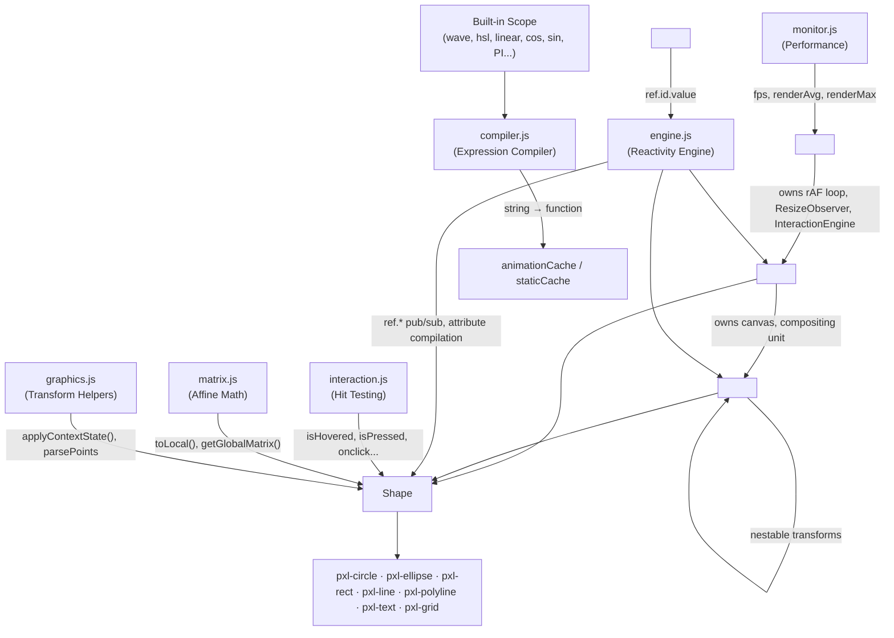

# Kilopixel Framework — Complete Technical Reference

> **Version**: 0.1.0 | **Status**: Pre-release (API may change, no backwards compatibility) | **Total Source**: ~53KB minified | **Zero Dependencies** | **Zero Build Step for Users**

Kilopixel is a **declarative, reactive animation engine for HTML5 Canvas** built on Web Components. Users describe canvas scenes using custom HTML elements (`<pxl-stage>`, `<pxl-layer>`, `<pxl-circle>`, etc.) and the framework compiles, evaluates, and renders everything at 60fps automatically.

```html
<!-- Minimal working example -->
<script src="pxl.min.js"></script>
<pxl-stage id="main" ratio="16 / 9">
  <pxl-layer>
    <pxl-circle x="500" y="300" r="50" fill="red" rotate="t * 90"></pxl-circle>
  </pxl-layer>
</pxl-stage>
```

---

## Table of Contents

1. [Architecture Overview](#architecture-overview)
2. [Source Files](#source-files)
3. [Element Hierarchy & Inheritance](#element-hierarchy--inheritance)
4. [The Expression Compiler](#the-expression-compiler)
5. [The Reactivity Engine](#the-reactivity-engine)
6. [Coordinate System & Transform Pipeline](#coordinate-system--transform-pipeline)
7. [The Responsive Unit System](#the-responsive-unit-system)
8. [Color & Gradient System](#color--gradient-system)
9. [Arrowhead System](#arrowhead-system)
10. [Time Drivers](#time-drivers)
11. [Interaction System](#interaction-system)
12. [Matrix Engine & Coordinate Mapping](#matrix-engine--coordinate-mapping)
13. [Element Reference — Stage](#element-reference--stage)
14. [Element Reference — Layer](#element-reference--layer)
15. [Element Reference — Group](#element-reference--group)
16. [Element Reference — Shape (Base Class)](#element-reference--shape-base-class)
17. [Element Reference — Circle](#element-reference--circle)
18. [Element Reference — Ellipse](#element-reference--ellipse)
19. [Element Reference — Rect](#element-reference--rect)
20. [Element Reference — Line](#element-reference--line)
21. [Element Reference — Polyline](#element-reference--polyline)
22. [Element Reference — Text](#element-reference--text)
23. [Element Reference — Grid](#element-reference--grid)
24. [Element Reference — Variable](#element-reference--variable)
25. [Per-Frame Render Pipeline](#per-frame-render-pipeline)
26. [Performance Monitor](#performance-monitor)
27. [Build System](#build-system)
28. [AI Code Generation Guide](#ai-code-generation-guide)

---

## Architecture Overview



### Per-Frame Data Flow

```
Stage.requestRender() → requestAnimationFrame → Stage.render(t)
  ├─ Sort layers by DOM position (if dirty)
  ├─ For each layer (if isDirty):
  │   ├─ evaluateAnimations(t)  → update attributeValues, broadcast ref.*
  │   ├─ ctx.clearRect()
  │   ├─ Heartbeat: if animated → self.invalidate() (keeps rAF alive)
  │   ├─ ctx.save() + applyContextState(translate→rotate→scale→skew→offset)
  │   ├─ For each child (group/shape):
  │   │   ├─ evaluateAnimations(t)
  │   │   ├─ ctx.save() + applyContextState()
  │   │   ├─ shape.draw(ctx, u, t) → _buildPath + applyStyle
  │   │   └─ ctx.restore()
  │   └─ ctx.restore()
  ├─ Performance metrics accumulation
  ├─ interaction.process()  → hit testing, state updates, event dispatch
  └─ pxl.perf.publish()  (every 1 second)
```

---

## Source Files

The framework compiles from these files (in build order):

| # | File | Purpose |
|---|------|---------|
| 1 | `js/engine.js` | Global `pxl` namespace, reactivity pub-sub, attribute compilation bridge |
| 2 | `js/matrix.js` | Zero-GC 2D affine matrix engine (Float32Array) |
| 3 | `js/compiler.js` | Multi-tier expression parser, built-in scope, time drivers |
| 4 | `js/interaction.js` | InteractionEngine class, dummy context hit testing, pointer events |
| 5 | `js/graphics.js` | Transform pipeline helper, anchor tables, points parser, radius resolver, arrowhead constants & record factory, line dash helper |
| 6 | `js/monitor.js` | Performance telemetry (fps, renderAvg, renderMax) |
| 7 | `js/elements/stage.js` | Root container, canvas host, rAF loop, resize, pointer routing |
| 8 | `js/elements/node.js` | `PxlNode` base class (extends HTMLElement), matrix tracking |
| 9 | `js/elements/layer.js` | Compositing layer, own canvas, dirty-flag rendering |
| 10 | `js/elements/group.js` | Nestable transform container, draws into parent canvas |
| 11 | `js/elements/shape.js` | Base Shape class, style application, gradient creation, arrows |
| 12 | `js/elements/shapes/circle.js` | `<pxl-circle>` — arcs, pies, donuts, arrowheads |
| 13 | `js/elements/shapes/ellipse.js` | `<pxl-ellipse>` — elliptical arcs with independent radii |
| 14 | `js/elements/shapes/rect.js` | `<pxl-rect>` — per-corner radii, 9-position anchor |
| 15 | `js/elements/shapes/line.js` | `<pxl-line>` — simple line with arrowheads |
| 16 | `js/elements/shapes/polyline.js` | `<pxl-polyline>` — per-coordinate animation, Catmull-Rom smoothing, arrowheads |
| 17 | `js/elements/shapes/text.js` | `<pxl-text>` — 3-tier caching, word-wrap, reveal effect |
| 18 | `js/elements/shapes/grid.js` | `<pxl-grid>` — infinite viewport-clipped grid |
| 19 | `js/elements/variable.js` | `<pxl-var>` — reactive variable element |

---

## Element Hierarchy & Inheritance

```
HTMLElement
├── Stage (pxl-stage)           — NOT a PxlNode; standalone root
└── PxlNode (abstract base)
    ├── Layer (pxl-layer)       — extends PxlNode, owns <canvas>
    ├── Group (pxl-group)       — extends PxlNode, transform container
    ├── Variable (pxl-var)      — extends PxlNode, reactive variable
    └── Shape (abstract)        — extends PxlNode, drawing + styling
        ├── Circle (pxl-circle)
        ├── Ellipse (pxl-ellipse)
        ├── Rect (pxl-rect)
        ├── Line (pxl-line)
        ├── Polyline (pxl-polyline)
        ├── Text (pxl-text)
        └── Grid (pxl-grid)
```

### Namespace (Only `pxl` Is Global)

All classes live on the `pxl` namespace as class expressions, like every other engine object (`pxl.Matrix`, `pxl.InteractionEngine`):

```javascript
pxl.Line = class Line extends pxl.Shape {
  static defaults = { ...pxl.Shape.defaults, x1: 0, y1: 0, x2: 0, y2: 0 /* … */ };
  // …
};
customElements.define('pxl-line', pxl.Line);
```

- **Only `pxl` is global.** Engine code never declares top-level `class`, `const`, `let`, `var` or `function`: public parts go on `pxl.*`, internals on `pxl._*`. A top-level declaration would become a global name for every script on the page (user scripts with the same name fail with a SyntaxError; a global `Text` would hide the DOM's `Text`). `build.js` refuses to build if it finds one.
- **`class pxl.Line …` is not valid JavaScript** (a declaration needs a plain name); the class expression `pxl.Line = class Line …` keeps the readable name (`pxl.Line.name === 'Line'`) without a global.
- **Debugging:** type `pxl` in the console to browse all classes, engine functions and state (`pxl.nodes`, `pxl.perf`, …).
- **Custom shapes** extend `pxl.Shape` (`class Star extends pxl.Shape`), exactly like the built-in shapes.
- **Classic script, not an ES module:** Kilopixel's interface is HTML plus standard DOM, so there is nothing to `import`; a classic `<script>` in `<head>` upgrades elements during parsing and works without a build step and from `file://`. Design: `design/2026-10-17_bundle_scope_plan.md`.

### PxlNode (Base Class for Layer/Group/Shape/Variable)

**Source**: `js/elements/node.js`

Every PxlNode has:
- `static defaults` — read-only attribute defaults of the class, inherited by spreading (`static defaults = { ...pxl.Shape.defaults, r: 0, … }`). The `PxlNode` constructor copies them into `attributeExpressions` and `attributeValues`; `pxl.resolveEmptyAttribute` reads them for bare / removed attributes (see [Empty & Removed Attributes](#empty--removed-attributes))
- `attributeExpressions` — compiled functions or static values for each attribute
- `attributeValues` — current evaluated values (read by render loop)
- `animatedAttributeKeys[]` — attributes that depend on `t` (evaluated every frame)
- `reactiveAttributeKeys[]` — attributes that depend on `ref.*` variables (evaluated on change)
- `toLocalAttributeKeys[]` — reactive attributes using `toLocal()`, also re-evaluated when an ancestor's transform changes (see [Coordinate Mapping](#coordinate-mapping-tolocal))
- `isAnimated` — true if any attribute uses time-dependent expressions
- `_localMatrix` / `_globalMatrix` — Float32Array affine matrices, recomputed lazily
- `parentLayer` — reference to closest `<pxl-layer>` ancestor
- `parentContainer` — reference to closest `<pxl-group>` or `<pxl-layer>` parent

**Key Methods**:
- `attributeChangedCallback(name, old, new)` — compiles attribute via `pxl.compileAttribute()`, broadcasts ref changes, invalidates layer
- `connectedCallback()` — finds parentLayer/parentContainer, registers child, restores subscriptions, registers in `pxl.nodes` if has `id`
- `disconnectedCallback()` — removes from `pxl.nodes`, clears subscriptions, unregisters from parent
- `variableChangedCallback(varName)` — re-evaluates reactive attributes for a changed variable, unsubscribes if no longer needed
- `evaluateAnimations(t)` — iterates `animatedAttributeKeys`, calls expression functions with time, broadcasts ref changes if values changed, marks local matrix dirty on transform changes
- `getLocalMatrix()` / `getGlobalMatrix()` — lazy versioned matrix computation with parent chain walking

**The `attributeValues` Object**:
Has four hidden (non-enumerable) properties:
- `set(key, value)` — calls `this.setAttribute(key, value)` on the element. Used by imperative event handlers: `ref.myVar.set('value', 100)`
- `$node` — back-reference to the DOM element itself
- `tx` / `ty` — getters for the element's **drawn origin** in its parent space (the space of its own `x` / `y`): the local matrix translation, i.e. `x` / `y` plus the `dx` / `dy` offset turned by the element's own `rotate`, `zoom` / `scalex` / `scaley` and skew. Equal to `x + dx` / `y + dy` only without those. Same value as `toLocal(ref.el, 'tx' | 'ty')` for a reader in the same space

---

## The Expression Compiler

**Source**: `js/compiler.js`

### Compilation Pipeline

The compiler uses a progressive "Fast Path" classification system. Static strings are intercepted early to avoid any runtime cost. The pipeline (in order):

1. **Hex Colors** (`#ff0000`, `#fff`) → returned as-is (zero cost)
2. **Template Literals** (`` `...` ``) → always compiled dynamically
3. **Alphabetical Words** — sub-checks:
   - Pure alphabetical (`/^[a-zA-Z\s]+$/`) → returned as string (e.g. `"red"`, `"none"`)
   - Exception: `"t"` → compiled as time expression
   - Exception: `"true"` / `"false"` → boolean
   - Exception: Math constants like `"PI"` → numeric value from scope
   - Static CSS color functions (`rgb(...)`, `rgba(...)` with only numbers) → returned as string
4. **Quoted String Literals** (`'Hello World'`) → inner string extracted
5. **Pure Numbers** (`"100"`, `"-50"`, `"0.25"`) → parsed to Number
6. **Math/Animation Guard** — regex detects `t`, `ref.`, `toLocal(`, operators, parentheses → compiled

### Expression Compilation (`compileExpression`)

When a string reaches this stage:

1. **Cache lookup** — checks `staticCache` and `animationCache` Maps first
2. **CSS % sanitizer** — converts illegal JS percentages: `50%` → `'50%'`
3. **Time dependency check** — regex tests for `t` (not preceded by `.`) or any driver function name; `toLocal(` sets `usesToLocal`
4. **`pxl.rewriteExpression()`** (shared with `on*` handlers) — `ref.player.x` → `ref.player?.x` (no TypeError before elements connect) and `toLocal(` → `pxl.toLocal(this, `
5. **Variable dependency extraction** — regex extracts all `ref.xxx` identifiers
6. **Smart return detector** — if no `return` keyword, wraps in `return ...;`

Then branches:

**Animation Path** (has time dependency or variable refs):
```javascript
const fn = new Function('scope', 'ref', `
  const { PI, sin, cos, wave, ... } = scope;
  let t;
  const loop = (d) => (t % d) / d;
  const wave = (d) => 0.5 - cos((t / d) * PI * 2) * 0.5;
  // ... all 8 time drivers
  return function(_t) {
    t = _t;
    return <user expression>;
  };
`)(pxl.scope, pxl.nodes);
```

The outer function (factory) executes ONCE, destructuring the entire scope. The inner function (closure) executes every frame, receiving only `_t`.

**Properties added to the function**:
- `fn.isTimeDependent` — true if uses `t` or time drivers
- `fn.variableDependencies` — array of `ref.xxx` strings (if any)
- `fn.usesToLocal` — true if the expression calls `toLocal()` (reader-side reactivity, see [Coordinate Mapping](#coordinate-mapping-tolocal))

**Static Path** (no time, no variables):
Evaluated once via `new Function`, result cached in `staticCache`.

### No `Math.` Prefix Required (Top-Level Scope Injection)

All standard JavaScript `Math` constants and methods (`PI`, `cos`, `sin`, `abs`, `min`, `max`, `pow`, `round`, etc.) are injected directly into every compiled expression's top-level scope.

> [!IMPORTANT]
> **Never use the `Math.` prefix** inside declarative expressions. Write `cos(t)` and `sin(t)` directly instead of `Math.cos(t)` or `Math.sin(t)`.

### Smart Return

The compiler auto-wraps expressions in `return` unless the string already contains the `return` keyword. This enables two syntax modes:
- **Simple expressions**: `t > 1000 ? 'red' : 'blue'` (auto-wrapped)
- **Full code blocks**: `if (t < 1000) { return 'red'; } else { return 'blue'; }`

---

## The Reactivity Engine

**Source**: `js/engine.js`

### Core Architecture

- **`pxl.nodes`** — a flat `{}` registry mapping element `id` → `attributeValues` object. When any element with an `id` connects to the DOM, it registers: `pxl.nodes[myId] = this.attributeValues`
- **`pxl._subscriptions`** — a `{ fullKey: [element, element, ...] }` pub-sub map
- **`pxl.broadcast(fullKey)`** — iterates subscribers backwards (safe for in-place removal), calling `element.variableChangedCallback(fullKey)`

### Attribute Classification (Three Tiers)

When `pxl.compileAttribute(element, name, value)` is called:

| Result Type | Storage | Evaluation |
|-------------|---------|------------|
| **Static** (number, string, boolean) | `attributeValues[name] = value` | Never re-evaluated |
| **Time-Dependent Function** (`fn.isTimeDependent = true`) | Added to `animatedAttributeKeys[]` | Every frame via `evaluateAnimations(t)` |
| **Reactive Function** (has `variableDependencies` but no time) | Added to `reactiveAttributeKeys[]` | Only when referenced variable broadcasts |

### Empty & Removed Attributes

A bare attribute (`<pxl-polyline closed>`, `el.hidden = true`, `toggleAttribute`) arrives as `''`, a removed one (`removeAttribute`, `el.hidden = false`, frameworks dropping `null` / `undefined` bindings) as `null`. `pxl.compileAttribute` resolves both **before** parsing via `pxl.resolveEmptyAttribute`:

| Incoming | Boolean attribute (`pxl.BOOLEAN_ATTRIBUTES`) | `<pxl-var>` `value` | Any other attribute |
|---|---|---|---|
| `''` (bare) | `true` (HTML presence rule) | `''` | class default |
| `null` (removed) | class default (`false`) | `0` | class default |

- Boolean attributes: `hidden`, `closed`, `smooth`, `pie`, `anticlockwise`, `labels`. Only bare, `"true"` and `"false"` are booleans: `closed="1"` is **not** `true`.
- The resolved value is static, so removing an animated or reactive attribute also stops its animation / subscription.
- Defaults that are `null` on purpose keep meaning "not set" (rect `r1`–`r4` fall back to `r`, circle `end` / `sweep` mean a full circle).
- Stage (not a `PxlNode`): bare `alwaysrender` = `true`; bare / removed `ratio` = `16 / 9`.
- Event handlers: see [Event Handling](#event-handling).
- Not handled: whitespace-only values (`" "` parses to `0`) and invalid values (`miterlimit="abc"`).
- Design: `design/2026-10-17_attribute_defaults_and_state_isolation_plan.md`.

### Variable Change Propagation

```
pxl.broadcast('ref.myVar')
  → for each subscriber element (backwards):
      → element.variableChangedCallback('ref.myVar')
        → pxl.evaluateAttributesForVariable(element, 'ref.myVar')
          → re-evaluate all reactive attributes that depend on 'ref.myVar'
          → returns bitmask: bit 1 = var still needed, bit 2 = values changed
        → if bit 1 is 0: unsubscribe (self-cleaning)
        → if bit 2 is 1: broadcast own ref key + invalidate layer
```

### The `ref.*` Namespace

All reactive references use a flat `ref.` prefix:
- `ref.myCircle.x` — reads `pxl.nodes['myCircle'].x` (the circle's current x value)
- `ref.main.mouseX` — reads the stage's mouse X coordinate
- `ref.speed.value` — reads a `<pxl-var id="speed">` element's value
- `ref.btn.isHovered` — reads a shape's hover state

The optional chaining injector ensures `ref.player?.x` so unresolved refs return `undefined` instead of throwing.

> [!WARNING]
> **Why Canvas Target IDs Must Not Use Kebab-Case (`-`)**
> Never use hyphens (`kebab-case`) in IDs for `<pxl-layer>`, `<pxl-var>`, or any shape element that will be referenced by `ref.*` in declarative expressions. Because hyphens are subtraction operators in JavaScript, writing `ref.ex4-layer.x` throws a JavaScript syntax error (`(ref.ex4) - (layer.x)`). Always use **`camelCase`** (`id="ex4Layer"`, `id="orbitSpeed"`) for elements referenced by `ref.*`.

---

## Coordinate System & Transform Pipeline

### Center + Offset Architecture

Every element (layer, group, shape) has this coordinate model:

- **`x`, `y`** — The **Center** of the element. All transforms (rotation, scaling, skewing) occur around this point. When `dx`/`dy` offsets are applied, the shape is visually displaced but `x`/`y` remains the transform origin.
- **`dx`, `dy`** — A **Local Offset** applied *after* rotation and scaling. Shifts where the shape is drawn without moving its center of transformation. This allows orbiting without changing the rotation center.

### Transform Pipeline Order

Applied by `pxl.applyContextState()` in this exact order:

```
1. ctx.translate(x * u, y * u)      ← Move to center (transform origin)
2. ctx.rotate(rotate * π/180)        ← Rotate around pivot
3. ctx.scale(zoom * scalex, zoom * scaley) ← Zoom and scale around center
4. ctx.transform(1, skewy, skewx, 1) ← Skew
5. ctx.translate(dx * u, dy * u)     ← Offset AFTER rotation/scale
6. ctx.globalAlpha *= alpha           ← Compound opacity
7. ctx.globalCompositeOperation       ← Blend mode
8. ctx.filter                         ← CSS filter
```

**Zoom and Scale**: `scalex` / `scaley` are the two arguments of the canvas `ctx.scale(x, y)` (two attributes, because splitting one `scale="x, y"` expression at commas isn't safe). `zoom` is a uniform factor on top: it **multiplies** both axes (`zoom * scalex`, `zoom * scaley`), so `zoom="2" scalex="1.5"` draws at 3 / 2, and an animated `zoom` (a pulse, hover feedback) can be combined with a stretched shape. `zoom="-1"` turns the element by 180° (both axes negative). Design: `design/2026-10-29_tolocal_decomposition_plan.md` §5.

### Why This Matters

The center/offset split makes orbital motion trivial:

```html
<!-- Planet orbiting center at 60°/sec, 200-unit orbital radius -->
<pxl-circle x="500" y="300" dx="200" rotate="t * 60" r="20" fill="red"></pxl-circle>
```

Without this split, you'd need nested groups or trigonometry.

### Shape Drawing Origin

Shapes are drawn relative to `(0, 0)` within the transformed context. The transform pipeline has already positioned the canvas context at the shape's center. For example, a circle draws `ctx.arc(0, 0, r * u, ...)`.

---

### Style Cascade & Inheritance (Dual Architecture)

Kilopixel uses a strict **Dual Architecture** for context states, separating flattened DOM compositing from Canvas pixel operations.

- **Layer-Level (`<pxl-layer>`)**: Uses the **CSS DOM API**. Applying `alpha`, `blend`, or `filter` to a layer modifies the `<canvas>` DOM element itself (`opacity`, `mix-blend-mode`, `filter`). The entire flattened canvas blends with the stage background. Shapes inside the layer do *not* inherit these properties; they are drawn sharp and opaque into the canvas buffer, and the browser's GPU composites the final flattened image into the page.
- **Shape-Level (`<pxl-circle>`, etc.)**: Uses the **HTML5 Canvas API**. Applying `alpha`, `blend`, `filter`, or `mask` to a shape changes how its pixels are drawn onto the layer's canvas (`ctx.globalAlpha`, `ctx.globalCompositeOperation`, `ctx.filter`). Overlapping shapes will cast shadows on each other, bleed through each other, or mask each other mathematically.
- **Zero-Inheritance Groups (`<pxl-group>`)**: Groups are **Pure Spatial Transform Containers** and do *not* support compositing attributes (`alpha`, `blend`, etc.). This enforces a clean 3-tier architecture with maximum performance.
- **Native Shadows (Shapes Only)**: Raw canvas shadows (`shadowcolor`, `shadowblur`, `shadowx`, `shadowy`) are only supported on Shapes. For layers, use the `filter="dropShadow(...)"` helper instead to cast a unified silhouette shadow.

### Blend vs. Masking (Semantic Separation)

While both `blend` and `mask` on a Shape map to the exact same underlying Canvas property (`ctx.globalCompositeOperation`), they are separated in the API to clarify intent and respect the limitations of the Dual Architecture:
- **`blend` (Layers & Shapes)**: Designed for color mixing (e.g., `screen`, `multiply`, `overlay`, `lighter`). Because `<pxl-layer>` uses CSS `mix-blend-mode`, it supports standard color-mixing algorithms. *Note: Kilopixel officially supports the Canvas `lighter` mode for additive blending, and automatically translates it to the CSS `plus-lighter` standard when applied to a layer.*
- **`mask` (Shapes Only)**: Designed for Boolean alpha-compositing and clipping (e.g., `destination-in`, `destination-out`, `source-atop`). Because CSS `mix-blend-mode` cannot perform Canvas-style alpha clipping, these operations would fail on a Layer. The `mask` attribute was added strictly to Shapes as a semantic alias, giving developers a dedicated, logical place to execute these Canvas-only boolean operations without causing confusion.

*(Note: If both attributes are applied to a shape, `mask` takes precedence over `blend`.)*

---

## The Responsive Unit System

- **Logical width**: Always **1000** (hardcoded)
- **Unit `u`**: `clientWidth / 1000` — the scaling factor
- **Logical height**: Dynamic, calculated as `clientHeight / u`
- All spatial values (x, y, dx, dy, r, w, h, strokewidth, etc.) are multiplied by `u` at draw time
- **DPI awareness**: Canvas is scaled by `devicePixelRatio` via ResizeObserver

This means:
- `x="500"` is always horizontal center
- `x="0"` is always left edge, `x="1000"` is always right edge
- The same code works at 50×50px and 4K resolution

**Performance implication**: Because the logical width is fixed at 1000, raw numbers like `x="500"` hit the compiler's Fast Path (just a number, zero evaluation cost). Prefer `x="500"` over `x="ref.main.width / 2"`.

---

## Color & Gradient System

### Color Functions (Scope Injected)

These are JavaScript functions in the compiler's scope, **not** CSS. They return strings:

```javascript
rgb(r, g, b)       → "rgb(r,g,b)"
rgba(r, g, b, a)   → "rgba(r,g,b,a)"
hsl(h, s, l)       → "hsl(h,s%,l%)"      // numbers auto-get '%' suffix
hsla(h, s, l, a)   → "hsla(h,s%,l%,a)"
```

Because they contain parentheses, the compiler automatically routes them through the expression path (not the static Fast Path). They are safely re-evaluated at 60fps.

### Gradient Descriptors (Deferred Creation)

`linear()`, `radial()`, and `conic()` return lightweight **descriptor objects**, not `CanvasGradient` instances. The actual gradient is created at draw time by `shape.createGradient()` when the bounding box is known.

#### The `colorsArray` Parameter

All three gradient types share a common `colorsArray` parameter to define their color stops. You can provide this array in two formats:
- **Colors Only**: `['red', 'yellow', 'blue']` (The engine automatically spaces them evenly from 0.0 to 1.0)
- **Color Stops**: `[0, 'red', 0.8, 'blue', 1, 'yellow']` (Alternating numeric offsets and color strings for explicit control)

#### `linear(direction, colorsArray)`

**Angle mode** (number):
```html
fill="linear(45, ['red', 'blue'])"
```
The angle uses CSS-like geometry. At draw time, endpoints are calculated using `distance = |w/2·cos| + |h/2·sin|`, ensuring the gradient line always reaches the bounding box edges regardless of angle or aspect ratio.

**Vector mode** (array):
```html
fill="linear([0, 0, 1, 1], ['red', 'blue'])"
```
Coordinates are **proportional** to the shape's bounding box. `[0, 0]` = top-left, `[1, 1]` = bottom-right.

#### `radial(config, colorsArray)`

The radial gradient API accepts configurations with **1**, **3**, or **6** arguments, mapped directly to HTML5 Canvas 2D radial gradient geometry (`ctx.createRadialGradient(x0, y0, r0, x1, y1, r1)`):

| Args | Syntax | Description |
|:---:|---|---|
| **1** | `radial([r1], colorsArray)` | **Concentric, Center-Locked**: Origin is locked to shape center `(0.5, 0.5)` with inner radius `r0 = 0`, expanding out to outer radius `r1`. |
| **3** | `radial([x0, y0, r1], colorsArray)` | **Concentric, Custom Origin**: Origin is set to point `(x0, y0)` (proportional 0..1 to bounding box) with inner radius `r0 = 0`, expanding out to outer radius `r1`. |
| **6** | `radial([x0, y0, r0, x1, y1, r1], colorsArray)` | **3D Spotlight / Eccentric Cones**: Full independent control over Start Circle `(x0, y0, r0)` and End Circle `(x1, y1, r1)` for directional beams, 3D spotlights, and hollow cores. |

##### Radius Formats (`r0`, `r1`)
Radii can be expressed in four distinct formats:
1. **Logical Numbers**: Responsive logical canvas units (e.g., `200`, automatically scaled by unit `u` at draw time via `Math.abs(r * u)`).
2. **Side Edge Keywords (Perpendicular Projection)**: Calculates the perpendicular distance straight to the boundary line, ensuring the radial circle is perfectly tangent to the target edge without diagonal overshoot:
   - `'top'`: Distance straight up to top edge ($y \cdot h \cdot u$).
   - `'bottom'`: Distance straight down to bottom edge ($(1 - y) \cdot h \cdot u$).
   - `'left'`: Distance straight left to left edge ($x \cdot w \cdot u$).
   - `'right'`: Distance straight right to right edge ($(1 - x) \cdot w \cdot u$).
3. **Perimeter Point Keywords (Euclidean Distance)**: Measures Euclidean distance from circle center `(x, y)` to a discrete perimeter point:
   - **Corner Vertices**: `'top-left'`, `'top-right'`, `'bottom-right'`, `'bottom-left'`
   - **Edge Midpoints**: `'top-center'`, `'right-center'`, `'bottom-center'`, `'left-center'`
4. **Dynamic CSS Keywords**: Dynamically measures distance to the shape's bounding box edges and corners:
   - `'closest-side'`: Distance to the nearest bounding box edge.
   - `'farthest-side'`: Distance to the farthest bounding box edge.
   - `'closest-corner'`: Distance to the nearest bounding box corner.
   - `'farthest-corner'`: Distance to the farthest bounding box corner.

##### Distance Model
- **For Side Edges**: Perpendicular 1D line projection (0 square roots, zero allocations, sub-nanosecond register execution):
  $$\text{radius}_{\text{top}} = |y \cdot h \cdot u|, \quad \text{radius}_{\text{left}} = |x \cdot w \cdot u|$$
- **For Perimeter Points**: Continuous monotonic Euclidean distance from circle origin `(x, y)` to target anchor point `(ax, ay)`:
  $$\text{radius} = \sqrt{((x - ax) \cdot w \cdot u)^2 + ((y - ay) \cdot h \cdot u)^2}$$
This guarantees mathematical alignment with the Canvas 2D specification, smooth continuous transitions, and zero GC pressure during 60fps animations.

#### `conic(startAngleOrConfig, colorsArray)`

**Simple mode** (number):
```html
fill="conic(0, ['red', 'yellow', 'lime', 'cyan', 'blue', 'magenta', 'red'])"
```
`startAngle` in degrees, centered on the bounding box center.

**Config mode** (array):
```html
fill="conic([90, 0.3, 0.7], ['red', 'blue'])"
```
`[startAngle, cx, cy]` — start angle in degrees, center coordinates (proportional).

#### Color Stop Formats

All gradient functions accept two color stop formats:
```javascript
['red', 'blue']                    // Simple — evenly spaced
[0, 'red', 0.5, 'green', 1, 'blue'] // Offset-mapped — explicit positions
```

#### Gradient Caching

The Shape base class maintains a **dual-slot gradient cache** (`_gradCache[0]` for fill, `_gradCache[1]` for stroke). Each slot tracks the descriptor object reference, responsive unit `u`, and all four bounding box values (`left`, `top`, `right`, `bottom`). If all values match, the cached `CanvasGradient` is reused. This ensures gradients update correctly when a shape's geometry animates (e.g., changing radius or width), while avoiding unnecessary recreation for static shapes.

---

## Unified Responsive Filters

Kilopixel provides a unified API for CSS and Canvas filters that mirrors the Gradient architecture, accessible natively via `pxl.scope`.

### Usage

Filters are invoked as standard function calls rather than raw string concatenation. They can be applied individually or chained using an array.

**Single Filter**:
```html
<pxl-layer filter="blur(5)"></pxl-layer>
```

**Chained Filters (Array)**:
```html
<pxl-shape filter="[blur(10), contrast(150), saturate(200)]"></pxl-shape>
```

### Available Filter Helpers

| Function | Output | Description |
| :--- | :--- | :--- |
| `blur(radius)` | `blur(...)` | `radius` is automatically scaled by `u`. |
| `dropShadow(x, y, blur, color)` | `drop-shadow(...)` | `x`, `y`, `blur` are scaled by `u`. Defaults to `#000` if no color provided. |
| `brightness(val)` | `brightness(...)` | Uses percentage (`val`%). |
| `contrast(val)` | `contrast(...)` | Uses percentage (`val`%). |
| `hueRotate(deg)` | `hue-rotate(...)` | Uses degrees (`deg`deg). |
| `invert(val)` | `invert(...)` | Uses percentage (`val`%). |
| `saturate(val)` | `saturate(...)` | Uses percentage (`val`%). |
| `grayscale(val)` | `grayscale(...)` | Uses percentage (`val`%). |
| `sepia(val)` | `sepia(...)` | Uses percentage (`val`%). |
| `opacity(val)` | `opacity(...)` | Uses percentage (`val`%). |

> [!IMPORTANT]
> **No Units Required**: Do not provide `px`, `%`, or `deg` manually! The scope helpers automatically append the correct units (`blur(5)` → `blur(5px)`). Kilopixel's graphics pipeline automatically detects pixel values and multiplies them by the physical scaling factor (`u`) before drawing.

---

## Arrowhead System

**Source**: `js/elements/shape.js` (shared math), `js/graphics.js` (constants), per-shape mapping in `line.js`, `polyline.js`, `circle.js`, `ellipse.js`  
**Design**: `design/2026-10-14_unified_arrowhead_geometry_plan.md` (full derivations)

Supported on `<pxl-line>`, `<pxl-polyline>`, `<pxl-circle>` and `<pxl-ellipse>` via `arrowstart`, `arrowend` (number or `'auto'`) and `arrowstyle` (`'filled'` | `'line'`).

### Size
- The arrowhead is an **equilateral triangle** (60° tip). `size` is its side length, which equals the **base width** (wing corner to wing corner).
- `'auto'` = `strokewidth × 3.6`. Values `≤ 0` mean no arrowhead.
- Length from tip to base = `size × cos30° ≈ 0.866 × size`.
- **No minimum size**: heads narrower than the stroke are allowed (user's choice).

### Alignment Principle
> The linecap defines where the line ends, and the arrow tip ends at the same spot.

- The tip lands on the cap boundary: the end point for `butt`, `strokewidth / 2` beyond it for `square` and `round`. This is the same for both styles.
- `'line'` chevrons: the stroked corner reaches beyond its path vertex by `strokewidth` (miter), `strokewidth / 2` (round) or `strokewidth / 4` (bevel), and the vertex is pulled back by that amount. Chevrons use the shape's `linejoin`.
- **Miter tips are always sharp**: a 60° miter needs a canvas miter limit of `2` (`1 / sin 30°`). If the shape's `miterlimit` is lower than `4` (e.g. to blunt sharp polyline corners), `drawArrows` raises it to `4` (headroom for float rounding) for the chevron stroke only, so the path corners stay bevelled while the arrow tip stays pointed.

### Shaft Pullback (Inset)
The stroke under the head is shortened ("inset") so it never shows beside or in front of the head:
- **`'filled'`**: the shaft ends at depth `D = min(max(Dmin, 0.6 × length), length + capExt)` behind the tip, where `Dmin` is the exact minimum for the cap (`0.866·sw` butt, `1.366·sw` square, `1·sw` round). This formula is continuous, so animated sizes never jump. Very small heads sit flush on the shaft end like a pointed cap.
- **`'line'`**: the shaft's visible end is exactly at the chevron vertex (inset = the join extension).
- **One trim definition**: the shaft end and the head base lie `inset` / the head length away from the tip **in a straight line**, on every shape. Lines: exact along the line. Circles: `2·asin(d / 2R)`. Ellipses and smooth polylines: 12 bisection steps (ellipse: on the angle; polyline: on the first/last Bézier segment, split with de Casteljau, `_flatCache` is never mutated). The head points along the **chord over its own length**, so its base sits on the curve.

### Rules & Limits
- Arrowheads only apply to **open** strokes. They are ignored with `pie`, `closed`, `ir` / `irx` / `iry`, and on closed polylines. A full 360° sweep with arrows stays an open arc.
- Heads inherit the stroke style (colors and gradients). **No `stroke` (or `strokewidth="0"`) means no arrowheads.**
- `'line'` chevrons are always drawn solid, even on dashed strokes.
- If a path is shorter than both insets combined, only the heads are drawn.
- 2-point polylines are drawn straight even with `smooth` (a curve through 2 points with free ends is a line).
- Polylines: arrows skip zero-length end segments (first/last points closer than 0.01 px) and sit on the first/last point with a distinct neighbour. If all points are the same, no heads are drawn.

### Performance
- Zero allocations per frame: each arrow shape pre-allocates two records (`_arrowStart`, `_arrowEnd`) via `pxl.createArrowRecord()`, with all fields initialized as doubles (one stable hidden class).
- Vector API: directions are unit vectors; wings are a rotation by the constants `pxl.ARROW_COS30` / `pxl.ARROW_SIN30`. There is no `atan2`, and no trig inside the head drawing.
- Both heads are drawn in one path: one `fill()` or `stroke()` per shape.
- Fast path: shapes without arrowheads skip all arrow math.

---

## Time Drivers

All 8 time drivers are defined in `pxl.drivers` and injected into every compiled expression's scope. The variable `t` is in **seconds** (not milliseconds). Each driver takes a `d` parameter (duration/period in seconds) and returns a value in the `[0, 1]` range.

| Driver | Formula | Behavior |
|--------|---------|----------|
| `loop(d)` | `(t % d) / d` | Linear sawtooth, 0→1 repeating |
| `yoyo(d)` | `1 - abs((t % (d*2)) / d - 1)` | Linear ping-pong, 0→1→0 |
| `wave(d)` | `0.5 - cos((t/d) * PI * 2) * 0.5` | Smooth sinusoidal, 0→1→0 |
| `bounce(d)` | `abs(sin((t/d) * PI))` | Absolute sine, bouncing ball |
| `strobe(d)` | `t % d < d*0.5 ? 1 : 0` | Binary on/off toggle |
| `glide(d)` | `l*l*(3-2*l)` where `l = (t%d)/d` | Smooth ease-in-out (Hermite) |
| `pulse(d)` | `pow(sin((t/d) * PI), 6)` | Sharp spike pulse |
| `glitch(d)` | `abs(sin(floor(t/d) * 437.58)) % 1` | Pseudo-random stepped values |
| `time(unit)` | e.g. `time('s')` | Real-world time ('ms', 's', 'm', 'h', 'day', 'date', 'month', 'year') with decimal precision |

**Usage**: All `(d)` drivers return 0-1. Multiply to scale, add to offset:
```html
r="30 + wave(2) * 70"           <!-- radius oscillates between 30 and 100 over 2 seconds -->
fill="hsl(loop(5) * 360, 80, 50)"  <!-- hue cycles through rainbow every 5 seconds -->
```

**Real-world time clocks**:
The `time(unit)` driver returns exact real-world values based on the user's local clock. To enable smooth 60fps animations (e.g., sweeping analog clock hands), the returned values include decimal precision (e.g., `time('s')` might return `45.242`).

| Unit | Returns | Range | Use case |
|------|---------|-------|----------|
| `'ms'` | Milliseconds | `0 - 999` | Strobe effects, micro-animations |
| `'s'` | Seconds of the minute | `0.0 - 59.999` | Second hand: `rotate="(time('s') / 60) * 360"` |
| `'m'` | Minutes of the hour | `0.0 - 59.999` | Minute hand: `rotate="(time('m') / 60) * 360"` |
| `'h'` | Hours of the day | `0.0 - 23.999` | 12h Hour hand: `rotate="((time('h') % 12) / 12) * 360"` |
| `'day'` | Day of the week | `0 - 6` | Sunday=0, Monday=1 |
| `'date'` | Day of the month | `1 - 31` | Calendars |
| `'month'`| Month of the year | `1 - 12` | 1=Jan, 12=Dec |
| `'year'` | Full year | e.g. `2026` | Copyright text |

*Tip: For a digital ticking clock instead of a smooth sweep, use `floor(time('s'))`.*

---

## Interaction System

**Source**: `js/interaction.js`

### Dual Architecture

The framework exposes interactions via two complementary systems:

#### 1. Declarative States (for styling/expressions)

Automatically updated boolean properties on shape elements:
- `isHovered` — true while pointer is over the element
- `isPressed` — true while pointer is held down on the element

```html
<pxl-rect id="btn" w="100" h="40"
  fill="ref.btn.isPressed ? '#333' : (ref.btn.isHovered ? '#666' : '#999')"
  zoom="ref.btn.isPressed ? 0.95 : (ref.btn.isHovered ? 1.05 : 1)"></pxl-rect>
```

#### 2. Imperative Events (for logic/scripting)

Instantaneous JavaScript blocks compiled and attached to elements:
- `onclick` — pointer click
- `onenter` — pointer enters element
- `onleave` — pointer leaves element
- `ondown` — pointer press starts
- `onup` — pointer press ends
- `onmove` — pointer moves while over element

```html
<pxl-circle onclick="ref.counter.set('value', ref.counter.value + 1)" ...></pxl-circle>
```

**Event compilation**: Event strings are compiled via `new Function` with the full scope (including `ref`, all math functions, all drivers). They are bound to the element via `.bind(this)`.

### Hit Testing Algorithm

The framework uses a **dummy canvas context** (`pxl.dummyCtx`) with intercepted `fill()` and `stroke()` methods:

1. A 1×1 off-screen canvas is created at module load
2. Its `fill` method is overridden to call `isPointInPath(hitX, hitY)`
3. Its `stroke` method is overridden to call `isPointInStroke(hitX, hitY)`
4. During hit testing, the engine:
   - Iterates interactive elements in **reverse DOM order** (front-to-back)
   - Walks the parent chain to build the transform stack
   - Applies the **spatial transforms only** (`pxl.applyTransformState`) to the dummy context — alpha, blend, mask, filter and shadows don't affect `isPointInPath`, so they are skipped
   - Calls the shape's optional **`hitTest(ctx, u)`** hook if it has one, otherwise its `draw()` method, on the dummy context
   - The intercepted fill/stroke methods check if the mouse point is inside
   - First hit wins (topmost element)

This reuses the shape's own `draw()` method for pixel-perfect mathematical hit testing without any separate collision geometry.

**`hitTest(ctx, u)` hook**: for shapes whose hit area can't be expressed as a path. Currently only `<pxl-text>` implements it (glyphs drawn with `fillText` produce no path): it adds its bounding box as a rect and calls the intercepted `ctx.fill()`. See [Element Reference — Text](#element-reference--text).

### InteractionEngine Lifecycle

- Shapes are registered with `stage.interaction.registerElement(el)` (only registered shapes are hit-tested) when they:
  - have an event handler (`onclick`, `onenter`, etc.), **or**
  - have their `isHovered` / `isPressed` read anywhere: in an expression on **any** element (`fill="ref.btn.isHovered ? …"` on `btn` itself or on another shape, a `<pxl-var>`, …) or inside an `on*` handler.
- **Auto-registration** (`pxl.trackInteractiveRefs`, compile time only): every attribute string and `on*` handler is scanned for `ref.<id>.isHovered` / `ref.<id>.isPressed` (state list: `pxl.INTERACTIVE_STATES`). The id is remembered in `pxl._interactiveIds`; the shape registers immediately if it is already connected, otherwise in its `connectedCallback` (works for any DOM order and for shapes added or re-added later).
- **Lazy unregister**: on leave / release, a shape without `on*` handlers is unregistered once nobody reads its states any more (no subscribers left on `ref.<id>`). References from time-dependent expressions and from `on*` handlers don't subscribe, so those ids are **sticky** (`pxl._stickyIds`) and stay registered until the shape is disconnected.
- Limitations: dynamic ids and bracket notation (`ref[name].isHovered`, `ref['btn'].isHovered`, `ref.btn['isHovered']`) are not detected. False positives (e.g. a string literally containing `ref.btn.isHovered`) only cause a harmless extra registration.
- Pointer events (`pointermove`, `pointerdown`, `pointerup`, `click`, `pointerenter`, `pointerleave`) are handled by the InteractionEngine via `handleEvent()`
- Hit testing runs in `process()`, called at the end of each `stage.render()`
- Mouse coordinates are converted to logical units: `offsetX / stage.unit`
- **Cursor**: the stage shows `cursor = 'pointer'` only over **clickable** shapes (an `onclick` / `ondown` / `onup` handler, or `isPressed` referenced somewhere — `pxl._pressableIds`); hover-only shapes keep `'default'`. The DOM style is only written when the cursor actually changes.

---

## Matrix Engine & Coordinate Mapping

**Source**: `js/matrix.js`

### Zero-GC Affine Matrix

`pxl.Matrix` is a namespace of static functions that operate on `Float32Array(6)` matrices `[a, b, c, d, tx, ty]`:

- `create()` → identity Float32Array
- `updateLocal(out, x, y, dx, dy, rotate, scalex, scaley, skewx, skewy)` → builds local transform
- `multiply(out, a, b)` → `out = a * b`
- `invert(out, a)` → `out = a⁻¹` (with degenerate fallback to identity)

Three pre-allocated scratch matrices prevent GC pressure:
- `pxl._scratchMatrixA`
- `pxl._scratchMatrixB`
- `pxl._identityMatrix`

### Lazy Versioned Matrix Tracking

Each PxlNode creates both matrices in its constructor and tracks their state to avoid recomputation:
- `_isLocalMatrixDirty` — set when a transform attribute changes (starts `true`)
- `_localMatrixVersion` / `_globalMatrixVersion` — increment when the matrix is recomputed
- `_lastLocalMatrixVersion` / `_lastParentMatrixVersion` — the versions the global matrix was built from; `_lastParentMatrixVersion` is reset on connect, because a new parent may have the same version number as the old one

`getGlobalMatrix()` recursively walks the parent chain, only recomputing when version mismatches are detected.

### Coordinate Mapping (`toLocal`)

The `toLocal(target, property)` function projects a target element's position into the caller's parent coordinate space — exactly the space where the caller's own attributes (`x`, `y`, etc.) are interpreted. This makes the result directly usable as an attribute value.

```html
<!-- Track a shape's actual drawn position from a different coordinate space -->
<pxl-line x1="toLocal(ref.planet, 'tx')" y1="toLocal(ref.planet, 'ty')" x2="0" y2="0"></pxl-line>
```

**Algorithm** (`pxl.toLocal`):
1. Get the caller's parent's global matrix
2. Get the target's global matrix
3. Compute: `Delta = Invert(CallerParentGlobal) × TargetGlobal`
4. Compute the target's offset vector in the delta space: `tdx = delta[0]·dx + delta[2]·dy`, `tdy = delta[1]·dx + delta[3]·dy`
5. Extract the requested property:

| Property | Formula | Description |
|----------|---------|-------------|
| `'x'` | `delta[4] - tdx` | Target's **pivot/center** (without offset) |
| `'y'` | `delta[5] - tdy` | Same for Y axis |
| `'dx'` | `tdx` | Target's **offset vector** rotated into caller's space |
| `'dy'` | `tdy` | Same for Y axis |
| `'tx'` | `delta[4]` | Target's **total position** (center + offset) |
| `'ty'` | `delta[5]` | Same for Y axis |
| `'rotate'` | `atan2(delta[1], delta[0]) × 180/π` | Direction of the target's x axis in degrees |
| `'scalex'` | `√(delta[0]² + delta[1]²)` | Length of the target's x axis (total, includes every `zoom`) |
| `'scaley'` | `det / scalex` | Height perpendicular to the x axis, **signed** (negative = mirrored) |
| `'skewx'` | `atan((delta[0]·delta[2] + delta[1]·delta[3]) / scalex²) × 180/π` | Lean of the target's y axis in degrees |
| `'zoom'` | `√|det|` | Total uniform zoom (see below) |

`det = delta[0]·delta[3] − delta[1]·delta[2]`. The frame properties decompose the delta in Kilopixel's own order (rotate → scale → skew) with `skewy = 0`: `rotate`, `scalex`, `scaley` and `skewx` rebuild any 2×2 matrix (mirrors and skew included). `skewy` is not offered: it isn't unique (`skewy="30"` is the same matrix as `rotate="30" scalex="1.155" scaley="0.866" skewx="23.4"`), so it would always be `0`.

**`'zoom'` (total zoom)**: the factor by which the target's frame changes areas, as a length factor. As long as nothing between the reader and the target (the target included) is stretched (`scalex ≠ scaley`), it is exactly the product of all `zoom` (and uniform `scalex = scaley`) factors, also with rotation, skew or mirroring in between; e.g. `zoom="2"` in a layer with `zoom="1.5"` gives `3`. With stretching in the pipeline it is the average factor (same area): then read `'scalex'` and `'scaley'` instead. Typical use: `r="ref.c.r * toLocal(ref.c, 'zoom')"` or `zoom="toLocal(ref.planet, 'zoom')"`.

**Totals, not attributes**: toLocal returns how the target looks from the reader's space, not which attribute caused it. Even in the same space, a target with `zoom="2"` reports `'scalex'` = 2 (its `ref.el.scalex` is 1), and one with `scalex="2"` reports `'zoom'` = 1.41 (its `ref.el.zoom` is 1). A matrix can't tell `zoom="2"` from `scalex="2" scaley="2"`.

**Clone rule** (exact copy of a frame from another space):

```html
x="toLocal(ref.el, 'x')" y="toLocal(ref.el, 'y')"
rotate="toLocal(ref.el, 'rotate')" skewx="toLocal(ref.el, 'skewx')"
scalex="toLocal(ref.el, 'scalex')" scaley="toLocal(ref.el, 'scaley')"
dx="ref.el.dx" dy="ref.el.dy"
```

The reader doesn't set `skewy` and keeps `zoom` at `1` (or uses it on purpose: `zoom="1.1"` is an outline 10 % larger). The offset comes from the plain ref, because the reader's own rotate / scale / skew turn it exactly like the target's.

**Unknown names**: `pxl.checkToLocalProperties` warns once at compile time when a literal property name isn't in `pxl.toLocalProperties` (e.g. `'skewy'`, the removed `'scale'`, typos). `pxl.toLocal` itself returns `0` for them without logging, because it runs every frame. Names given as variables aren't checked.

**Algebraic Identity**: `toLocal(target, 'x') + toLocal(target, 'dx')` equals `toLocal(target, 'tx')`. The `'tx'`/`'ty'` properties are shortcuts for the sum of center + offset. Use `'tx'`/`'ty'` when tracking where a shape actually appears (e.g., connecting lines). Use `'x'`/`'y'` when tracking the pivot point (e.g., drawing orbit rings around a center).

**Reactivity**: `toLocal` results update when either side moves:
- **Target side**: the reader subscribes to `ref.<target>`. When the target changes, or an ancestor of the target changes its transform, the target is broadcast (`broadcastGlobalMatrixChange()` walks the ancestor's subtree and broadcasts every tracked child).
- **Reader side**: the compiler flags `toLocal` expressions (`fn.usesToLocal`); `pxl.compileAttribute` lists reactive ones in the reader's `toLocalAttributeKeys`. When an ancestor of the reader changes its transform, the same walk calls `pxl.evaluateToLocalAttributes()` on the reader. If that moves the reader, its own subtree is walked by `setLocalMatrixDirty()`. The walk runs before the children are drawn, so there is no one-frame lag.
- Nothing is evaluated while nothing moves. Time-dependent `toLocal` expressions are evaluated every frame anyway and are not listed.
- Design: `design/2026-10-26_tolocal_fix_plan.md`.

**Targets**: shapes, groups and layers (anything with a frame). `ref.<stage>` returns `0` (the stage has no frame), a not yet connected `ref.<id>` returns `0`, and a `pxl-var` returns `NaN` (it observes only `value`, so its matrix is built from `undefined`).

**Draw order (one-frame lag)**: an element evaluates its animated values while it is drawn (`evaluateAnimations()` in `render()`); layers draw in DOM order, children in DOM order. A reader drawn **before** an animated target therefore reads the target's values from the previous frame; the target's broadcast then re-evaluates the reader and redraws its layer in the next frame. Rule: put readers after their targets (a later layer, or later in the same layer), like the connecting line in the walkthrough's §8 and the connector layer in `examples/test53.html`, which are the last layers. The reader-side walk above has no lag. The same applies to plain `ref.*` readers. A general fix (evaluate everything, then draw) is an idea in `.agents/TODO.md` §29.

Note: The compiler rewrites `toLocal(` to `pxl.toLocal(this, ` at compile time.

---

## Element Reference — Stage

**Tag**: `<pxl-stage>`  
**Class**: `pxl.Stage extends HTMLElement`  
**Source**: `js/elements/stage.js`

> Note: Stage does NOT extend PxlNode. It is a standalone root container.

### Observed Attributes

| Attribute | Default | Description |
|-----------|---------|-------------|
| `ratio` | `16 / 9` | Sets CSS `aspect-ratio`. Parsed through the expression compiler, so math like `10 / 3` works. Bare or removed → `16 / 9`. |
| `alwaysrender` | `false` | When `true` (or bare), disables the built-in `IntersectionObserver` and forces continuous rendering even when scrolled out of view. |

### Built-in `attributeValues` (Published via `ref.stageId.*`)

| Property | Type | Description |
|----------|------|-------------|
| `mouseX` | number | Pointer X in logical coordinates (0-1000). Default: 500 |
| `mouseY` | number | Pointer Y in logical coordinates. Default: 500 |
| `isHovered` | boolean | True when pointer is over the stage |
| `width` | number | Always 1000 (fixed logical width) |
| `height` | number | Dynamic, based on aspect ratio (`1000 / parsedRatio`) |
| `fps` | number | Frames rendered in last second |
| `renderAvg` | string | Average ms per frame (2 decimal places, `'0.00'` before the first publish) |
| `renderMax` | string | Worst frame ms in last second (2 decimal places, `'0.00'` before the first publish) |

Like on every element, `attributeValues` also has the hidden `set(key, value)` and `$node` properties. It is created in the constructor and kept on reconnect (mouse position and stats survive moving the stage in the DOM). `toLocal(ref.<stageId>, …)` returns `0`: the stage has no frame.

### Key Behavior

- Creates no shadow DOM or internal canvas — layers each create their own
- Sets `display: block`, `position: relative`, `width: 100%` on connect
- `ResizeObserver` with `device-pixel-content-box` (fallback to `content-box`)
- `unit = clientWidth / 1000`
- **Built-in `IntersectionObserver`**: Automatically pauses requestAnimationFrame loops when the stage is scrolled out of the viewport (or out of an overflow scroll container like a carousel), and resumes rendering immediately upon re-entry. Can be overridden with `alwaysrender="true"`.
- Manages its `_layers` array, sorts by DOM position when dirty
- Only renders dirty layers: `if (layer.isDirty) layer.render(u, t)`
- Delegates all pointer events to its `InteractionEngine`
- Registers with `pxl.perf` for telemetry
- Supports multiple independent stages per page

---

## Element Reference — Layer

**Tag**: `<pxl-layer>`  
**Class**: `pxl.Layer extends pxl.PxlNode`  
**Source**: `js/elements/layer.js`

### Observed Attributes (14)

`x`, `y`, `dx`, `dy`, `rotate`, `zoom`, `scalex`, `scaley`, `skewx`, `skewy`, `alpha`, `blend`, `filter`, `hidden`

### Default Values

```javascript
{ x: 0, y: 0, dx: 0, dy: 0, rotate: 0, zoom: 1, scalex: 1, scaley: 1,
  skewx: 0, skewy: 0, alpha: 1, blend: 'source-over', filter: 'none',
  hidden: false }
```

### Key Behavior

- Each layer creates its own `<canvas>` element, absolutely positioned over the stage
- `isDirty` flag controls whether the layer re-renders
- `_isCanvasEmpty` tracks whether the canvas was just cleared (optimization for hidden layers)
- `invalidate()` sets `isDirty = true` and calls `stage.requestRender()`
- Hidden optimization: if `hidden` (checked against `attributeExpressions`) AND `_isCanvasEmpty`, `invalidate()` returns early without scheduling rAF
- Layer compositing uses **CSS DOM properties** (`canvas.style.opacity`, `canvas.style.mixBlendMode`, `canvas.style.filter`) — not Canvas context state. The `'source-over'` blend mode maps to CSS `'normal'`.
- Layer transforms use `pxl.applyTransformState()` (spatial only), NOT `pxl.applyContextState()` (which adds compositing). This enforces the dual architecture.
- **CSS-Only Fast Path**: When a layer's only animated attributes are compositing properties (`alpha`, `blend`, `filter`) and NOT transforms, the layer skips canvas clearing and child re-rendering entirely — it only updates CSS DOM properties and requests the next frame.
- **Heartbeat**: animated layers call `this.stage?.requestRender()` at the end of `render()` (deliberately without setting `isDirty`, enabling the CSS-Only Fast Path)
- Children (groups and shapes) sorted by DOM position when `_isOrderDirty`
- `resize(w, h, dpr)` — called by stage, resizes canvas to physical pixels, scales context by DPR

---

## Element Reference — Group

**Tag**: `<pxl-group>`  
**Class**: `pxl.Group extends pxl.PxlNode`  
**Source**: `js/elements/group.js`

> [!NOTE]
> **Pure Spatial Transform Container**  
> `<pxl-group>` is a lightweight container dedicated exclusively to structural grouping and geometric transforms. It does NOT support bitmap compositing (`alpha`, `blend`, `filter`, `shadow*`). For compositing, use `<pxl-layer>` or apply the attributes directly to leaf shapes.

### Observed Attributes (11)

Same geometric transforms as Layer: `x`, `y`, `dx`, `dy`, `rotate`, `zoom`, `scalex`, `scaley`, `skewx`, `skewy`, `hidden`

### Key Behavior

- Does NOT own a canvas — draws into parent layer's context
- Groups can nest infinitely, each adding transforms to the stack
- `render(ctx, u, t)` evaluates animations, applies transforms, iterates children
- Only saves/restores context if there are actual transform changes (optimization)

---

## Element Reference — Shape (Base Class)

**Tag**: N/A (abstract)  
**Class**: `pxl.Shape extends pxl.PxlNode`  
**Source**: `js/elements/shape.js`

### Observed Attributes (33)

**Transform**: `x`, `y`, `dx`, `dy`, `rotate`, `zoom`, `scalex`, `scaley`, `skewx`, `skewy`  
**Style**: `fill`, `stroke`, `strokewidth`, `linecap`, `linejoin`, `miterlimit`, `linedash`, `dashoffset`  
**Render**: `alpha`, `blend`, `mask`, `filter`, `shadowcolor`, `shadowblur`, `shadowx`, `shadowy`, `hidden`  
**Events**: `onclick`, `onenter`, `onleave`, `ondown`, `onup`, `onmove`

### Style Attributes Breakdown

- **`fill` & `stroke`**: Accept standard CSS colors (`#hex`, `rgb()`, `rgba()`, `hsl()`, etc.) or dynamic gradient descriptors generated by `linear()`, `radial()`, or `conic()`.
- **`strokewidth`**: Thickness of the stroke. Multiplied by the responsive unit `u` at draw time. Defaults to `1`.
- **`linecap`**: Defines the end of lines. Options: `'butt'` (default), `'round'`, `'square'`.
- **`linejoin`**: Defines how two connecting segments are joined. Options: `'miter'` (default), `'round'`, `'bevel'`.
- **`miterlimit`**: Maximum miter length. Defaults to `10`.
- **`dashoffset`**: Shifts the start of the dash pattern. Multiplied by the responsive unit `u`. Defaults to `0`.
- **`linedash`**: Sets the stroke dash pattern. All values are automatically scaled by the responsive unit `u` at draw time. 
  > [!IMPORTANT]
  > **Architectural Rule (Seamless Animation):** For multiple dash/gap values, you MUST use JavaScript Array syntax (e.g., `linedash="[20, 10]"`). Kilopixel DOES NOT support SVG-style unbracketed strings (like `"20, 10"`). Enforcing the array syntax ensures that transitioning from a static dash to an animated dash (e.g., `linedash="[wave(t) * 20, 10]"`) requires zero syntax changes, keeping the engine clean and GC-free.
  
  Accepts the following strict formats:
  - **JavaScript Array (Required for multiple values)**: `linedash="[20, 10]"` or `setAttribute('linedash', [20, 10])`
  - **Dynamic Expression**: `linedash="[wave(2) * 20, 10]"`
  - **Single Number (Fast-path)**: `linedash="20"` or `setAttribute('linedash', 20)` (creates equal repeating dash and gap)
  - **Reset to Solid**: `linedash="none"`, `linedash="0"`, or `null`
  Scaled values are strictly evaluated by the compiler and cached per-shape (`(linedash, u)`) by the shape method `applyLineDash(ctx, u)`, without allocations per frame.

### Default Values

```javascript
{ x: 0, y: 0, dx: 0, dy: 0, fill: null, stroke: null, strokewidth: 1,
  linecap: 'butt', linejoin: 'miter', miterlimit: 10, linedash: null,
  dashoffset: 0, rotate: 0, zoom: 1, scalex: 1, scaley: 1,
  skewx: 0, skewy: 0, alpha: 1, blend: 'source-over', mask: 'none', filter: 'none',
  shadowcolor: null, shadowblur: 0, shadowx: 0, shadowy: 0,
  hidden: false, isHovered: false, isPressed: false }
```

### Key Methods

**`render(ctx, u, t)`**: Evaluates animations, checks hidden, applies transform pipeline (save/restore only if needed), calls `this.draw(ctx, u, t)`.

**`applyStyle(ctx, u)`**: After a path is built:
1. If `fill` is set (not `none`/`transparent`): resolve gradient, `ctx.fill()`
2. If `isStroked()`: `this.applyStrokeState(ctx, u)`, then `ctx.stroke()`

**`isStroked()`**: True if `stroke` is set (not `none`/`transparent`) and `strokewidth > 0`. Used by `applyStyle` and to decide whether arrowheads are drawn.

**`applyStrokeState(ctx, u)`**: Sets all stroke-related context state in one place: `strokeStyle` (gradient-resolved via slot `1`), `lineWidth = strokewidth * u`, `lineCap`, `lineJoin`, `miterLimit`, and line dash via `this.applyLineDash(ctx, u)`. Used by `applyStyle` for path-based shapes and directly by `<pxl-text>` (which cannot use paths because `strokeText()` paints glyphs directly). Convention: stroke state is always **set before stroking** and never reset afterwards — every stroke call site goes through this method, so leaked state from a previous shape is always overwritten.

**`createGradient(ctx, u, styleValue, slotIndex)`**: If the value is a gradient descriptor (has `isGradient: true`), creates a `CanvasGradient` from the shape's bounding box. Uses `_gradCache` dual-slot cache to avoid recreation.

**Arrowhead methods** (used by Line, Polyline, Circle, Ellipse; see [Arrowhead System](#arrowhead-system)):
- **`resolveArrow(rec, attrValue, u)`**: Resolves one arrow end (`arrowstart`/`arrowend` value) into `size`, `len`, `tipAdvance` and `inset` (context units), written into the pre-allocated `rec`. Returns `true` if this end has a head.
- **`aimArrow(rec, px, py, vx, vy)`**: Sets the unit direction from the vector `(vx, vy)` (pointing out of the path) and places the tip at `P + tipAdvance · dir`. Returns the vector's length.
- **`drawArrows(ctx, u, recStart, recEnd)`**: Draws both heads in one path: one `fill()` (filled, using `strokeStyle`) or one `stroke()` (line chevrons: dashes temporarily off, miter limit raised to at least 4 so the tip stays sharp). Expects stroke state to be applied already.
- **`traceArrow(ctx, rec, isLine)`**: Adds one head (triangle or chevron) to the current path.

### Event Handling

When `attributeChangedCallback` receives an event attribute (`onclick`, `onenter`, etc.):
1. The string goes through `pxl.rewriteExpression()` like attribute expressions: `ref.a.b` → `ref.a?.b`, and `toLocal()` works (the caller is the shape)
2. Compiled via `new Function` with full scope access
3. Bound to the element via `.bind(this)`
4. Stored in `this.handlers` (`handlers.click`, `handlers.enter`, …); the InteractionEngine calls them from there
5. Element is registered with `stage.interaction`

A removed or empty handler (`removeAttribute('onclick')`, `onclick=""`) sets the compiled handler to `null`. The shape is **not** unregistered immediately (a handler may remove itself while `InteractionEngine.process()` iterates); `releaseIfUnused()` unregisters it on its next leave / release.

---

## Element Reference — Circle

**Tag**: `<pxl-circle>`  
**Class**: `pxl.Circle extends pxl.Shape`  
**Source**: `js/elements/shapes/circle.js`

### Additional Observed Attributes

`r`, `ir`, `start`, `end`, `sweep`, `pie`, `closed`, `anticlockwise`, `arrowstart`, `arrowend`, `arrowstyle`

### Additional Defaults

```javascript
{ r: 0, ir: 0, start: 0, end: null, sweep: null, pie: false, closed: false,
  anticlockwise: false, arrowstart: 0, arrowend: 0, arrowstyle: 'filled' }
```

### Attribute Details

| Attribute | Type | Description |
|-----------|------|-------------|
| `r` | number | Outer radius |
| `ir` | number | Inner radius (creates donut/ring when > 0) |
| `start` | number | Arc start angle in degrees |
| `end` | number | Arc end angle in degrees (absolute) |
| `sweep` | number | Arc sweep angle in degrees (relative to start). Takes priority over `end`. |
| `pie` | boolean | If true, draws lines from arc endpoints to center (pie slice) |
| `closed` | boolean | If true, explicitly calls closePath() to connect arc endpoints with a straight chord |
| `anticlockwise` | boolean | Reverses arc direction |
| `arrowstart` | number/`'auto'` | Arrowhead size at start of arc. `'auto'` = `strokewidth * 3.6` |
| `arrowend` | number/`'auto'` | Arrowhead size at end of arc |
| `arrowstyle` | `'filled'`/`'line'` | Arrow rendering style |

### Drawing Logic

- Calculates start/end radians from degrees
- If `sweep` is set, `endRadians = startRadians + sweep * π/180`
- If neither `end` nor `sweep`, draws full circle
- Arrowheads (open arcs only; see [Arrowhead System](#arrowhead-system)): the arc is trimmed by `2·asin(inset / 2R)` radians (straight distance `inset` from the end); each head points along the chord from the arc point one head length in (`2·asin(len / 2R)`) back to the end
- Donut: if `ir > 0`, draws inner arc in reverse direction and closes
- Pie: if `pie` and not full circle, draws `lineTo(0, 0)` and closes

### Bounding Box

`{ left: -r, right: r, top: -r, bottom: r }`

---

## Element Reference — Ellipse

**Tag**: `<pxl-ellipse>`  
**Class**: `pxl.Ellipse extends pxl.Shape`  
**Source**: `js/elements/shapes/ellipse.js`

### Additional Observed Attributes

`rx`, `ry`, `irx`, `iry`, `start`, `end`, `sweep`, `pie`, `closed`, `anticlockwise`, `arrowstart`, `arrowend`, `arrowstyle`

### Additional Defaults

```javascript
{ rx: 0, ry: 0, irx: 0, iry: 0, start: 0, end: null, sweep: null,
  pie: false, closed: false, anticlockwise: false, arrowstart: 0, arrowend: 0, arrowstyle: 'filled' }
```

### Drawing Logic

Like Circle but uses `ctx.ellipse()` with independent `rx`/`ry` radii. Arrowheads (see [Arrowhead System](#arrowhead-system)) convert a straight distance from the arc end into a parameter offset with 12 bisection steps on the angle (a local estimate fails at the tip of thin ellipses). This is used both for the trim (`inset`) and for the head direction (chord over the head length).

### Bounding Box

`{ left: -rx, right: rx, top: -ry, bottom: ry }`

---

## Element Reference — Rect

**Tag**: `<pxl-rect>`  
**Class**: `pxl.Rect extends pxl.Shape`  
**Source**: `js/elements/shapes/rect.js`

### Additional Observed Attributes

`w`, `h`, `r`, `r1`, `r2`, `r3`, `r4`, `anchor`

### Additional Defaults

```javascript
{ w: 0, h: 0, r: null, r1: null, r2: null, r3: null, r4: null, anchor: 'center' }
```

### Attribute Details

| Attribute | Type | Description |
|-----------|------|-------------|
| `w` | number | Width |
| `h` | number | Height |
| `r` | number | Universal corner radius (all 4 corners) |
| `r1`-`r4` | number | Per-corner radius overrides (top-left, top-right, bottom-right, bottom-left). Falls back to `r`. |
| `anchor` | string | Position anchor. One of 9 positions. |

### Anchor System

The anchor shifts the drawing origin relative to the rect's bounding box:

| Anchor | Effect |
|--------|--------|
| `center` (default) | Rect centered on x/y |
| `top-left` | Rect's top-left corner at x/y |
| `top` | Rect's top-center at x/y |
| `top-right` | Top-right corner at x/y |
| `left` | Left-center at x/y |
| `right` | Right-center at x/y |
| `bottom-left` | Bottom-left at x/y |
| `bottom` | Bottom-center at x/y |
| `bottom-right` | Bottom-right at x/y |

Internally uses lookup tables: `pxl.anchorX` and `pxl.anchorY` mapping names to 0 / 0.5 / 1 proportions.

### Drawing Logic

- Calculates `startX = -w * anchorX * u`, `startY = -h * anchorY * u`
- If any corner radius > 0: uses `ctx.roundRect()` (supported by every browser that has `createConicGradient`, which the engine needs anyway), otherwise `ctx.rect()`
- Pre-allocated `_radii = [0,0,0,0]` array, reused every frame
- An unknown `anchor` name is not replaced by `center`: the rect is not drawn (NaN coordinates)

### Bounding Box

Takes anchor into account: `{ left: -w*ax, right: w*(1-ax), top: -h*ay, bottom: h*(1-ay) }`

---

## Element Reference — Line

**Tag**: `<pxl-line>`  
**Class**: `pxl.Line extends pxl.Shape`  
**Source**: `js/elements/shapes/line.js`

### Additional Observed Attributes

`x1`, `y1`, `x2`, `y2`, `arrowstart`, `arrowend`, `arrowstyle`

### Additional Defaults

```javascript
{ x1: 0, y1: 0, x2: 0, y2: 0, arrowstart: 0, arrowend: 0, arrowstyle: 'filled' }
```

### Drawing Logic

- Fast path: if no arrows, simple `moveTo` + `lineTo` + `applyStyle`
- With arrows (see [Arrowhead System](#arrowhead-system)): one `sqrt` for the direction; the shaft is trimmed by each end's `inset`. If both insets exceed the line length, only the heads are drawn.

### Bounding Box

```javascript
{ left: min(x1,x2), right: max(x1,x2), top: min(y1,y2), bottom: max(y1,y2) }
```

---

## Element Reference — Polyline

**Tag**: `<pxl-polyline>`  
**Class**: `pxl.Polyline extends pxl.Shape`  
**Source**: `js/elements/shapes/polyline.js`

### Additional Observed Attributes

`points`, `closed`, `smooth`, `mode`, `arrowstart`, `arrowend`, `arrowstyle`

### Additional Defaults

```javascript
{ closed: false, smooth: false, mode: 'absolute', arrowstart: 0, arrowend: 0, arrowstyle: 'filled' }
```

### Points Syntax

Points are separated by **semicolons**, X/Y by **commas**. Each coordinate can be an independent expression:

```html
points="0,0; 100,wave(2)*50; 200,0"
```

The parser (`pxl.parsePointsIntoArray`) is parenthesis-aware, so functions like `min(a, b)` work within coordinates.

### Per-Coordinate Animation

When `points` attribute changes:
1. `pxl.parsePointsIntoArray()` splits into individual coordinate strings
2. `clearPoints(count)` removes the synthetic `p0`, `p1`, `p2`... keys from the animated / reactive lists. Only keys beyond the new count are deleted; the others keep their value until recompiled (animated coordinates are only evaluated in the next frame)
3. Each coordinate is compiled independently as `pxl.compileAttribute(this, 'p0', coordString)`
4. `ref.<id>` is broadcast (like any other attribute change)
5. At draw time, `_flatCache[i] = attributeValues[_pointKeys[i]] * u`

This means each X and Y coordinate can have its own independent animation expression.

### Reading Points (`ref.<id>.pN`) — Internal, Not in Public Docs

Coordinates are readable like attributes: `<pxl-circle x="ref.poly.p2" y="ref.poly.p3">` sits on point 1 and follows it when the points are fixed, animated, reactive or replaced with `setAttribute('points', …)`. The public docs don't show this; they recommend a `<pxl-var>` that both shapes read (`points="150,450; 300, ref.peak.value; 450,450"` + `y="ref.peak.value"`). Limitations:
- **Flat index**: point *k* is `p(2k)` (x) and `p(2k+1)` (y).
- **Values as written**: before the polyline's `x`, `y`, `rotate`, `zoom`; only correct for readers in the same space. `toLocal()` can't map a single point.
- **Relative mode**: `pN` is the offset to the previous point, not the position.
- **Fewer points**: a removed coordinate reads as `undefined` (the reader's shape isn't drawn).

### Smoothing

When `smooth` is not false:
- **Centripetal Catmull-Rom** (alpha 0.5, like D3 `curveCatmullRom`) via `ctx.bezierCurveTo()`. Design: `design/2026-10-23_smooth_polyline_spline_plan.md`
- `smooth` can be a number: it scales every handle (default `1` when truthy, `0` = straight, negative = loops)
- Handles at point `P` with incoming segment `Δin` (length `dIn`) and outgoing `Δout` (`dOut`), `aIn = √dIn`, `aOut = √dOut`: tangent `T = dIn·Δout + dOut·Δin`, outgoing handle `k·T / (3·aIn·(aIn + aOut))`, incoming handle `−k·T / (3·aOut·(aIn + aOut))`. Evenly spaced points give the uniform `(pNext − pPrev)·k/6`
- **Free ends** (first/last point of an open path) get no handle: the curve leaves them towards the next control point instead of straightening out
- **Duplicate points** make a corner (both handles 0); the handles shrink continuously as two points move together
- **Ending on the start makes a corner**: a polyline whose last point repeats its first point has a corner there (two free ends meet, or with `closed` a repeated point). For a smooth loop, use `closed` and write each point once. There is no seam rule: `closed` only adds the closing segment, round or sharp is decided by the points alone (seam rule tried and removed on 2026-10-24)
- One segment loader (`loadSegment`) serves the drawing loop and the arrow trimming, so both always agree. Cost: 6 `sqrt` per segment, no allocations

### Modes

- `mode="absolute"` (default) — coordinates are absolute
- `mode="relative"` — each point is relative to the previous (accumulated: `_flatCache[i] += _flatCache[i-2]`)

### Drawing Logic

- Minimum 4 values (2 points) required
- Fills `_flatCache` Float32Array with scaled values
- Draws path: simple `lineTo` or smooth `bezierCurveTo` (2-point polylines are always straight)
- `closed` is strict (`closed === true`, like circle and ellipse): bare or `"true"` closes, `"1"` does not
- Arrowheads (open polylines only; see [Arrowhead System](#arrowhead-system)): `_flatCache` is never mutated. Straight: the first/last segment is trimmed by `inset` (clamped to the segment length). Smooth: the first/last Bézier segment is split with de Casteljau at the parameter where the curve is `inset` away from the end in a straight line (`trimParameter`, 12 bisection steps), so the curve stays identical, only shorter.
- If `closed`: `ctx.closePath()`

### Bounding Box

Iterates all point values (handling relative mode accumulation) to find min/max X/Y.

---

## Element Reference — Text

**Tag**: `<pxl-text>`  
**Class**: `pxl.Text extends pxl.Shape`  
**Source**: `js/elements/shapes/text.js`

### Additional Observed Attributes

`text`, `size`, `font`, `align`, `baseline`, `weight`, `fontstyle`, `maxwidth`, `direction`, `width`, `lineheight`, `letterspacing`, `reveal`

### Additional Defaults

```javascript
{ text: '', size: 16, font: 'sans-serif', align: 'start',
  baseline: 'alphabetic', weight: 'normal', fontstyle: 'normal',
  maxwidth: 0, direction: null, width: 0, lineheight: 1.2,
  letterspacing: 0, reveal: null }
```

### Attribute Details

| Attribute | Type | Description |
|-----------|------|-------------|
| `text` | string/expression | Text content. Strings must be quoted in expressions: `text="'Hello'"` |
| `size` | number | Font size in logical units |
| `font` | string | Font family (e.g. `'sans-serif'`, `'monospace'`) |
| `align` | string | `'start'`, `'end'`, `'left'`, `'right'`, `'center'` |
| `baseline` | string | `'alphabetic'`, `'top'`, `'middle'`, `'bottom'`, `'hanging'`, `'ideographic'` |
| `weight` | string | `'normal'`, `'bold'`, `'100'`-`'900'` |
| `fontstyle` | string | `'normal'`, `'italic'`, `'oblique'` |
| `maxwidth` | number | Maximum width (canvas `maxWidth` parameter) |
| `width` | number | Target width for auto word-wrapping (in logical units) |
| `lineheight` | number | Line height multiplier (default `1.2`) |
| `letterspacing` | number | Letter spacing in logical units |
| `direction` | string | Text direction (`'ltr'`, `'rtl'`) |
| `reveal` | number (0-1) | Typewriter effect. `0` = hidden, `1` = fully visible. Percentage of total characters. |

### 3-Tier Caching System

**Tier 1 — Font State Cache**: Rebuilds the font string (`"normal normal 16px sans-serif"`) only when size, font, weight, fontstyle, or letterspacing change. Tracks `_lastSize`, `_lastFont`, `_lastWeight`, `_lastStyle`, `_lastLetterspacing`, `_lastU`.

**Tier 2 — Text Layout Cache**: The auto word-wrap algorithm runs only when Tier 1 is dirty OR `text`/`width` change.
- If `width > 0`: splits text into words, measures each line, wraps when exceeding `width`
- Handles explicit `\n` newlines within text
- Caches result in `_lines[]` and `_totalChars`

**Tier 3 — Bounding Box & Alignment Cache**: Recomputes metrics only when Tier 2 is dirty OR `align`/`baseline`/`lineheight`/`direction` change.
- Uses `ctx.measureText()` for pixel-accurate metrics
- Calculates `_startY` offset based on baseline

### Reveal Effect

When `reveal` is set (0 to 1):
- Characters to show: `floor(reveal * (totalChars + 1))`
- `reveal="0"` hides all text, `reveal="1"` shows all
- Lines are truncated progressively via `substring()`
- Fast-path bailout if `charsRemaining <= 0`

### Bounding Box

Computed dynamically in Tier 3 cache using `ctx.measureText()` metrics (ascent/descent). Accounts for multi-line layout, alignment, and baseline.

### Text Rendering

- Skips empty text
- Resolves fill gradient; stroke state is set via the shared `applyStrokeState()` (so `strokewidth`, `linecap`, `linejoin`, `miterlimit`, `linedash`, `dashoffset` behave exactly like on other shapes)
- Iterates `_lines[]`, applies `fillText` and/or `strokeText`
- Respects `maxwidth` parameter
- `letterSpacing` is set on the context as a CSS string (e.g. `"5px"`)
- Sets `_hasInk = true` only when it actually paints (false for empty text, fully hidden `reveal`, or no fill and no stroke)

### Hit Testing

Glyphs drawn with `fillText` / `strokeText` produce no path, so `<pxl-text>` implements the `hitTest(ctx, u)` hook ([Interaction System](#interaction-system)):
- The hit area is the **bounding box** from the last `draw()` (Tier 3), not the glyph shapes: the whole word is the target, including gaps between letters and words.
- Padded by `strokewidth / 2` when the text is stroked, so outline text is hittable across its full stroke.
- **No hit when nothing is visible** (`_hasInk` is false): empty text, `reveal` hiding all characters, or neither fill nor stroke.
- Partially revealed text keeps the full box.
- Transforms (own and ancestors') apply automatically, so rotated, scaled and skewed text works.
- Known limitations (see `.agents/TODO.md`): web fonts loading after the first measurement keep the fallback font's box until the text changes; `maxwidth` compression is not reflected in the box.

---

## Element Reference — Grid

**Tag**: `<pxl-grid>`  
**Class**: `pxl.Grid extends pxl.Shape`  
**Source**: `js/elements/shapes/grid.js`

### Additional Observed Attributes

`step`, `major`, `labels`, `labelsize`

### Additional Defaults

```javascript
{ step: 50, major: 0, labels: false, labelsize: 12 }
```

### Attribute Details

| Attribute | Type | Description |
|-----------|------|-------------|
| `step` | number | Grid spacing in logical units |
| `major` | number | Every Nth line is a major line (thicker, 2× strokewidth). `0` = disabled. |
| `labels` | boolean | Show coordinate labels at major grid intersections |
| `labelsize` | number | Label font size in logical units |

### Infinite Viewport Clipping

The grid draws an effectively infinite plane, clipped to only what's visible:

1. Get the element's global matrix
2. Invert it to get the local-to-screen mapping
3. Push the 4 corners of the stage viewport through the inverse matrix
4. Find the min/max logical bounds of those transformed corners
5. Snap to grid step increments
6. Only draw lines within those bounds

This works correctly regardless of zoom, rotation, or deep group nesting.

### Drawing Logic

1. Calculate visible bounds via inverse matrix
2. Snap bounds to `step` increments
3. Draw minor grid lines (batched `beginPath` → multiple `moveTo`/`lineTo` → single `stroke`)
4. Apply fill/stroke style via standard `applyStyle`
5. Draw major grid lines (same batch approach, 2× lineWidth)
6. If `labels` and `major > 0`: draw coordinate text at major intersections using monospace font

### Bounding Box

Returns zeroed bounding box by default (grid is infinite). However, during draw, Grid dynamically updates its own `boundingBox` to match the visible viewport bounds, enabling gradients to render correctly across the visible area.

---

## Element Reference — Variable

**Tag**: `<pxl-var>`  
**Class**: `pxl.Variable extends pxl.PxlNode`  
**Source**: `js/elements/variable.js`

### Observed Attributes

`value`

### Default Values

```javascript
{ value: 0 }
```

### Key Behavior

- Sets `display: none` (invisible in DOM)
- Extends PxlNode directly (not Shape), so it has no visual output
- Registers in `pxl.nodes` via its `id`, so other elements can read `ref.myVar.value`
- Has a `render()` method that only calls `evaluateAnimations(t)` — this allows animated variables
- The `value` attribute can be any expression: static, animated, or reactive
- Bare `value` (`value=""`) is an empty string, not `0`, so a cleared text input bound to the variable gives `''`. Removed `value` → `0`

### Usage

```html
<pxl-var id="speed" value="100"></pxl-var>
<pxl-circle r="ref.speed.value" ...></pxl-circle>
```

Mutating from event handlers:
```html
<pxl-circle onclick="ref.speed.set('value', ref.speed.value + 10)" ...></pxl-circle>
```

The `set(key, value)` method on `attributeValues` calls `setAttribute()` on the element, triggering recompilation and broadcast.

### Composite Parameter Pattern (Decomposing Compound Attributes)

`<pxl-var>` acts as a clean reactive bridge when multiple UI inputs (such as range sliders) compose a single compound property (such as gradient vectors or color functions):

```html
<!-- Reactive bridge for gradient coordinates -->
<pxl-var id="x0" value="0"></pxl-var>
<pxl-var id="y0" value="0"></pxl-var>
<pxl-var id="x1" value="1"></pxl-var>
<pxl-var id="y1" value="1"></pxl-var>

<pxl-rect fill="linear([ref.x0.value, ref.y0.value, ref.x1.value, ref.y1.value], ['red', 'blue'])"></pxl-rect>
```

Each slider only needs to mutate its corresponding `<pxl-var>` (`document.getElementById('x0').setAttribute('value', this.value)`), completely avoiding complex string interpolation or external JavaScript glue functions.

---

## Per-Frame Render Pipeline

### Detailed Sequence

```
1. Something triggers stage.requestRender()
   ├─ An animated layer self-invalidates (heartbeat)
   ├─ A pointer event fires
   ├─ A reactive variable broadcasts
   └─ A DOM attribute changes

2. requestAnimationFrame → stage.frameCallback(timestamp)
   └─ stage.render(t / 1000)   ← t is converted to SECONDS

3. stage.render(t):
   ├─ Record performance: start = performance.now()
   ├─ Sort layers by DOM position (if _isOrderDirty)
   ├─ For each layer where isDirty:
   │   └─ layer.render(u, t)
   │       ├─ Sort children by DOM position (if _isOrderDirty)
   │       ├─ layer.evaluateAnimations(t)  ← evaluate layer's own animations
   │       ├─ ctx.clearRect(full canvas)
   │       ├─ layer.isDirty = false
   │       ├─ HEARTBEAT: if layer.isAnimated → layer.invalidate()
   │       ├─ if hidden: mark canvas empty, return
   │       ├─ if has transforms: ctx.save() + applyContextState()
   │       ├─ For each child:
   │       │   └─ child.render(ctx, u, t)  ← group or shape
   │       │       ├─ group: evaluateAnimations → recurse children
   │       │       └─ shape: evaluateAnimations → apply transforms → draw() → applyStyle()
   │       └─ if has transforms: ctx.restore()
   ├─ Record performance: ms = performance.now() - start
   ├─ interaction.process()  ← hit testing and event dispatch
   └─ pxl.perf.publish()  (if >= 1 second since last publish)
```

### Dirty-Flag Optimization

- Only layers with `isDirty === true` re-render
- Static layers (no animated attributes, no animated children) pay zero per-frame cost
- The heartbeat pattern: animated layers call `invalidate()` during render, which sets `isDirty = true` and schedules another rAF — but only if they have animated attributes
- Hidden + empty canvas: if a layer is `hidden` and its canvas was already cleared, `invalidate()` returns early without scheduling rAF

---

## Performance Monitor

**Source**: `js/monitor.js`

### Architecture

- `pxl.perf` — global singleton with a `stages[]` array
- Each stage registers on connect, unregisters on disconnect
- Each stage tracks: `perfFrames` (count), `perfAccumulated` (total ms), `perfMax` (worst ms)
- Publishing is triggered from `stage.render()` when >= 1 second has elapsed
- On publish: writes `fps`, `renderAvg`, `renderMax` directly to `stage.attributeValues` and broadcasts `ref.stageId`

### Display

```html
<pxl-text text="ref.main.fps + ' FPS | AVG: ' + ref.main.renderAvg + 'ms'"
  font="monospace" size="14" fill="#0f0"></pxl-text>
```

---

## Build System

**Source**: `build.js`

### Build Process

1. Reads and concatenates all 19 source files in dependency order
2. **Namespace check:** stops with an error if any line starts with a top-level `class` / `const` / `let` / `var` / `function` (only `pxl` may be global, see [Namespace](#namespace-only-pxl-is-global))
3. **Style checks:** stops with an error on
   - trailing whitespace in any engine file (`.editorconfig` trims it in most editors);
   - a field that breaks the underscore rule: every field set with `this.x = …` is found by name; a `_x` field used in another engine file, or an `x` field used only in its own file, is listed with the fix (rule: CLAUDE.md "Engine Code Style")
4. Injects version string: `window.pxl = { version: '0.1.0' };`
5. Writes concatenated file to `dist/temp_concat.js` and runs Terser via `npx terser` with `--compress passes=2 --mangle --keep-classnames` (class expressions keep readable names for DevTools and warnings)
6. Outputs to `dist/kilopixel-v0.1.0.min.js`
7. Copies to `dist/pxl.min.js` (generic alias)
8. Copies to `docs/js/pxl.min.js` (for GitHub Pages)
9. Copies to `docs/download/pxl.min.js` (for downloads page)
10. Generates `docs/download/kilopixel-boilerplate.zip` (starter package with `js/pxl.min.js` and modified `index.html`)
11. Cleans up legacy zip locations (`dist/` and `docs/`)
12. Reports original and minified sizes

### Build Command

```bash
node build.js
```

**No `node_modules` in project** — Terser is invoked via `npx`.

---

## AI Code Generation Guide

### Essential Rules for Generating Kilopixel HTML

#### 0. Documentation Pages & Interactive Playgrounds

When creating or modifying documentation pages under `docs/`, you MUST first consult `docs/DOCS_STANDARDS.md` to strictly follow all 3-part layout requirements (`Markup` -> `Stage` -> `Tabbed Controls`), color semantics, `pxlDocs` namespacing, top-of-layer variable placement, and the **3-Tier Playground Control Standard** (Tier 1: Direct `setAttribute`, Tier 2: Reactive `<pxl-var>`, Tier 3: Bottom `<script>`).


#### 1. Always Include These Elements

```html
<script src="pxl.min.js"></script>  <!-- or path/to/dist/pxl.min.js -->
<pxl-stage id="main" ratio="16 / 9">
  <pxl-layer>
    <!-- shapes go here -->
  </pxl-layer>
</pxl-stage>
```

Every shape MUST be inside a `<pxl-layer>`. Layers MUST be inside a `<pxl-stage>`.

#### 2. String Quoting Rules

Plain text attributes work without quotes — the compiler's Fast Path handles them:

```html
<!-- Plain text: no quotes needed -->
<pxl-text text="Hello World" ...></pxl-text>

<!-- Inside JS expressions: quotes ARE needed -->
<pxl-circle fill="t > 5 ? 'red' : 'blue'" ...></pxl-circle>
<pxl-text text="`Score: ${ref.score.value}`" ...></pxl-text>

<!-- Function arguments (like colors) inside expressions MUST also be quoted -->
<!-- Incorrect (SyntaxError: '#' not followed by identifier) -->
<!-- <pxl-layer filter="dropShadow(0, 20, 20, #0ff)"> -->
<!-- Correct -->
<pxl-layer filter="dropShadow(0, 20, 20, '#0ff')">
```

#### 3. Colors and Gradients Don't Need Backticks

```html
<!-- These work because parentheses trigger dynamic evaluation -->
<pxl-circle fill="hsl(t * 36, 80, 50)" ...></pxl-circle>
<pxl-rect fill="linear(45, ['red', 'blue'])" ...></pxl-rect>
<pxl-circle fill="radial(['farthest-corner'], ['white', 'black'])" ...></pxl-circle>
<pxl-circle fill="conic(0, ['red', 'yellow', 'lime', 'cyan', 'blue', 'magenta', 'red'])" ...></pxl-circle>
```

#### 4. Unified Responsive Filters (Arrays vs Strings)

Kilopixel provides a unified API for CSS and Canvas filters using `pxl.scope` helpers. Do NOT use backticks for filters!

```html
<!-- Static filter (Single function call) -->
<pxl-circle filter="blur(5)" ...></pxl-circle>
<pxl-circle filter="dropShadow(0, 0, 10, '#38bdf8')" ...></pxl-circle>

<!-- Complex / Animated filter (Array syntax) -->
<pxl-circle filter="[blur(wave(2) * 10)]" ...></pxl-circle>
<pxl-circle filter="[dropShadow(0, 0, wave(2)*15, 'red')]" ...></pxl-circle>
```

> [!NOTE]
> **CSS Filters vs. Native Canvas Shadows**:
> - **CSS Filters (`filter="..."`)**: The scope helpers (`blur`, `dropShadow`, etc.) take values in logical units and automatically scale them to physical pixels internally.
> - **Native Canvas Shadows (`shadowblur="10"`)**: Native shadow attributes also operate in logical units (`u`). Native shadows are often faster for individual shapes, while `dropShadow` is required for tracing a layer's silhouette.


#### 5. Reactive Variables Pattern

```html
<pxl-var id="score" value="0"></pxl-var>
<pxl-text text="`Score: ${ref.score.value}`" ...></pxl-text>
<pxl-circle onclick="ref.score.set('value', ref.score.value + 1)" ...></pxl-circle>
```

#### 6. Orbital Motion

```html
<!-- dx creates orbit radius, rotate spins around the pivot (x,y) -->
<pxl-circle x="500" y="300" dx="150" rotate="t * 45" r="15" fill="orange"></pxl-circle>
```

#### 7. Interactive Elements

```html
<!-- Declarative hover/press styling -->
<pxl-rect id="btn" x="500" y="300" w="120" h="50" r="10"
  fill="ref.btn.isPressed ? '#222' : (ref.btn.isHovered ? '#555' : '#888')"
  zoom="ref.btn.isPressed ? 0.95 : (ref.btn.isHovered ? 1.05 : 1)"
  onclick="ref.counter.set('value', ref.counter.value + 1)"></pxl-rect>
```

#### 8. Performance Monitor Display

```html
<pxl-text x="20" y="30"
  text="ref.main.fps + ' FPS | ' + ref.main.renderAvg + 'ms'"
  font="monospace" size="14" fill="#0f0"></pxl-text>
```

#### 9. Polyline Points Syntax

```html
<!-- Semicolons separate points, commas separate X,Y -->
<pxl-polyline points="100,100; 200,50; 300,100; 400,50" stroke="white"></pxl-polyline>

<!-- Per-coordinate animation -->
<pxl-polyline points="100,wave(2)*200; 200,wave(3)*200; 300,wave(4)*200" stroke="cyan"></pxl-polyline>

<!-- Relative mode -->
<pxl-polyline mode="relative" points="0,0; 50,50; 50,-50; 50,50" stroke="lime"></pxl-polyline>
```

#### 10. Cross-Space Coordinate Mapping (`toLocal`)

```html
<!-- Track a shape's total position across coordinate spaces -->
<pxl-line 
  x1="toLocal(ref.planet, 'tx')" y1="toLocal(ref.planet, 'ty')"
  x2="0" y2="0" stroke="white"></pxl-line>

<!-- Track only the pivot center (without offset) -->
<pxl-circle 
  x="toLocal(ref.planet, 'x')" y="toLocal(ref.planet, 'y')" 
  r="150" stroke="gray" fill="none"></pxl-circle>

<!-- Point in the planet's direction, and grow with its total zoom -->
<pxl-polyline x="toLocal(ref.planet, 'tx')" y="toLocal(ref.planet, 'ty')"
  rotate="toLocal(ref.planet, 'rotate')" points="0, 0; 60, 0" arrowend="auto" stroke="white"></pxl-polyline>
<pxl-circle x="toLocal(ref.planet, 'tx')" y="toLocal(ref.planet, 'ty')"
  r="ref.planet.r * toLocal(ref.planet, 'zoom') + 10" stroke="white" fill="none"></pxl-circle>
```

`'tx'`/`'ty'` = total drawn position (center + offset). `'x'`/`'y'` = pivot center only. `'tx' = 'x' + 'dx'` algebraically. `'rotate'` = direction of the target's x axis; `'zoom'` = total uniform zoom (exact while nothing in between is stretched, otherwise use `'scalex'` / `'scaley'`). To copy a whole frame (skew and mirror included), use the clone rule in [Coordinate Mapping](#coordinate-mapping-tolocal). Put readers in a layer after their target (one-frame lag otherwise).

Note: `ref.myShape.tx` gives the shape's drawn origin in its own parent space (`x` plus the offset `dx` turned by the shape's own `rotate` / `zoom` / `scalex` / `scaley` / skew), correct for readers in the same space. `toLocal(ref.myShape, 'tx')` projects that into the CALLER's parent coordinate space. Use `toLocal` when shapes are in different layers or groups.

#### 11. Common Pitfalls

- **No Self-Closing Tags (`/>`)** → Custom Web Components are not void elements in HTML5. Always use explicit closing tags (`<pxl-circle></pxl-circle>`), never `<pxl-circle />` (causes silent DOM nesting bugs)
- **No Redundant Defensive Fallbacks** → All `PxlNode` attributes are strictly initialized with their class `defaults`, and bare / removed attributes resolve to those defaults again ([Empty & Removed Attributes](#empty--removed-attributes)). Never use `alpha !== undefined` or `(shadowblur || 0)`. Trust the engine's deterministic initialization.
- **Boolean attributes** → `closed`, `pie`, `smooth`, `hidden`, `anticlockwise`, `labels` accept bare (`<pxl-polyline closed>`), `"true"` or `"false"`. Write `="true"` in examples for readability.
- **Use `onenter` not `onhover`** → The hover-entry event attribute is `onenter`, not `onhover`
- **Use raw numbers for coordinates** → `x="500"` not `ref.main.width / 2` (logical width is always 1000)
- **Time `t` is in seconds** → `t * 90` = 90°/sec, `wave(2)` = 2-second cycle. Never treat `t` as milliseconds.
- **Don't forget `fill` or `stroke`** → shapes with neither are invisible
- **Don't animate inside static CSS filter strings** → use Array syntax `filter="[blur(wave(2)*10)]"` instead
- **CSS filter pixels vs logical units** → filter helpers (`blur(5)`) auto-scale the values to physical pixels; native shadows (`shadowblur="5"`) also use responsive logical units (`5 * u`)
- **Don't nest `<pxl-stage>` inside `<pxl-stage>`** → stages are independent roots
- **Arrowheads need an open, stroked path** → they are ignored on `pie`, `closed`, rings (`ir`), closed polylines, and shapes without `stroke`
- **Radial Gradients** → Use 1/3/6-value syntax: `radial([r1], colors)`, `radial([x0, y0, r1], colors)`, or `radial([x0, y0, r0, x1, y1, r1], colors)`. Radii accept logical numbers (e.g., `200`), side edges (`'top'`, `'bottom'`, `'left'`, `'right'`), perimeter points (`'top-center'`, `'top-right'`, etc.), or dynamic CSS keywords (`'closest-side'`, `'farthest-corner'`, etc.). Centers `x0`/`y0`/`x1`/`y1` are proportional (`0..1`) to bounding box.

#### 12. Scope Available in Expressions

**All Math constants**: `PI`, `E`, `LN2`, `LN10`, `LOG2E`, `LOG10E`, `SQRT1_2`, `SQRT2`

**All Math methods**: `abs`, `acos`, `acosh`, `asin`, `asinh`, `atan`, `atan2`, `atanh`, `cbrt`, `ceil`, `clz32`, `cos`, `cosh`, `exp`, `expm1`, `floor`, `fround`, `hypot`, `imul`, `log`, `log10`, `log1p`, `log2`, `max`, `min`, `pow`, `random`, `round`, `sign`, `sin`, `sinh`, `sqrt`, `tan`, `tanh`, `trunc`

**Color constructors**: `rgb()`, `rgba()`, `hsl()`, `hsla()`

**Gradient constructors**: `linear()`, `radial()`, `conic()`

**Utility functions**: `lerp(a, b, t)`, `clamp(v, low, high)`, `map(v, inMin, inMax, outMin, outMax)`

**Time drivers**: `loop()`, `yoyo()`, `wave()`, `bounce()`, `strobe()`, `glide()`, `pulse()`, `glitch()`, `time(unit)`

**Reactive references**: `ref.xxx.property`

**Coordinate mapping**: `toLocal(ref.target, 'x'|'y'|'dx'|'dy'|'tx'|'ty'|'rotate'|'scalex'|'scaley'|'skewx'|'zoom')`

**Variables**: `t` (time in seconds)
